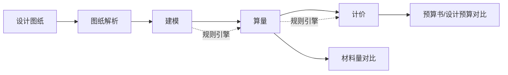
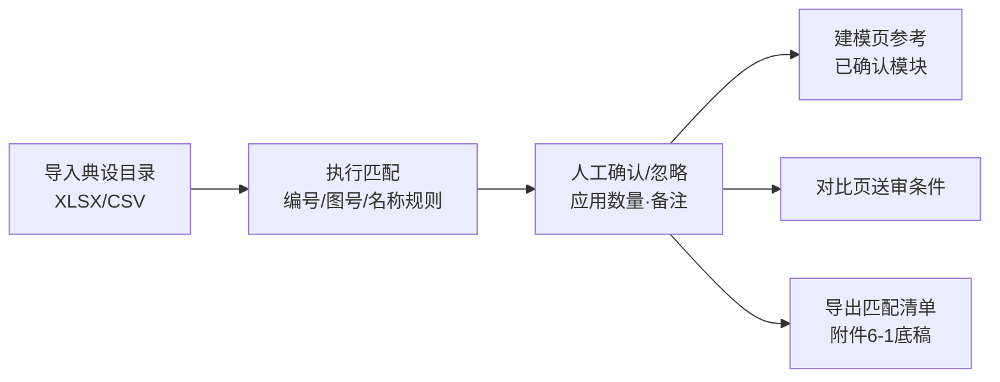
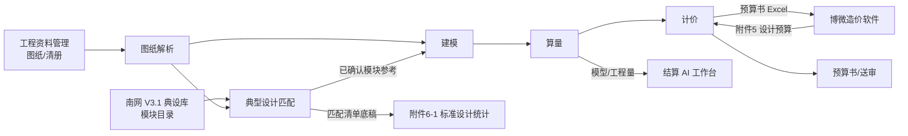

# 设计图纸 → 建模 → 算量 → 计价 工作流建设方案（一期，含 v2 典型设计匹配、v3 开始入口与新建项目、v4 项目编码与上传体验、v5 真实资料接入）

**适用对象：** 配电网工程施工企业（10kV 及以下配电网工程）

**编制：** 数字化建设专班（造价组、工程组、信息组）

**版本：** V1.6（v7 迭代：上传可选择文件夹；v6 典设匹配自动执行；v5 本机真实典设库/定额资料接入）

**日期：** 2026 年 11 月

**配套文件：**

- 《设计图纸 → 建模 → 算量 → 计价 工作流原型（开发契约，内部）》
- 《典型设计匹配能力接入契约（v2，内部）》
- 《工作流开始入口与新建项目契约（v3，内部）》
- 《20kV 及以下配电网工程建设预算编制与计算规定（2022 年版）》
- 《配网结算 AI 工作台建设方案（一期）》

**演示环境：** 本地原型应用 `http://127.0.0.1:8091`，演示数据已匿名为项目 A/B/C。

> **阅读说明**
>
> 1. 本文档为内部建设方案，配合可运行原型使用；文中项目、单位、人员均为匿名演示数据，不包含真实项目资料。
> 2. 文中“示例定额库”“主材单价”为**演示数据，不是官方定额与企业正式价格**；费用构成、取费基数与费率按 2022 版《20kV 及以下配电网工程建设预算编制与计算规定》编制，演示取江西 Ⅰ 类地区（县城或镇）参数，社保/公积金费率、基本设计费等已在第八章逐项注明演示口径。
> 3. 原型中的 AI 能力以规则引擎模拟，尚未接入大模型；生产环境的 AI 边界见第九章。
> 4. 本文中的金额、工程量均可在原型页面中复核；量差与预算对比数据随演示项目 A/B/C 内置于演示库，运行方式见配套 README。

---

## 一、建设背景与现状痛点

### （一）业务背景

公司主要从事 10kV 及以下配电网工程施工，项目类型以台区改造、业扩配套为主。每个项目的造价工作都要围绕一套设计资料展开：施工图设计说明书、10kV/0.4kV 线路平面图、台架变安装图、杆塔明细表、主要设备材料清册、施工图预算（附件 5）等。资料格式覆盖 PDF、DWG、XLSX、BDY3、JPG 等，设计预算通常由设计单位用博微造价软件导出。

目前从拿到图纸到形成施工图预算，链路是“图纸 → 博微建模 → 算量 → 计价”，四个环节分散在不同人员、不同工具和不同 Excel 表里，设计资料只作为“翻阅依据”，没有被结构化，也没有形成可复用的项目级数据。

### （二）现状手工链路

| 环节 | 现状做法 | 主要问题 |
| --- | --- | --- |
| 图纸接收与识读 | 打开 PDF/DWG 逐张看图，人工摘录路径长度、杆塔、配变容量、导线型号 | 信息二次录入，重复劳动多；图纸版本靠文件名区分，易错用旧版 |
| 建模 | 在博微或 Excel 中按图纸手工搭线路、杆塔、设备、土建模型 | 依赖个人经验，模型口径因人而异；改一处要全表联动，返工多 |
| 算量 | 按定额子目手工列项、写计算式，导线按亘长×相数、另加预留损耗 | 相数、预留、损耗、土方口径不统一，不同人算出不同量 |
| 计价 | 套定额、调主材价、按 2022 版编制规定取费，汇总安装/建筑/设备/其他/预备费 | 取费基数与费率易错；设计预算与自编预算口径不同，复核无统一对照 |
| 复核与送审 | 复核员对着 Excel 逐格核对，用批注和口头沟通 | 复核无留痕、版本不可追溯；问题反复沟通，周期拉长 |
| 数据复用 | 预算定稿后数据留在个人电脑或项目文件夹 | 无法复用到结算、物资、成本分析，重复录入 |

### （三）现状痛点归纳

1. **图纸信息二次录入：** 图纸上的路径、杆塔、设备信息需要人工转抄到建模和算量表格，耗时长且容易错行、漏项。
2. **建模依赖个人经验：** 线路怎么分段、杆塔怎么归并、设备挂在哪条线路，缺少统一模板，新手建模质量不稳定。
3. **算量口径不一致：** 相数（10kV 三相、低压四线）、导线预留损耗、杆塔与拉线坑土方等口径散落在个人习惯中，同一项目两次算量结果可能不同。
4. **套价取费易错：** 2022 版编制规定的费用构成层次多、费率高，手工套价容易错套子目、错用基数、漏计费用。
5. **设计预算复核无统一口径：** 设计单位报来的预算（附件 5）与施工单位自编预算科目口径不一致，差异只能靠人工逐项对照，说不清“差在哪、为什么差”。
6. **清册与图纸不一致难发现：** 设计材料清册与杆塔明细表、平面图之间存在量差，人工比对难以发现异常项。
7. **数据无法复用到结算：** 设计与预算数据没有结构化沉淀，结算阶段（三算对比、材料对账）需要重新收集、重新录入。
8. **典设应用统计靠人工：** 南网 V3.1 典型设计模块在图纸中的引用情况靠人工翻图核对，附件6-1《标准设计应用情况统计表》缺少图纸依据底稿，应用率统计口径不统一。

### （四）本项目的解决边界

本项目以“一条链路、四个阶段”的方式把上述环节串起来：图纸解析产出结构化线索，建模形成配网模型，算量按统一规则出工程量并自动比对设计清册，计价按 2022 版规定套示例定额库并输出预算书。原型只解决“造价编制链路的数据贯通与复核留痕”，不改动设计出图、物资采购、财务结算等系统。

## 二、建设目标与总体思路

### （一）建设目标

1. **一个入口：** 项目从收图到预算定稿在同一应用内完成，四个阶段状态、负责人、复核记录一屏可见。
2. **一套口径：** 相数、预留损耗、土方、取费基数、费用构成固化为规则，减少“人不同、量不同”。
3. **一份模型：** 图纸识别结果自动生成配网模型初稿，人工校正后作为算量和后续复用的唯一数据源。
4. **一次比对：** 算量结果自动与设计材料清册比对、计价结果自动与设计预算（附件 5）比对，差异自动分级归因。
5. **一套留痕：** 提交、复核、退回、版本、审计日志全程留痕，AI（规则）输出与人工修改可追溯。
6. **读懂设计引用：** 自动识别图纸/说明书中引用的南网 V3.1 典设模块，形成可人工确认的应用匹配清单，支撑建模参考与附件6-1 图纸依据底稿。

### （二）总体思路：一条链路、四个阶段、三个底座

**一条链路：** 设计图纸 → 建模 → 算量 → 计价。四个阶段共用同一个项目库、同一份模型和同一套定额费率数据，上一阶段的输出即下一阶段的输入，阶段之间由门禁和复核控制。

**四个阶段：**

| 阶段 | 一句话说明 | 主要输出 |
| --- | --- | --- |
| 图纸解析 | 把图纸目录、说明书、清册、预算文件变成结构化线索 | 图纸目录、识别结论、项目画像线索 |
| 建模 | 由识别结果生成并校正配网模型 | 线路、设备、主材、土建、拆除模型 |
| 算量 | 按固定规则从模型计算工程量 | 工程量清单（含计算式与依据）、材料量差异表 |
| 计价 | 套示例定额库并按 2022 版规定取费、与设计预算对比 | 费用汇总、预算书 Excel、预算差异表 |

**三个底座：**

1. **图纸结构化能力：** 图纸目录与命名规范、PDF/XLSX/DWG/JPG 解析（DWG 经 ODA 转 DXF 提取文字）、清册字段映射，以及典设模块目录导入与匹配（见第六章）。
2. **配网模型：** 线路、设备、主材、土建、拆除五类实体的统一字段与校验规则，是算量的数据基础。
3. **定额费率库：** 2022 版编制规定的费用构成与真实费率；定额子目与主材价格为**示例库（演示数据）**，二期替换为正式定额库与企业价格库。



### （三）AI 辅助点与人机边界

**AI 辅助点（一期以规则引擎模拟，二期接私有化模型）：**

| 环节 | AI 辅助内容 | 人工动作 |
| --- | --- | --- |
| 图纸解析 | 从说明书/平面图文字中抽取路径长度、杆塔数、配变容量、导线型号等关键词，生成识别摘要 | 核对图纸目录与识别结论，修正缺失项 |
| 典设匹配 | 从图纸/说明书文本中提取南网 V3.1 典设模块编号，匹配典设模块目录并给出匹配方式、置信度与证据 | 确认/忽略匹配项，核对图纸依据 |
| 建模 | 依据识别结果生成模型初稿（线路、杆塔、设备、主材、土建、拆除） | 逐项校正长度、杆塔、设备参数 |
| 校验 | 自动检查缺导线型号、杆塔数为 0、相数与电压不符、设备无单价等问题并分级提示 | 按提示修正或说明 |
| 算量 | 按规则计算工程量并生成计算式、依据；自动与设计清册比对并归因 | 确认差异、处理“异常”项 |
| 计价 | 自动套用示例定额库、汇总费用，生成量价差异说明 | 复核费率、基数、主材价，修正定额子目 |
| 复核 | 生成复核要点清单（高风险项、差异项、版本变化） | 复核员逐项确认，签字留痕 |

**人机边界（三条红线）：**

1. **AI 不签章：** 所有 AI/规则输出均为“初稿/建议”，只有具备权限的人员复核通过后才能进入下一阶段；系统不提供自动签章、自动审批。
2. **AI 不直接定价：** 定额套用、主材价调整、费率适用、金额确认均由造价人员判断，AI 只做初稿和提示，不能直接生成对外报价或结算金额。
3. **金额人工复核：** 涉及金额的工程量、单价、费率、汇总值必须经复核员复核；复核记录、版本号、审计日志不可删除，金额修改可追溯。

### （四）建设原则

1. **不重复造系统：** 本工作流是内部《工程资料管理（内部使用版）》与博微造价软件之间的“编制与复核层”，不重建资料库、不替代博微。
2. **先结构化后智能：** 先把图纸变成结构化数据，再谈 AI 辅助；避免“无依据生成”。
3. **规则透明可核对：** 每条工程量都能看到计算式与依据，每笔费用都能看到基数、费率与公式，复核可逐项追溯。
4. **数据不出域：** 项目资料只在公司内网/本地处理，一期原型不调用任何外部接口。
5. **先试点后推广：** 用 3 个匿名演示项目跑通链路，再选择真实项目试点、逐步替换正式定额库。

## 三、四阶段流程

**工作流入口（v3）：** 登录后进入工作台，顶部“开始工作流（三步走）”引导区给出明确起点——第 1 步新建项目（或选择演示项目）、第 2 步按图纸解析→建模→算量→计价逐阶段提交/复核、第 3 步对比分析与导出；主按钮“＋ 新建项目，从图纸解析开始”进入 `/project/new`，次按钮进入“5 分钟演示路线”。新建项目填写名称（必填）、项目编码（选填，投资计划/合同编码，全库唯一；留空自动生成 `PRJ-YYYYMMDD-NN`）、类型、地点、备注后，系统初始化、四阶段（图纸解析=进行中）并跳转图纸解析页，即可上传图纸开始工作流；项目编码作为后续识图→结算链路统一项目标识；项目页顶部“下一步”引导条按当前阶段提示下一步动作与跳转按钮。复核员为只读角色，不可新建项目。

### （一）阶段总览

| 阶段 | 输入 | 关键动作 | 输出物 | 检查点 | 责任人 | 建议时长 |
| --- | --- | --- | --- | --- | --- | --- |
| 图纸解析 | 施工图设计说明书、10kV/0.4kV 平面图、台架变安装图、杆塔明细表、主要设备材料清册、施工图预算；典设模块目录（可选） | 上传图纸（支持多选、分批累计添加；已上传可删除/重传）；记录格式与状态；提取项目画像与线路/杆塔/设备线索；人工编目与校对；导入典设目录并执行匹配（可选） | 图纸目录（状态：待识别/已识别/需插件/解析失败）、识别摘要、项目画像线索、典设匹配清单（可选） | 已识别图纸不少于 3 份；说明书、清册、平面图齐全；DWG 插件状态明确，BDY3 预算以 XLSX 替代；典设匹配为可选辅助项（不改变门禁） | 造价员（设计联络配合提供资料） | 0.5–1 天 |
| 建模 | 已识别图纸及识别摘要、设计清册 | 由识别结果生成模型初稿；逐项校正线路/设备/主材/土建/拆除；执行模型校验；提交复核 | 配网模型 v1（线路、设备、主材、土建、拆除）、校验结果 | 至少 1 条线路 + 1 条设备；无“高”级校验问题；相数、导线型号、单价完整 | 造价员 | 1–2 天 |
| 算量 | 复核通过的模型、设计材料清册 | 按算量规则重算工程量；生成计算式与依据；与设计清册比对、差异分级归因；提交复核 | 工程量清单、材料量差异表、计算依据 | 工程量清单非空且全部“已计算”；差异项逐条有归因 | 造价员 | 0.5 天 |
| 计价 | 复核通过的工程量、示例定额库、主材价、2022 版费率 | 套定额子目；调整主材价；按费用构成取费；汇总；与设计预算（附件 5）对比；导出预算书；提交复核 | 费用汇总表、预算书 Excel、预算差异表、计价复核记录 | 费用汇总完整、金额自洽；差异项有说明；导出文件可打开 | 造价员（复核员复核） | 0.5–1 天 |

### （二）阶段门禁与复核机制

四个阶段构成严格的状态机，每个阶段有四种状态，顺序推进、可退回：

状态流转：未开始 → 进行中 →（提交）待复核 →（复核通过，版本 +1）已完成；复核退回则回到进行中；上一阶段完成后，下一阶段自动由“未开始”置为“进行中”。

**提交前置条件（不满足时提交失败并给出中文原因）：**

| 阶段 | 提交条件 |
| --- | --- |
| 图纸解析 | 至少有 3 份状态为“已识别”的图纸 |
| 建模 | 至少 1 条线路 + 1 条设备；模型校验无“高”级问题 |
| 算量 | 工程量已重算，清单行数大于 0 |
| 计价 | 已完成计价，费用汇总表有数据 |

**复核规则：**

1. 复核人不能同时是提交人（管理员除外）；提交仅允许造价员/管理员，复核仅允许复核员/管理员。
2. 复核通过：阶段置“已完成”、记录复核人/复核时间、版本号 +1，自动把下一阶段从“未开始”置为“进行中”。
3. 复核退回：阶段回到“进行中”，记录退回意见；造价员修改后重新提交，形成新的版本。
4. 每次提交、复核、退回均写入复核记录与审计日志，包含项目、阶段、人员、时间、结论、意见。
5. 页面按钮按“阶段是否可编辑 + 当前用户角色”显示；越权操作被拒绝，页面以提示条说明原因。

### （三）阶段一：图纸解析

**目标：** 把设计资料变成可核对的图纸目录和识别结论，为建模提供线索。

**动作：** ① 按目录规范上传说明书（PDF）、10kV/0.4kV 线路平面图（DWG）、台架变安装图（DWG）、杆塔明细表（XLSX）、材料清册（XLSX）、施工图预算（XLSX）、勘察照片（JPG）；② 系统按格式解析：PDF 抓取路径/杆塔/配变等关键词，XLSX 读工作表与材料/工程量行数，DWG 检测 ODA 插件（未安装标记“需插件”），JPG 编目；单文件解析失败不影响其他文件，状态分为“待识别/已识别/需插件/解析失败”；③ 人工核对识别结论、补齐缺失信息、确认版本。

**输出：** 图纸目录、识别摘要、项目画像线索。**检查点：** 已识别图纸不少于 3 份；说明书、材料清册、线路平面图齐全；DWG 插件状态明确、BDY3 预算已用 XLSX 替代。

**演示数据示例：** 项目 C 的识别摘要为“识别：10kV 路径 0.077km、杆塔 4 基、配变 500kVA、低压路径 0.015km”，状态“已识别待提交复核”。

**辅助能力（v2）：** 本阶段可导入典设模块目录并执行典型设计匹配（见第六章）。匹配清单作为图纸解析阶段的辅助成果，用于建模参考、对比页送审检查与导出附件6-1 底稿；不改变本阶段“至少 3 份已识别图纸”的提交门禁。

### （四）阶段二：建模

**目标：** 形成可算量、可校验的配网模型，作为后续计算的唯一数据源。

**动作：** ① 由识别结果生成模型初稿（线路、设备、主材、土建、拆除）；② 人工校正长度、杆塔、档距、拉线、设备容量与单价、甲供/乙供、土建与拆除工程量；③ 执行模型校验，按“高/中/低”级别修正；④ 校验通过后提交复核，复核通过则模型定版（版本 +1）。

**输出：** 配网模型、SVG 平面示意图、模型校验结果。**检查点：** 至少 1 条线路 + 1 条设备；无“高”级问题；相数、导线型号、设备单价、供料方式完整。

### （五）阶段三：算量

**目标：** 按统一规则从模型计算工程量，并与设计材料清册比对。

**动作：** ① 按算量规则重算工程量，每条清单写入计算式与依据，例如“0.057 × 3 × 1.03 = 0.176”“16 × 1.2 = 19.2”；② 自动生成设计清册 vs 模型的对比行（设计量、模型量、差异、差异率、分级、原因）；③ 造价员逐条确认差异，异常项需设计联络确认后提交复核。

**输出：** 工程量清单（含计算式/依据）、材料量差异表。**检查点：** 清单非空且全部“已计算”；差异项逐条有归因；异常项已标识说明。

**演示数据示例（项目 A）：** 10kV 架空线路架设 0.057km、低压线路架设 0.7875km、10kV 导线主材 0.176km、低压导线主材清册量 3.245km、水泥杆 16 根、杆坑土方 19.2m³、拉线坑土方 9.6m³、拉线 12 条、电缆 0.0742km。

### （六）阶段四：计价

**目标：** 按 2022 版编制规定的费用构成与费率，套用示例定额库形成预算书，并与设计预算对比。

**动作：** ① 套用示例定额库子目（安装/建筑/拆除），可人工更换子目，主材按材料表单价计价；② 按费用构成取费：直接费 → 措施费 → 间接费 → 利润 → 编制基准期价差 → 增值税，形成安装、建筑、拆除工程费；③ 计取设备购置费、其他费用、基本预备费，汇总静态投资；④ 与设计预算（附件 5）五项科目对比，导出预算书 Excel 并提交复核。

**输出：** 费用汇总表、预算书 Excel、预算差异表、复核记录。**检查点：** 费用汇总完整；静态投资 = 建安 + 设备购置费 + 其他费用 + 基本预备费；差异项有说明；导出文件可打开。

## 四、角色与权限

### （一）角色定义

| 角色 | 主要职责 | 系统内动作 |
| --- | --- | --- |
| 造价员 | 图纸整理、建模、算量、计价编制，处理量差与预算差异 | 编辑四阶段数据、提交复核、导出；不可复核 |
| 复核员 | 独立复核模型、工程量、定额套用与费用汇总 | 复核通过/退回、填写复核意见；不参与编制 |
| 管理员 | 账号与演示环境维护、审计查看、异常处理 | 全部查看；可提交与复核（管理员不受“提交人不得复核本人”限制）；不对外提供业务结论 |
| 设计联络 | 与设计单位沟通图纸版本、清册与图纸不一致问题 | 提供资料、确认设计口径（原型阶段线下承担） |
| 项目经理 | 项目进度与成果审核、对外送审决策 | 查看项目进度、预算与风险（原型阶段按项目可见性承担） |

> 说明：一期原型账号体系实现造价员、复核员、管理员三类登录角色；设计联络、项目经理为流程责任角色，原型阶段通过线下确认与项目可见性体现，二期接入统一身份后配置账号。

### （二）权限矩阵

| 功能 | 造价员 | 复核员 | 管理员 | 设计联络 | 项目经理 |
| --- | --- | --- | --- | --- | --- |
| 查看工作台/项目/各阶段页面 | 是 | 是 | 是 | 是 | 是 |
| 上传图纸、编辑图纸目录 | 是（阶段可编辑时） | 否 | 是 | 提供资料 | 否 |
| 编辑建模/算量/计价数据 | 是（阶段可编辑时） | 否 | 是 | 否 | 否 |
| 提交阶段复核 | 是 | 否 | 是 | 否 | 否 |
| 复核通过/退回 | 否 | 是 | 是 | 否 | 否 |
| 导出工程量清单/预算书 | 是 | 是 | 是 | 否 | 是 |
| 查看复核记录与审计日志 | 是 | 是 | 是 | 是 | 是 |
| 维护账号与系统配置（二期） | 否 | 否 | 是 | 否 | 否 |

### （三）演示账号

| 账号 | 密码 | 角色 | 说明 |
| --- | --- | --- | --- |
| admin | admin123 | 管理员 | 可查看全部项目，可提交/复核 |
| zaojia | 123456 | 造价员 | 编制与提交，适合演示项目 C 的全流程 |
| fuhe | 123456 | 复核员 | 复核通过/退回，适合演示阶段门禁 |

演示环境支持 `?as=admin|zaojia|fuhe` 快速切换身份（仅 `WORKFLOW_DEMO=1` 时开启）；三个账号均可看到项目 A/B/C。生产环境必须关闭演示身份并接入正式账号体系。

## 五、数据标准与接口

### （一）图纸目录与命名

1. **目录结构：** 项目编码/附件序号-图纸类别/图号-名称-版本.扩展名，例如 `DEMO-C/附件3-10kV线路平面图/施C-01-10kV线路平面图-V1.0.dwg`。
2. **图纸类别：** 设计说明书、平面图、安装图、明细表、材料清册、预算、勘察及现场照片。
3. **图纸目录字段：** 图号、名称、类别、格式、张数、状态、识别摘要、来源文件、上传人、上传/解析时间。
4. **版本管理：** 同名图纸以“图号 + 版本号”区分，新版本上传后旧版本保留并标注替代关系；预算对比引用设计预算的版本号。

### （二）文件格式与解析接口

| 格式 | 典型文件 | 解析方式 | 一期状态 | 输出 |
| --- | --- | --- | --- | --- |
| PDF | 施工图设计说明书、预算扫描件 | PyMuPDF 提取文本，正则抓取路径/杆塔/配变等关键词 | 内置，可用 | 文本、识别摘要 |
| XLSX/XLS | 杆塔明细表、主要设备材料清册、施工图预算（博微导出） | openpyxl/xlrd 读取工作表与行数 | 内置，可用 | 工作表清单、材料/工程量行数 |
| DWG | 10kV/0.4kV 线路平面图、台架变安装图 | ODA File Converter 转 DXF，ezdxf 提取文字；未装插件标记“需插件” | 需插件（插件存在时自动调用） | 图号/图框/杆塔明细文字 |
| BDY3 | 博微预算原生文件 | 需预算软件厂商插件，原型不解析 | 需厂商插件（二期） | 原型不解析；设计预算改用博微导出的 XLSX |
| JPG/PNG | 勘察及现场照片 | Pillow 编目 | 内置，可用 | 尺寸/编目信息 |

> 解析结果只作为“识别线索”，必须人工核对；解析状态在图纸目录中公开可见，避免把识别结果当结论直接使用。

### （三）材料清册字段

主要设备材料清册映射为统一的设备/主材模型，字段如下：

| 字段 | 说明 | 示例 |
| --- | --- | --- |
| 类别 | 设备、主材 | 设备 |
| 名称 | 材料设备名称 | 配电变压器 |
| 规格型号 | 型号/容量/截面等 | SB20-M-500kVA |
| 单位 | 台、套、根、条、只、组、千米、米、m³ | 台 |
| 数量 | 设计清册量 | 1 |
| 甲供/乙供 | 供应方式 | 甲供 |
| 单价 | 材料/设备单价（元/单位） | 68000 |
| 金额 | 数量 × 单价 | 68000 |
| 来源 | 清单来源（附件 4 工作表、行号或图纸编号） | 材料清册-甲供材料 |

### （四）工程量清单字段与编码

1. **清单字段：** 序号、单位工程、清单编码、名称、规格、单位、数量、计算式、依据、类别（安装/建筑/拆除/主材）、定额子目、状态（已计算/待确认）。
2. **编码规则：** 一期原型使用演示编码——清单编码 `YDx-xxxx`（专业 + 册 + 章 + 顺序），定额子目编码同格式；正式编码二期按 2022 版定额库与博微导则生成，并保留原清册编码映射。
3. **单位工程：** 按“线路名称 / 台架变工程 / 电缆工程 / 拆除工程”归集，便于与预算书单位工程表对应。

### （五）单位与小数位

| 数据项 | 单位 | 精度 | 示例 |
| --- | --- | --- | --- |
| 线路亘长/架设长度 | km | 3–4 位小数 | 0.057、0.7875、2.131 |
| 导线/电缆主材量 | km | 3–4 位小数 | 0.176、3.2445、0.0742 |
| 杆塔 | 基/根 | 整数 | 16、50、4 |
| 拉线 | 条 | 整数 | 12、24 |
| 土方 | m³ | 2 位小数 | 19.2、9.6 |
| 设备 | 台/套 | 整数 | 1、2 |
| 金额 | 元 | 2 位小数 | 11750.40 |
| 页面展示金额 | 万元 | 2 位小数 | 35.41 |
| 费率 | % | 2 位小数 | 27.90 |
| 相数 | 相 | 整数 | 3（10kV）、4（低压四线） |

### （六）与博微软件的衔接

1. **输入：** 博微导出的施工图预算（附件 5，XLSX）作为设计预算对比基准，只读取“费用汇总/总算表”层级的金额，不参与建模。
2. **输出：** 原型导出的预算书 Excel 包含费用汇总表、安装工程预算表、主材表、其他费用明细表，按博微可读的表格结构组织；二期按博微模板做字段映射评测，再评估 BDY3/XML 直连（需厂商插件）。
3. **口径约定：** 设计预算与模型预算的对比科目统一为“设备购置费、安装工程费（含建筑）、其他费用、基本预备费、静态投资”五项，避免逐张工作表比对。
4. **不直接改写博微文件：** 原型不写博微工程文件，所有输出为 Excel；正式导入博微由造价员在过渡期手工导入，二期评估自动化。

## 六、典型设计匹配（v2 迭代）

### （一）能力定位

南网 V3.1 典型设计（典设）库按“册—篇—类别—模块编号”组织模块（编号形如 `CSG-GD-10B-TB-GZ-Z-Ⅰ`），设计图纸与说明书通常以模块编号/图号引用典设。典型设计匹配能力把“项目设计图纸 ↔ 典设模块目录”对应起来，回答“本项目用了哪些典设模块、依据是哪张图纸、置信度如何”。

1. **定位：** 属于图纸解析阶段的辅助能力，用于识别图纸/说明书/模型/算量数据中引用的典设模块，形成“典型设计应用匹配清单”；不新增第五个阶段、不改变原有四阶段门禁。
2. **用途：** 为建模初稿提供参考（已确认模块在建模页只读展示）；作为对比页送审条件的辅助检查项；导出清单可作为附件6-1《标准设计应用情况统计表》的图纸依据底稿。
3. **人机边界：** 规则匹配给出候选、匹配方式、置信度与证据来源；由造价员逐项“确认应用/忽略”，AI/规则不代替设计选型与人工确认。

### （二）业务流程

1. **导入典设目录：** 上传 XLSX/CSV 目录文件（字段：序号、卷册、类别、模块编号、模块名称、模块单位；兼容附件6-1“V3.1 模块汇总表（参考）”双表结构），系统解析、去重后入库，并记录导入批次。
2. **执行匹配：** 从已解析图纸摘要/文本、附件1说明书、模型与算量数据中提取模块编号，按匹配规则为每个目录模块取最佳匹配，生成匹配方式、置信度与证据摘要。
3. **人工确认：** 逐项“确认应用”或“忽略”，可填写应用数量与备注；确认/忽略状态在重新匹配时保留。
4. **结果应用：** 建模页展示“典设匹配参考”（已确认模块前 6 条，只读）；对比页送审条件增加“典型设计应用匹配已完成”；导出《典型设计匹配清单》Excel（可作附件6-1 底稿）。



### （三）匹配规则与置信度

**证据提取：** 从图纸识别摘要、说明书文本、模型与工程量数据中提取 `CSG…` 模块编号（兼容 `CSG-10B-TB-SB` 旧写法；归一化时允许 `CSG-` 与 `CSG-GD-` 前缀差异，不判为精确匹配）。证据字段记录来源（文件/字段）与检出的编号，最多 3 条来源（超出加“等”）、截断 200 字，例如“附件3施工图:台架变安装图.dwg → CSG-GD-10B-TB-GZ-Z-Ⅰ”。

**匹配方式与置信度：**

| 匹配方式 | 判定规则 | 得分 | 置信度 |
| --- | --- | --- | --- |
| 编号精确 | 证据编号与目录模块编号完全一致 | 100 | 高 |
| 图号序列 | 证据编号以“目录模块编号-”开头（证据是目录编号的细化图号） | 90 | 高 |
| 编号变体 | 归一化后 `CSG-`/`CSG-GD-` 前缀差异（88 分）、去尾部数字/罗马序后相等（85 分）、目录编号比图号细且证据至少 4 段（78 分）、前缀相同且下一字符为 ×/(/罗马序（76 分） | 76–88 | 中 |
| 名称推断 | 无编号命中时，模块名称与证据文本最长公共子串 ≥4 字 | — | 低 |
| 未匹配 | 无编号命中且名称无法推断 | 0 | 空 |

**约束与人工规则：**

1. **电压标签守卫：** 证据与目录都含电压标签（10B/20B/10D/20D/10K/0.4K/0.4D）且不一致时直接判 0 分，避免 10kV 与 0.4kV 模块串档。
2. **同一模块只保留最佳匹配：** 每个目录模块取最高分证据；一个证据编号可匹配多个目录模块（模板引用多个模块属正常）。
3. **确认状态保留：** 重新执行匹配时，同一模块编号原有的“已确认/已忽略”状态沿用，匹配证据与置信度可更新。
4. **人工确认纪律：** 高置信候选仍需人工核对图纸；中/低置信候选必须人工判断，必要时填写备注说明依据；“确认应用”不代表设计已采用，最终以设计文件为准。

### （四）数据表设计

| 表 | 关键字段 | 说明 |
| --- | --- | --- |
| `typdesign_modules` | 项目、卷册、篇、类别、模块编号、模块名称、单位、备注 | 项目级典设模块目录（每次导入按项目覆盖） |
| `typdesign_imports` | 项目、文件名、模块数、导入人、导入时间 | 目录导入批次记录 |
| `typdesign_matches` | 项目、模块、编号、名称、卷册、类别、单位、匹配方式、置信度、证据、应用数量、状态（待确认/已确认/已忽略）、备注、更新时间 | 匹配结果；`(项目, 模块编号)` 唯一 |

### （五）页面与操作

| 路由 | 方法 | 说明 | 权限 |
| --- | --- | --- | --- |
| `/project/{id}/typdesign` | GET | 典型设计匹配页：统计卡、导入表单、执行匹配、匹配明细、导出 | 登录可读 |
| `/project/{id}/typdesign/import` | POST | 上传 XLSX/CSV 目录并导入 | 造价员/管理员 |
| `/project/{id}/typdesign/match` | POST | 执行匹配 | 造价员/管理员 |
| `/project/{id}/typdesign/{mid}/confirm` | POST | 确认应用（可填应用数量、备注） | 造价员/管理员 |
| `/project/{id}/typdesign/{mid}/ignore` | POST | 忽略 | 造价员/管理员 |
| `/project/{id}/typdesign/export.xlsx` | GET | 导出《典型设计匹配清单》 | 登录可导出 |

**页面入口：**

1. 项目内导航新增“典型设计”项（位于“图纸解析”之后），所有项目页可见。
2. 图纸解析页：典型设计匹配状态卡（目录 N / 已匹配 / 待确认 / 已确认 / 应用率）+“执行匹配”“查看明细”入口；未导入目录时提示先导入。
3. 项目工作流页：典型设计匹配卡片（统计 + 入口）。
4. 建模页：只读“典设匹配参考”面板（已确认模块），位于“由图纸生成模型初稿”附近，仅作参考不影响建模逻辑。
5. 对比页：送审条件新增“典型设计应用匹配已完成”（目录已导入 + 待确认为 0 + 已确认 ≥1），未满足时进入风险清单。

### （六）与四阶段门禁的关系

典型设计匹配是图纸解析阶段的**辅助能力**，不新增阶段、不改变阶段门禁：

1. 图纸解析阶段的提交条件仍为“至少 3 份已识别图纸”，典设匹配是否完成不影响提交/复核。
2. 匹配结果不写入模型规则；已确认模块只在建模页只读展示，建模初稿仍由“由图纸生成模型初稿”按原规则生成，人工校正后再提交。
3. 对比页“典型设计应用匹配已完成”作为送审条件的辅助检查项，未满足时列为风险提示，不替代原有四阶段门禁。
4. 导入/匹配/确认/忽略均写审计日志；复核员只读，导入与确认仅造价员/管理员可操作。

### （七）真实项目落地要点

1. **目录来源与版本：** 正式使用时导入南网 V3.1 典设库导出目录或设计院提供的项目典设应用目录，按版本归档；目录文件更新后需重新导入并重新匹配（重新导入会重置该项目的匹配结果，确认状态需重新核对）。
2. **证据质量：** DWG 需 ODA File Converter 转 DXF 提取图面文字，PDF 说明书用 PyMuPDF 提取文本；扫描件/图片图纸暂无 OCR，命中率低时以人工确认补足；图纸无编号引用时匹配率低属正常。
3. **人工复核：** 匹配清单是“图纸依据底稿”，不等于设计采用清单；确认人需核对图纸与典设模块的对应关系，应用数量按实际填写，争议项以设计文件/设计联络确认为准。
4. **与附件6-1 联动：** 导出的《典型设计匹配清单》可作附件6-1《标准设计应用情况统计表》的图纸依据底稿，正式统计表仍需按公司口径填报。
5. **数据安全：** 典设目录、图号与图纸均为内部资料，只在本地/内网处理，禁止上传公网工具。

### （八）演示数据声明

演示库为项目 A/B/C 各内置同一份**演示用典设目录节选（40 条模块，非完整 V3.1 库）**：第三册台架变 15 条、第四册架空线路 10 条、第七册低压线路 8 条、第一册配电站 4 条、第六册通信 3 条。演示匹配状态：

| 项目 | 目录 | 匹配状态 | 演示用途 |
| --- | --- | --- | --- |
| 项目A | 40 条 | 已执行匹配，高置信模块已确认（已确认 ≥18） | 展示完成态、已确认清单与导出 |
| 项目B | 40 条 | 已执行匹配，全部待确认 | 展示人工确认动作与待办 |
| 项目C | 40 条 | 仅导入目录，未执行匹配 | 展示导入结果与“执行匹配”动作 |

匹配结果由演示目录与演示图纸摘要（编号文本）得出，仅用于演示匹配规则与状态流转；正式项目需导入真实典设目录并人工确认。

### （九）限制与后续

**当前限制：**

1. 演示目录仅 40 条节选，非完整南网 V3.1 库；未做目录版本管理与跨项目共享目录。
2. 匹配依赖图纸文本（编号、名称），无图框/图元级视觉识别与 OCR；DWG 无 ODA 插件时无法提取文字。
3. 匹配结果为规则推断，需人工确认；不自动回填附件6-1 正式统计表。
4. 匹配状态为项目内辅助状态，不影响四阶段门禁与预算金额。

**后续规划：**

1. 接入完整南网 V3.1 典设库与目录版本管理（按专业/册/版本维护）。
2. 增强图纸识别（DWG 图框/图元级、扫描件 OCR、附件1说明书表格解析），提高编号提取命中率。
3. 与附件6-1《标准设计应用情况统计表》自动联动，导出即填报底稿。
4. 多项目典设应用统计分析（按模块/册统计应用率），支撑标准化设计与造价分析。

## 七、建模与算量规则

### （一）模型构成

| 实体 | 关键字段 | 说明 |
| --- | --- | --- |
| 线路 | 名称、电压、起点、终点、亘长（km）、回路数、相数、导线型号、杆塔数、杆型、平均档距、拉线条数、土质 | 一条线路对应一个单位工程 |
| 设备 | 类别（设备/主材）、名称、规格、单位、数量、单价、甲供/乙供 | 设备计设备购置费；主材用于安装计价 |
| 主材 | 同上（类别=主材） | 导线、电缆、水泥杆、拉线、金具、避雷器等 |
| 土建 | 名称、规格、单位、数量 | 台架变基础、电缆直埋沟等 |
| 拆除 | 名称、规格、单位、数量 | 拆除低压导线、拆除水泥杆等 |

### （二）建模规则

1. **由图纸生成初稿：** 识别结果中的路径长度、杆塔数、配变容量、导线型号写入线路/设备；主材按清册行生成；土建按典型台架变配置生成；拆除按设计说明的拆除范围生成。
2. **人工校正优先：** 自动生成只是初稿，长度、杆塔、档距、拉线、设备单价以人工校正结果为准；校正动作留痕。
3. **相数规则：** 10kV 线路按三相（3 相）；1kV 低压线路按四线（4 相）。相数参与导线主材量计算，不允许随意修改为非 3/4。
4. **亘长与档距：** 线路长度取亘长（km），档距 = 亘长 / 档数；模型校验时用“平均档距 × 杆塔数”与亘长比对，偏差超过 20% 提示。
5. **校验分级：**
   - **高：** 线路缺导线型号、杆塔数为 0、亘长 ≤ 0、相数与电压不符、设备无单价、档距 × 杆塔与亘长偏差 > 20%。
   - **中：** 档距不在 30–80m、拉线为 0 但杆塔数 > 3、缺台架变基础。
   - **低：** 设备未标甲供/乙供、拆除项无依据。
6. 校验结果按“高 → 中 → 低”排序并显示计数；存在“高”级问题时不允许提交建模复核。

### （三）算量规则

> **单线口径（v8）：** 线路架设定额按单线计算，工程量 = 线路亘长 × 单线根数（10kV 三相 3 根、低压三相四线 4 根），单位 km（单线长度）；导线主材仍按“亘长 × 根数 × 1.03”计，两者口径配套，计算式与依据在算量页逐行可查。

算量规则与 2022 版定额体系对齐，按线路、设备、主材、土建、拆除五类计算，每条清单带计算式、依据和来源。

| 序号 | 清单项 | 计算规则 | 单位 | 演示定额子目 | 类别 |
| --- | --- | --- | --- | --- | --- |
| 1 | 10kV 架空线路架设 | 亘长（按亘长计算） | km | YD3-0301 | 安装 |
| 2 | 低压线路架设 | 亘长 | km | YD3-0302 | 安装 |
| 3 | 导线主材 | 清册有同名导线主材时按清册量计入（不重复生成）；否则亘长 × 相数 × 1.03（预留 3%） | km（千米） | — | 主材 |
| 4 | 电杆组立 | 杆塔数；Φ190×12m 用 YD3-0103，Φ150×8m 用 YD3-0101 | 根 | YD3-0101/0103 | 安装 |
| 5 | 拉线制作安装 | 拉线条数 | 条 | YD3-0201 | 安装 |
| 6 | 杆坑土方 | 杆塔数 × 1.2m³ | m³ | YD1-0101 | 建筑 |
| 7 | 拉线坑土方 | 拉线条数 × 0.8m³ | m³ | YD1-0102 | 建筑 |
| 8 | 10kV 线路金具安装 | 杆塔数 | 套 | YD3-0601 | 安装 |
| 9 | 低压线路金具安装 | 杆塔数 | 套 | YD3-0602 | 安装 |
| 10 | 变压器安装 | 设备行数量；500kVA 用 YD2-0101，200kVA 用 YD2-0102 | 台 | YD2-0101/0102 | 安装 |
| 11 | 低压配电箱安装 | 设备行数量 | 台 | YD2-0201 | 安装 |
| 12 | 配电智能网关安装 | 设备行数量 | 套 | YD2-0301 | 安装 |
| 13 | 避雷器安装 | 主材行数量 | 只 | YD3-0401 | 安装 |
| 14 | 电力电缆敷设 | 主材行数量 | 千米 | YD3-0501 | 安装 |
| 15 | 电缆终端头制作 | 主材行数量 | 个 | YD3-0502 | 安装 |
| 16 | 接地装置安装 | 主材行数量 | 组 | YD2-0401 | 安装 |
| 17 | 安全围栏安装 | 主材行数量 | 套 | YD2-0501 | 安装 |
| 18 | 台架变金具及支架安装 | 主材行数量 | 套 | YD2-0601 | 安装 |
| 19 | 台架变基础 | 土建行数量（C20 混凝土） | m³ | YD1-0201 | 建筑 |
| 20 | 电缆直埋沟 | 土建行数量（开挖及回填） | m | YD1-0301 | 建筑 |
| 21 | 拆除低压导线 | 拆除行数量 | km | YD5-0101 | 拆除 |
| 22 | 拆除水泥杆 | 拆除行数量 | 根 | YD5-0102 | 拆除 |

**口径说明：**

1. **预留损耗与导线主材口径：** 清册已有同名导线主材时按清册量计入（不再重复生成）；清册无同名导线时按亘长 × 相数 × 1.03 计，1.03 为预留损耗 3% 的演示口径。材料量对比中的模型量按公式口径（如项目 A 低压导线 0.7875 × 4 × 1.03 = 3.2445km）与设计清册量（3.15km）比对；电缆主材按 6% 预留口径演示。正式项目应按企业损耗定额与当地造价管理机构口径调整。
2. **土方口径：** 杆坑按每基 1.2m³、拉线坑按每条 0.8m³（普通土）演示；正式计价应按土质、坑型、放坡与定额说明计算，原型仅作为快速估算口径。
3. **甲供/乙供：** 甲供设备与主材计入设备购置费或安装主材，乙供材料按主材价计价；供应方式影响预算汇总和后续结算扣回，建模时必须标注。
4. **设备不进安装主材：** 设备（变压器、配电箱、智能网关）本身计入设备购置费，安装清单只计安装费，避免重复计价。
5. **与设计清册对比口径：** 对比项选择导线、电缆、水泥杆、拉线、避雷器、拆除量等主要材料；设计量取清册，模型量取算量结果；差异率 = （模型量 − 设计量）/ 设计量。

### （四）材料量差异分级与演示结果

1. **正常：** 差异率绝对值 < 1% 且为量差，或差异可由预留/损耗（3%/6%）解释，原因列写明口径。
2. **关注：** 差异率 1%–5%（含边界）且不属于预留/损耗口径，需造价员核对清册与模型。
3. **异常：** 差异率超过 5% 或与图纸/明细表矛盾（如清册与杆塔明细表不一致），需设计联络确认并留痕。

**演示数据（项目 A/B/C 材料量对比）：**

| 项目 | 材料 | 设计量 | 模型量 | 差异 | 分级 | 原因 |
| --- | --- | --- | --- | --- | --- | --- |
| A | 低压导线（km） | 3.15 | 3.2445 | +3% | 正常 | 预留损耗 3% |
| A | 电力电缆（km） | 0.070 | 0.0742 | +6% | 正常 | 电缆预留及波形系数 6% |
| A | 拆除低压导线（km） | 2.5 | 2.5 | 0 | 正常 | 拆除范围一致 |
| B | 10kV 导线（km） | 6.62 | 6.585 | −0.53% | 正常 | 量差在 1% 内 |
| B | 低压导线（km） | 3.108 | 3.201 | +2.99% | 正常 | 预留损耗 3% |
| B | 拉线（条） | 18 | 24 | +6 条 | **异常** | 清册与杆塔明细表不一致，需设计确认 |
| B | 配电变压器（台） | 1 | 1 | 0 | 正常 | 与清册一致 |
| C | 低压导线（km） | 0.060 | 0.0618 | +3% | 正常 | 预留损耗 3% |
| C | 配电智能网关（套） | 1 | 1 | 0 | 正常 | 与清册一致 |

> 表中节选主要对比项；其余项（水泥杆、拉线、避雷器、拆除量等）差异为 0 且分级为正常，10kV 导线与低压导线在预留口径下差异不超过 ±1% 或为 +3%，均为正常。以上数字为演示数据，用于演示“正常/异常”分级与归因，正式项目需按实际清册与图纸复核。

### （五）算量示例（项目 A）

```text
10kV 架空线路架设：0.057 km（YD3-0301）
低压线路架设：0.7875 km（YD3-0302）
10kV 导线主材：清册量 0.176 km（0.057 × 3 × 1.03）
低压导线主材：清册量 BLVV-240 1.648 + BLVV-120 1.597 = 3.245 km
电杆组立：2 + 14 = 16 根（Φ150×8m，YD3-0101）
杆坑土方：16 × 1.2 = 19.2 m³（YD1-0101）
拉线坑土方：12 × 0.8 = 9.6 m³（YD1-0102）
拉线制作安装：12 条（YD3-0201）
电力电缆敷设：0.0742 km（YD3-0501）
```

## 八、计价规则

### （一）依据与口径

1. **计价依据：** 2022 版《20kV 及以下配电网工程建设预算编制与计算规定》的费用构成、取费基数与费率。
2. **演示参数：** 取江西 Ⅰ 类地区、县城或镇；编制基准期价差演示取 0（正式项目按造价管理机构发布文件调整）；社保费率 26.5%、公积金费率 12%、基本设计费 5.5% 等为演示取值，正式使用时按最新规定与费率表内插确定。
3. **示例定额库：** 原型内置的 23 条定额子目与主材单价为**演示数据**，不代表官方定额与企业正式价格；二期替换为正式定额库、企业价格库与博微价格文件。

### （二）费用构成

| 层级 | 费用项 | 说明 |
| --- | --- | --- |
| 直接费 | 人工费、材料费、机械费、主材费 | 按定额子目与主材单价计算 |
| 措施费 | 冬雨季施工增加费、夜间施工增加费、施工工具用具使用费、特殊地区施工增加费、安全文明施工费 | 安装/建筑分别按费率计取 |
| 间接费 | 规费（社会保险费、住房公积金）、企业管理费 | 规费按人工费×系数×费率，企管费按（人工+机械）×费率 |
| 利润 | 安装、建筑分别计取 | 按（人工+机械）×费率 |
| 价差 | 编制基准期价差 | 演示取 0 |
| 税金 | 增值税 | 按（直接费+间接费+利润+价差）×9% |
| 单位工程造价 | 安装工程费、建筑工程费、拆除工程费 | 上述各项汇总 |
| 设备购置费 | 设备原价 + 运杂费 | 设备行金额 × 1.0106（运杂费 1.06%） |
| 其他费用 | 项目管理经费、招标费、监理费、前期费、勘察费、设计费、评审费、咨询费、检测费、标准编制费、生产准备费、后评价费、余物清理费 | 见本章（五） |
| 基本预备费 | （建安 + 设备购置费 + 其他费用）× 3% | 演示费率 |
| 静态投资 | 建安 + 设备购置费 + 其他费用 + 基本预备费 | 预算书最终金额 |

### （三）安装/建筑工程费率

**措施费（基数 = 人工费 + 机械费）：**

| 费用项 | 安装工程费率 | 建筑工程费率 |
| --- | --- | --- |
| 冬雨季施工增加费 | 3.25% | 1.81% |
| 夜间施工增加费 | 0.56% | 0.31% |
| 施工工具用具使用费 | 2.03% | 0.93% |
| 特殊地区施工增加费 | 0% | 0% |
| 安全文明施工费 | 22.06% | 12.88% |
| **措施费合计** | **27.90%** | **15.93%** |

**间接费、利润与税金：**

| 费用项 | 安装工程 | 建筑工程 |
| --- | --- | --- |
| 规费 | 人工费 × 1.1 ×（26.5% + 12%） | 人工费 × 1.08 ×（26.5% + 12%） |
| 企业管理费 | （人工费 + 机械费）× 19.91% | （人工费 + 机械费）× 10.22% |
| 利润 | （人工费 + 机械费）× 12.4% | （人工费 + 机械费）× 6.56% |
| 增值税 | （直接费 + 间接费 + 利润 + 价差）× 9% | 同左 |

> 拆除工程无材料与主材，费率构成与安装工程相同。规费中的社保费率 26.5%、公积金费率 12% 为演示取值，工程实施时按项目所在地最新规定执行；编制基准期价差演示取 0。

### （四）设备购置费

设备购置费 = Σ（设备行数量 × 单价）× 1.0106，其中 1.06% 为运杂费演示费率。设备仅计设备购置费，不重复进入安装主材。

### （五）其他费用

设“建安” = 安装工程费 + 建筑工程费 + 拆除工程费。

| 费用项 | 计算式（演示） |
| --- | --- |
| 项目管理经费 | 建安 × 1.22% |
| 招标费 | （建安 + 设备购置费）× 0.32% |
| 工程监理费 | 建安 × 2.64% |
| 项目前期工作费 | 建安 × 2.29% |
| 勘察费 | 建筑工程费 × 4.5% + （10kV 线路亘长 + 低压线路亘长）× 1000 元/km（近似） |
| 基本设计费 | （建安 + 设备购置费）× 5.5%（演示费率，正式按费率表区间内插） |
| 其他设计费 | 基本设计费 × 18% |
| 设计文件评审费 | 基本设计费 × 4.8% |
| 施工过程造价咨询及竣工结算审核费 | 建安 × 0.51% |
| 工程质量检测费 | 建安 × 0.15% |
| 技术经济标准编制费 | 建安 × 0.10% |
| 生产准备费 | 建安 × 0.5% |
| 项目后评价费 | 建安 × 0.5% |
| 余物清理费 | 仅当有拆除工程量时：拆除工程直接费 × 35%（线路拆除不能利用） |

### （六）基本预备费与静态投资

- 基本预备费 = （建安 + 设备购置费 + 其他费用）× 3%。
- 静态投资 = 建安 + 设备购置费 + 其他费用 + 基本预备费。
- 费用汇总按“安装工程费 / 建筑工程费 / 拆除工程费 / 设备购置费 / 其他费用 / 基本预备费 / 静态投资”分组展示，金额保留两位小数；页面金额以万元展示、明细以元展示。

### （七）设计预算对比

计价完成后，自动与设计预算（附件 5）按五个科目对比：设备购置费、安装工程费（含建筑）、其他费用、基本预备费、静态投资。差异率 =（模型预算 − 设计预算）/ 设计预算，页面同时给出差异说明与送审条件，供复核员判断“量差、价差还是口径差”。

### （八）导出

预算书 Excel 工作表：费用汇总表、安装工程预算表（含建筑/拆除工程与定额子目、主材明细）、主要材料表、其他费用明细、预算对比；工程量清单 Excel 单独导出（清单页 + 编制说明页）。导出文件使用中文文件名（工程量清单-项目X.xlsx、施工图预算-项目X.xlsx）与表头样式，供复核、送审和过渡期导入博微。

## 九、AI 应用点与禁止事项

### （一）一期 AI 应用点（规则引擎模拟）

| 序号 | 应用点 | 输入 | 输出 | 一期实现 |
| --- | --- | --- | --- | --- |
| 1 | 图纸识别摘要 | PDF 文本、XLSX 工作表、DWG 文字 | 路径、杆塔、配变、导线型号等识别结论 | 关键词与正则规则 |
| 2 | 模型初稿生成 | 已识别图纸摘要 | 线路/设备/主材/土建/拆除初稿 | 规则填充 |
| 3 | 模型校验提示 | 模型数据 | 高/中/低问题清单与修正建议 | 规则校验 |
| 4 | 材料量差异归因 | 设计清册量、模型量 | 差异分级与原因说明 | 规则分级 |
| 5 | 计价差异说明 | 费用汇总、设计预算 | 科目差异与初步说明 | 规则摘要 |
| 6 | 复核要点清单 | 阶段数据、差异项 | 复核关注点 | 规则生成 |
| 7 | 典型设计匹配 | 图纸摘要/说明书文本、模型与算量名称 | 典设模块候选、匹配方式、置信度、证据 | 编号/图号规则匹配 + 人工确认 |

二期接入私有化大模型后，可在上述场景增加自然语言说明与问答能力，但输出格式、复核流程与留痕要求不变。

### （二）AI 禁止事项

1. **不签章：** 禁止自动签署、自动审批、自动定案；任何对外文件必须由有权限人员签字/确认。
2. **不直接定价：** 禁止由 AI 直接确定单价、费率、定额子目和最终金额；AI 只能给初稿、对照和提示。
3. **不替代复核：** 禁止绕过复核门禁；AI 输出必须经造价员复核、复核员确认。
4. **不生成无依据内容：** 禁止在缺少图纸/清册/定额依据时编造工程量、材料量、金额。
5. **不使用外部服务处理敏感资料：** 禁止把真实项目资料、合同、金额上传到公网 AI 工具；生产环境只用私有化模型/内网服务。
6. **不对外承诺：** AI 输出不得直接用于对业主、分包、供应商的承诺性答复。

## 十、与现有系统关系

### （一）现有系统盘点

| 系统 | 现有能力 | 与本工作流的关系 |
| --- | --- | --- |
| 工程资料管理（内部使用版） | 资料上传、存储、生成、结算等基础功能 | 上游：提供图纸与设计资料；本工作流不重建资料库，通过共享目录/接口读取（二期） |
| 南网 V3.1 典设库 / 附件6-1 | 典型设计模块目录、标准设计应用情况统计 | 上游：提供典设模块目录用于图纸匹配；匹配清单导出后可作附件6-1 图纸依据底稿 |
| 结算 AI 工作台 | 设计量/预算量/结算量三算对比、差异说明、复核留痕 | 下游：本工作流输出的模型、工程量、预算可复用于结算阶段；两者共用“设计基准数据”与复核规范 |
| 博微造价软件 | 建模、套定额、取费、预算书生成、BDY3 原生格式 | 并行/下游：本工作流输出的预算书 Excel 供导入博微；设计预算（附件 5）由博微导出，作为对比基准 |
| 飞书 | 消息、审批、待办入口 | 二期：推送阶段待办、复核提醒与日报 |

### （二）数据流示意



### （三）定位与边界

1. **本工作流定位为“设计→造价编制层”：** 负责图纸结构化、建模、算量、计价与复核，不替代资料管理、博微计价工具和结算工作台。
2. **不做重复建设：** 不重建资料库（用资料管理）、不重建结算定案（用结算 AI 工作台）、不重建完整审批流（二期接飞书）。
3. **数据单向为主：** 一期以“资料管理/本地文件 → 本工作流 → 预算书 Excel”的单向流为主；二期再评估接口化对接与双向同步。
4. **口径统一：** 与结算 AI 工作台共用“设计基准、量差口径、复核留痕”三套规范，避免设计与结算两套口径。
5. **典设库对接：** 典型设计匹配读取项目导入的典设模块目录，不重建典设库；正式库由设计管理部门维护版本，本工作流只做目录导入、匹配、人工确认与底稿导出。

## 十一、实施路线

### （一）分期计划

| 阶段 | 建议周期 | 工作内容 | 交付物 | 验收要点 |
| --- | --- | --- | --- | --- |
| 一期：原型验证 | 约 6 周 | 四个阶段页面与状态机；PDF/XLSX/DWG（插件）解析；模型/算量/计价规则引擎；示例定额库；预算对比；Excel 导出；复核与审计；3 个匿名演示项目；v2 典型设计匹配（目录导入/规则匹配/人工确认/导出）；v3 工作流开始入口与新建项目（简单建档/四阶段初始化/下一步引导）；v4 新建项目录入项目编码（唯一校验）、上传分批累计、图纸删除/重传；v5 本机真实资料接入（典设库目录→图纸文件列、定额资料可解析性盘点） | 可运行原型（FastAPI + SQLite + Jinja2，端口 8091）、本方案、演示截图（含 v2 典设匹配与 v3 开始入口） | 项目 C 全流程可演示；A 项目完成态可查看；典设匹配可执行、确认、导出；工作台首屏可见“开始工作流”，新建项目可录入项目编码并创建进入图纸解析；上传可分批累计、已上传图纸可删除；自动化测试通过 |
| 二期：正式定额库与博微对接 | 约 6–8 周 | 替换正式 2022 版定额库与企业价格库；接入 BDY3/博微导出格式；DWG 图元级识别增强；接入完整南网 V3.1 典设库与附件6 统计联动；项目建档与用户管理；与工程资料管理接口 | 二期版本、定额库映射说明、典设库/附件6 联动说明、接口文档 | 真实项目试算结果与博微编制结果偏差可解释；定额/价格可版本化更新；典设目录版本可管理 |
| 三期：试点上线 | 约 4 周 | 内网部署、统一身份（可选）、飞书待办推送；试点项目运行与培训；指标监控 | 上线版本、试点报告、操作手册 | 试点项目全流程跑通；复核留痕完整；用户可用性达标 |

### （二）一期原型交付内容（v1 + v2 + v3，已完成）

1. FastAPI + SQLite + Jinja2 服务端渲染，本项目为唯一入口；登录、工作台（含开始工作流引导区）、新建项目页、项目工作流主页（含下一步引导条）、图纸解析、建模、算量、计价、对比、演示路线页。
2. 四阶段状态机与复核门禁：提交前置条件、复核通过/退回、版本号、复核记录、审计日志。
3. 建模：图纸识别结果生成模型初稿、五类模型表格编辑、模型校验分级、SVG 平面示意图。
4. 算量：规则引擎计算工程量（含计算式/依据）、材料量对比与差异分级、工程量清单导出。
5. 计价：示例定额库套价（可换子目）、2022 版费用构成与费率取费、费用汇总、设计预算对比、预算书导出。
6. 演示数据：3 个匿名项目 A/B/C（台区改造、业扩配套），覆盖完成态、算量复核态、图纸解析态。
7. README 提供 Windows/Linux 启动方式、演示账号、5 分钟演示路线与解析插件说明。
8. 典型设计匹配（v2 迭代）：典设模块目录导入（XLSX/CSV，兼容附件6-1 双表结构）、规则匹配与置信度、人工确认/忽略、图纸解析页/项目页/建模页/对比页集成、导出《典型设计匹配清单》；不新增阶段门禁。
9. 工作流开始入口与新建项目（v3 迭代）：工作台“开始工作流（三步走）”引导区；`/project/new` 简单建档（名称/类型/地点/备注，自动编码 `PRJ-YYYYMMDD-NN`、四阶段初始化、演示账号加入成员）；项目页“下一步”引导条；登录页/演示路线页开始提示；不改变四阶段语义与既有引擎接口。
10. 项目编码与上传体验（v4 迭代）：新建项目可录入项目编码（选填、3–40 位字母数字 `-_.`、全库唯一，留空自动生成 `PRJ-YYYYMMDD-NN`），作为后续识图→结算统一项目标识；图纸上传支持多选/分批累计添加；已上传图纸在解析阶段可删除/重传并写审计。
11-d. 作业指导书工序库（v8 迭代）：把本机作业指导书/样板点作业书按工序整理为可检索条目（施工工艺、质量要求、安全措施、材料机具、引用标准），在顶部导航提供独立页面，并在建模页、算量页给出“相关施工工序”面板；索引由 `scripts/build_work_instruction_index.py` 在本机生成、存放在本地（不入仓库），无索引时回退到自写演示条目。
11-c. 上传支持选择文件夹（v7 迭代）：图纸上传区提供“选择文件”（多选/分批累计）与“选择文件夹”两个入口；选择文件夹时前端提交文件相对路径，服务端按 `uploads/{项目id}/{子目录}/` 保存并在图纸目录保留层级，便于追溯图纸来源目录。
11-b. 典型设计匹配自动执行（v6 迭代）：典设匹配不作为独立流程环节——在图纸上传/解析、删除图纸、生成建模初稿、导入典设目录时自动执行；结果直接显示在图纸解析页/建模页；主导航不再单列“典型设计”，`/project/{id}/typdesign` 仅保留为明细、人工确认与导出页；不改变四阶段门禁与建模规则。
11. 真实资料接入（v5 迭代）：支持用 `scripts/build_typical_design_catalog.py` 从本机 V3.1 典设库（7 册 DWG）与附件6-1 模块汇总表生成带“图纸文件”列的典设目录；导入后匹配明细与导出清单显示库内图纸相对路径；`scripts/check_quota_library.py` 盘点 2022 版定额资料可解析性（预规为文字版、5 册预算定额为扫描版），真实定额子目需电子版/OCR 后再导入。

> 一期原型当前的定额子目、主材价与演示典设目录（40 条节选）均为演示数据，尚未接入正式定额库、完整 V3.1 典设库、博微和统一身份；运行环境与使用限制见 `apps/design-cost-workflow/README.md`。

### （三）里程碑与验收指标

| 里程碑 | 验收标准 |
| --- | --- |
| M1 原型可用 | 应用可启动，`/health` 正常；工作台首屏可见“开始工作流”入口；新建项目可创建并跳转图纸解析页；项目 C 从图纸解析到计价导出可完整演示 |
| M2 规则可信 | A/B/C 项目算量与计价结果自洽（静态投资 = 各费用之和）；材料量差异分级与演示数据一致 |
| M3 典设匹配可用 | 典设目录可导入；项目 C 可执行匹配并确认；匹配清单可导出；对比页送审条件正确联动 |
| M4 复核闭环 | 提交/复核/退回/版本/审计全链路可操作、可追溯；越权操作被拦截 |
| M5 试点准备 | 正式定额库与价格库映射完成；完整典设库目录与附件6-1 统计口径确定；试点项目选择、培训与指标方案确定 |
| M6 试点验收 | 试点项目预算编制周期缩短、复核问题可追溯、与博微结果偏差可解释；典设应用底稿可支撑附件6-1 填报 |

### （四）资源与分工

1. **业务：** 造价组负责规则口径、演示数据评审与试点验证；工程组负责图纸与设计联络。
2. **产品/项目：** 1 人，负责范围、计划与跨部门协调。
3. **开发：** 后端/数据 1–2 人、前端 1 人、解析 1 人、测试 1 人（二期可按需增加）。
4. **信息：** 负责内网部署、账号与权限、备份、安全审计。
5. **外部资源：** 二期需预算软件厂商（BDY3/博微格式）与定额库授权支持。

### （五）待确认事项

1. 正式定额库（2022 版）与企业价格库的授权来源、更新频率与维护责任人。
2. 与博微软件的对接方式：Excel 导入、XML 导出还是厂商插件直连；试点项目是否具备博微授权。
3. 统一身份与账号体系：是否接入公司统一认证，设计联络/项目经理账号如何维护。
4. 试点项目与试点团队、上线时间；是否需要飞书待办推送。
5. 数据保存与备份策略：项目数据保存年限、访问审计与脱敏要求。
6. 典设目录来源与版本管理：正式南网 V3.1 典设库由哪个部门维护、目录版本如何更新，附件6-1 统计是否以匹配清单为底稿。

## 十二、风险与控制

| 序号 | 风险 | 影响 | 应对 |
| --- | --- | --- | --- |
| 1 | 图纸识别错误或漏项 | 模型、工程量偏差 | 识别结果只作线索；人工逐项校正；校验分级提示；新旧版本对照 |
| 2 | 清册与图纸不一致 | 算量口径与设计预算对不上 | 材料量对比自动标“异常”并归因；异常项由设计联络确认，确认意见体现在复核记录中 |
| 3 | 定额/费率版本错用 | 计价结果错误、返工 | 费率与费用构成固化为代码/配置并版本化；计价页展示基数与公式；复核员逐项核对 |
| 4 | 示例定额/材料价被误当正式数据 | 对外报价失真 | 页面与文档显著标注“演示数据”；二期替换正式库前不用于真实项目计价 |
| 5 | AI/规则输出被直接采用 | 造价责任不清 | AI 不签章、不定价；输出标注“初稿/建议”；复核门禁强制人工确认 |
| 6 | 越权操作或数据外泄 | 合规风险 | 角色权限与阶段门禁；本地/内网部署；审计日志；不接外部 AI 服务 |
| 7 | 版本与数据丢失 | 无法追溯、返工 | 阶段版本号；复核记录与审计日志；数据目录备份（`data/` 不入库） |
| 8 | 范围扩大、工期失控 | 一期延期 | 锁定一期 MVP；定额库/博微/统一身份等放二期；需求变更走评审 |
| 9 | 业务人员不使用 | 工具空转 | 演示路线与培训；嵌入现有编制流程；减负不减责；试点反馈迭代 |
| 10 | 插件依赖（ODA/厂商插件） | DWG/BDY3 无法解析 | 一期标记“需插件”并支持 PDF/XLSX 替代；插件安装与授权由信息组统一管理 |
| 11 | 典设目录版本过期或与项目不匹配 | 匹配结果失真、附件6-1 底稿错误 | 目录按版本归档并记录导入批次；匹配结果人工确认后再使用；定期更新目录 |
| 12 | 编号误匹配或图纸无编号 | 误用典设、建模参考偏差 | 电压标签守卫与置信度分级；中/低置信必须人工确认；证据来源可回溯 |

## 十三、结论与待确认事项

### （一）结论

1. “设计图纸 → 建模 → 算量 → 计价”适合做成一条链路上的四个阶段：以图纸解析为入口、以配网模型为唯一数据源、以算量与计价规则为口径、以复核门禁为质量保障。
2. 一期原型已实现四阶段页面、状态机与复核、建模/算量/计价规则引擎、示例定额库、设计预算对比与 Excel 导出，3 个匿名演示项目可完整演示，具备试点条件。
3. 2022 版费用构成与真实费率已按编制规定固化，示例定额库与主材价明确为演示数据；二期替换正式定额库并接入博微后可用于真实项目试算。
4. 本工作流定位为“编制与复核层”，与工程资料管理、结算 AI 工作台、博微软件形成上下游关系，不重复建设。
5. 典型设计匹配（v2）已接入图纸解析阶段：支持典设目录导入、编号/图号规则匹配、人工确认/忽略与导出，不新增阶段门禁；正式使用时需导入完整南网 V3.1 典设库并由人工复核确认。

### （二）待确认事项

见第十一章（五）。一期试用前需明确：正式定额库来源、博微对接方式、统一身份方案、试点项目与时间、数据备份与审计要求。

## 十四、附录

### （一）演示项目与演示账号

**演示账号：**

| 账号 | 密码 | 角色 |
| --- | --- | --- |
| admin | admin123 | 管理员 |
| zaojia | 123456 | 造价员 |
| fuhe | 123456 | 复核员 |

**演示项目：**

| 编号 | 项目编码 | 名称 | 类型 | 初始阶段 | 演示用途 |
| --- | --- | --- | --- | --- | --- |
| 1 | DEMO-A | 项目A·某台区改造工程 | 台区改造 | 计价定稿（四阶段已完成） | 展示完成态、量差与预算对比、导出 |
| 2 | DEMO-B | 项目B·某业扩配套工程 | 业扩配套 | 算量复核（待复核） | 展示复核门禁与异常量差（拉线） |
| 3 | DEMO-C | 项目C·某业扩配套工程 | 业扩配套 | 图纸解析（进行中） | 5 分钟演示：图纸/典设匹配→建模→算量→计价→对比 |

> 除演示项目 A/B/C 外，工作台支持通过“＋ 新建项目，从图纸解析开始”创建项目（名称/类型/地点/备注，自动生成编码与四阶段初始化，创建后跳转图纸解析页）；GET `/project/new` 登录可看，提交创建仅造价员/管理员，复核员为只读角色；新建项目写入本地演示库，所有演示账号可见。

### （二）演示项目主要数据

| 指标 | 项目A | 项目B | 项目C |
| --- | --- | --- | --- |
| 10kV 线路亘长 | 0.057 km | 2.131 km | 0.077 km |
| 低压线路亘长 | 0.7875 km | 0.777 km | 0.015 km |
| 配变容量 | 500 kVA | 200 kVA | 500 kVA |
| 杆塔（10kV + 低压） | 2 + 14 = 16 基 | 36 + 14 = 50 基 | 2 + 2 = 4 基 |
| 10kV 导线型号 | JKLGYJ-70/10 | JKLGYJ-70/10 | JKLGYJ-70/10 |
| 低压导线型号 | BLVV-240/BLVV-120 | JKLYJ-120(1kV) | JKLYJ-240(1kV) |
| 拉线 | 12 条 | 18→24 条（异常） | 0 |
| 拆除 | 低压导线 2.5km、水泥杆 3 根 | 无 | 无 |
| 土建 | 台架变基础 2.4m³、电缆沟 70m | 台架变基础 2.4m³ | 台架变基础 2.4m³ |
| 设计预算静态投资（演示） | 26.36 万元 | 49.07 万元 | 16.44 万元 |
| 典设匹配（v2） | 40 条已匹配，高置信已确认（≥18） | 40 条已匹配，全部待确认 | 40 条仅导入目录，未匹配 |

**阶段状态（演示库初始值）：** A：四阶段全部完成（计价版本 2，可送审）；B：图纸解析、建模已完成，算量待复核，计价未开始；C：图纸解析进行中，建模及后续未开始。

**设计预算生成口径：** 演示库先按模型计算模型预算，再按项目系数生成设计预算（附件 5），保证对比自洽：

| 项目 | 设备购置费系数 f_e | 安装工程费系数 f_i | 其他费用系数 f_o | 基本预备费 |
| --- | --- | --- | --- | --- |
| A | 0.995 | 1.012 | 0.990 | 三项和 × 3% |
| B | 1.008 | 0.988 | 1.020 | 三项和 × 3% |
| C | 0.998 | 1.005 | 1.000 | 三项和 × 3% |

> 静态投资 = 设备购置费 + 安装工程费（含建筑）+ 其他费用 + 基本预备费。设计预算为演示数据，不代表真实项目预算。

### （三）示例定额库（演示数据，非官方定额）

以下为原型内置示例定额的节选（完整 23 条见 `rates.py`），单位为元/单位；**仅用于演示套价流程，不是官方定额，不能作为对外计价依据**。

| 定额编码 | 名称 | 单位 | 人工费 | 材料费 | 机械费 |
| --- | --- | --- | --- | --- | --- |
| YD3-0101 | 电杆组立 Φ150×8m 水泥杆 | 根 | 310 | 45 | 85 |
| YD3-0103 | 电杆组立 Φ190×12m 水泥杆 | 根 | 480 | 60 | 130 |
| YD3-0201 | 拉线制作安装 | 条 | 130 | 25 | 12 |
| YD3-0301 | 10kV 架空绝缘导线架设（亘长） | km | 760 | 90 | 240 |
| YD3-0302 | 低压架空绝缘导线架设（亘长） | km | 520 | 60 | 130 |
| YD3-0401 | 10kV 避雷器安装 | 只 | 55 | 15 | 8 |
| YD3-0501 | 电力电缆敷设（1kV 240mm²） | km | 900 | 80 | 160 |
| YD3-0601 | 10kV 线路金具安装 | 套 | 25 | 5 | 3 |
| YD2-0101 | 台架式变压器安装（500kVA） | 套 | 2200 | 260 | 520 |
| YD2-0201 | 低压配电箱安装 | 台 | 720 | 90 | 80 |
| YD2-0401 | 接地装置安装（2 根接地极） | 组 | 260 | 90 | 30 |
| YD1-0101 | 杆坑土方开挖（普通土） | m³ | 42 | 0 | 9 |
| YD1-0201 | 混凝土基础（C20） | m³ | 360 | 380 | 55 |
| YD1-0301 | 电缆直埋沟开挖及回填 | m | 18 | 2 | 4 |
| YD5-0101 | 拆除低压导线 | km | 160 | 10 | 20 |

主材默认单价同为演示数据（元/单位，页面可改）：水泥杆 Φ150×8m 800、Φ190×12m 1450；拉线 380；10kV 避雷器 380；10kV 金具 450；低压金具 120；台架变金具及支架 3500；接地装置材料 900；安全围栏 1200；电缆终端头 450；电力电缆 ZA-YJV-1×240 180000/km；10kV 导线 JKLGYJ-70/10 12500/km；BLVV-240 9000/km；BLVV-120 7000/km；JKLYJ-120 9000/km；JKLYJ-240 14000/km。

### （四）演示与截图

1. **演示路线页：** 应用内 `/demo`（项目 C，5 分钟演示路线，8 个步骤覆盖四阶段与典设匹配，逐步链接到图纸解析、典型设计匹配、建模、算量、计价、对比）；典型设计匹配也可从项目内导航“典型设计”进入（或从图纸解析页/项目工作流页的典设卡片进入）。
2. **Before/After 截图位置：** 仓库根 `docs/shots/design-cost/`。
   - Before：`before-*.png`，以 Excel 表格还原“现状手工流程”（图纸信息登记与建模表、算量计算表、计价汇总表），标注“演示数据还原，非旧版应用截图”。
   - After（v1 四阶段）：`after-*.png`，原型页面截图（登录、工作台、项目工作流、图纸解析、建模、算量、计价、对比、演示路线）。
   - After（v2 典设匹配）：`v2-*.png`，基线为 PR #4 初版（commit `05b91ad`，无典设匹配能力）：`v2-01-drawings-c-typdesign.png` 项目C 图纸解析页（含典设匹配卡片）、`v2-02-project-a-typdesign.png` 项目A 工作流页（典设匹配卡片）、`v2-03-typdesign-a.png` 项目A 典设匹配页（已确认）、`v2-04-typdesign-b.png` 项目B 典设匹配页（待确认）、`v2-05-typdesign-c-after-match.png` 项目C 执行匹配后的匹配页、`v2-06-model-a-typdesign.png` 项目A 建模页（典设参考面板）。
   - After（v3 开始工作流与新建项目）：`v3-*.png`，基线为 v2 版本（commit `bfc8544`，无开始引导/新建项目）：Before `v3-before-dashboard.png`（工作台无开始引导）、`v3-before-project-c.png`（项目C 页无下一步引导）、`v3-before-login.png`；After `v3-01-dashboard-start.png` 工作台“开始工作流”引导区、`v3-02-project-c-next-step.png` 项目C“下一步”引导条、`v3-03-new-project-form.png` 新建项目表单、`v3-04-new-project-created.png` 新建后跳转的图纸解析页、`v3-05-demo-start-hint.png`（可选）演示路线开始提示。
- After（v7 文件夹上传）：`v7-01-drawings-folder-upload.png`，基线为 v6 版本（commit `779def7`，上传区只有“选择文件”）：After 新增“或选择文件夹”入口与相对路径保留。
- After（v6 自动典设匹配）：`v6-*.png`，基线为 v4 版本（commit `f2413c6`）：Before `v6-before-drawings-c.png`（图纸页“执行匹配”手动按钮）、`v6-before-project-c.png`（项目页单列典型设计卡）；After `v6-01-drawings-c-auto-match.png`（图纸页自动匹配提示、无手动执行匹配主按钮）、`v6-02-project-c-auto-match.png`（项目页典型设计（自动）卡）、`v6-03-typdesign-detail.png`（明细页顶部自动执行说明）。
- After（v5 真实资料库接入）：`v5-*.png`，基线为 v4 版本（commit `f2413c6`，典设匹配页无“库内图纸”列）：After `v5-01-typdesign-c-real-library.png`（项目C 导入 V3.1 典设库目录后的匹配明细，含库内图纸路径）。
- After（v4 项目编码与上传体验）：`v4-*.png`，基线为 v3 版本（commit `6d3da08`，新建项目无项目编码字段、图纸页无删除列/累计上传）：Before `v3-03-new-project-form.png`（无项目编码字段）、`after-04-drawings-c.png`（图纸页无删除列、上传不支持累计）；After `v4-01-new-project-form-code.png`（含项目编码输入）、`v4-02-new-project-created-with-code.png`（录入编码创建后的项目页）、`v4-03-drawings-upload-delete.png`（分批累计上传提示 + 图纸删除操作列）。
3. **截图用途：** 用于内部汇报与 PR 证据，不包含真实项目资料；v2/v3 截图与各自基线对比用于说明“图纸解析阶段新增典型设计匹配能力”“补充工作流开始入口与新建项目”。

### （五）页面入口一览（v3）

| 页面 | 路由 | 说明 |
| --- | --- | --- |
| 登录 | `/login` | 本地演示账号登录；表单下方提示“登录后：工作台 → 新建项目（或选择演示项目）→ 从图纸解析开始工作流” |
| 工作台 | `/` | 统计卡、项目卡片、“开始工作流（三步走）”引导区（“＋ 新建项目，从图纸解析开始”主按钮 / “5 分钟演示路线”次按钮）、待办与风险提醒 |
| 新建项目 | `/project/new` | 名称（必填，≤60 字）、类型、地点、备注；POST 创建后跳转图纸解析页；GET 登录可看，提交仅造价员/管理员 |
| 项目工作流 | `/project/{id}` | 四阶段 stepper、“下一步”引导条、典型设计匹配卡片、预算对比、审计动态 |
| 图纸解析 | `/project/{id}/drawings` | 图纸上传/识别、典型设计匹配状态卡、提交复核 |
| 典型设计匹配 | `/project/{id}/typdesign` | 典设目录导入、执行匹配、确认/忽略、导出（v2） |
| 建模 / 算量 / 计价 | `/project/{id}/model`、`/quantities`、`/pricing` | 模型编辑与校验、算量与材料量对比、计价与设计预算对比/导出 |
| 对比分析 | `/project/{id}/compare` | 材料量与预算对比、风险清单、送审条件（含典型设计应用匹配条件） |
| 演示路线 | `/demo` | 项目C 5 分钟演示路线与开始提示 |
| 健康检查 | `/health` | 返回 `{"ok": true, "projects": n}`（无需登录） |

### （六）演示数据声明

1. 演示项目 A/B/C、某供电所、造价员/复核员等均为匿名演示数据，不含真实单位、项目、地址、人员信息。
2. 示例定额库的定额编码、人工/材料/机械消耗量与主材单价为**演示数据**，非官方定额或企业正式价格；费率、费用构成按 2022 版编制规定编制，演示参数（江西 Ⅰ 类地区、县城或镇、社保/公积金/基本设计费/预备费费率、价差等）已在第八章注明。
3. 演示系统运行数据保存在本地 `data/` 目录（数据库与上传文件），已通过 `.gitignore` 排除，不提交仓库；上传文件仅保存在本机，供内部演示使用。
4. 原型不调用外部网络服务；二期接入私有化模型前，任何真实项目资料不得输入公网 AI 工具。
5. 典型设计匹配的演示典设目录为 40 条节选（非完整南网 V3.1 库），匹配结果由规则推断、仅用于演示；正式项目需导入真实典设目录并人工确认，不得把演示匹配结果当作设计采用依据。
6. 演示环境通过“新建项目”创建的项目写入本地 `data/` 数据库（不提交仓库），重置演示库后清除；新建项目仅用于演示流程与文档截图，不代表真实项目建档。

### （七）术语与口径速查

亘长＝线路首末杆之间的水平距离（导线架设与主材量的基数）；相数：10kV 三相、低压四线；预留损耗：导线 3%、电缆 6%（演示）；单位工程：按线路/台架变/电缆/拆除划分的计价单元；定额子目：定额库中“编码 + 名称 + 单位 + 人工/材料/机械消耗”的计价条目；静态投资＝建安 + 设备购置费 + 其他费用 + 基本预备费；门禁＝阶段提交/复核的前置条件与状态约束；典设匹配＝把项目图纸/说明书中的南网 V3.1 典设模块编号与项目导入的典设目录比对，给出匹配方式、置信度与证据；应用率＝已匹配模块数 ÷ 目录模块数 ×100%；项目编码＝新建项目时自动生成的 `PRJ-YYYYMMDD-NN` 编号。
