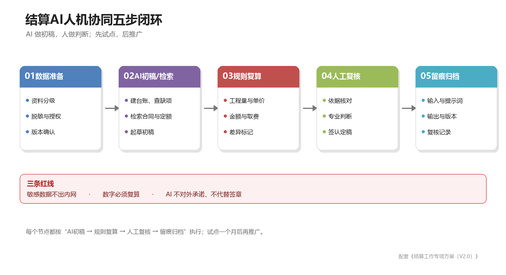

# 结算工作AI应用方案与操作指引

（配电网工程）

**编制单位：** 工程部、市场部（结算组）

**版本：** V3.0

**日期：** 2026年11月

**配套文件：** 《结算工作专项方案（V2.1）》

## 一、编制目的与适用范围

### （一）编制目的

结算工作的主要时间消耗，不在最后的定案签字，而在资料收集、缺项检查、数据核对、结算书起草、对数问答和进度跟踪。这些工作重复、规则明确、文档量大，适合交给AI做初稿和初筛，让人把时间用在判断、协调和签认上。

本指引的目的是：明确结算全过程哪些环节可以用AI、用到什么程度、由谁复核、用什么工具、怎么防止出错，把AI辅助落到可执行的步骤和模板上，为投产后20天定案留出复核和纠偏的缓冲。

### （二）适用范围

本指引适用于公司承接的10kV及以下配电网工程结算工作，覆盖工程部、市场部结算组、物资组及相关管理人员。其他类型工程可参照执行。

首批试点聚焦三个场景：资料完整性检查、送审结算书初稿、对数问题准备。试点跑通后再推广到分包结算、物资对账、影像整理和进度管控。

### （三）与主方案的关系

《结算工作专项方案（V2.1）》管“谁在什么时间做什么、交付什么”，本指引管“哪些环节用AI、怎么用、谁复核、什么不能做”。两份文件配套使用，节点和时限以主方案为准，AI操作以本指引为准。

## 二、总体定位与原则

### （一）AI的定位

AI在结算工作中是资料员的“扫描仪”、结算员的“初稿员”、对数的“检索员”、进度的“记录员”，不是签认人、决策人和对外承诺人。

具体来说，AI适合做五类事：

1. **查：** 从大量文档中找缺项、找依据、找矛盾。
2. **算：** 用规则和表格复算工程量、单价、金额，标记差异。
3. **写：** 起草结算书初稿、差异说明、回复函、日报和周报。
4. **找：** 在合同、定额、制度、历史案例中检索适用条款。
5. **盯：** 跟踪节点、生成提醒、汇总风险。

AI不适合做四类事：现场工程量最终确认、隐蔽工程真实性判断、签章和定案、对外承诺和争议裁决。

### （二）五条原则

1. **人机协同。** AI出初稿和初筛结果，人做判断、修改、签认。AI不替代责任。
2. **数据不出域。** 业主、审计、合同、人员等敏感资料，只在公司私有化或专有云环境处理；不上传公网免费AI工具。
3. **结果可追溯。** 保留输入资料、提示词、模型版本、AI输出和复核记录，随项目资料归档。
4. **数字必复核。** 工程量、单价、金额、取费、甲供材扣回必须用Excel、计价软件或规则脚本复算，不直接采用AI计算结果。
5. **先试点后推广。** 先在一个收尾项目、三个场景跑通，验证准确率和提效后再复制，不搞一次性全面铺开。

### （三）人机分工总表

| 工作类型 | AI负责 | 人负责 | 典型例子 |
| --- | --- | --- | --- |
| 查 | 文档解析、缺项检查、签章缺失标记 | 确认真实性、补正、签认 | 竣工资料完整性检查 |
| 算 | 表格提取、差异计算、异常标记 | 复核计算口径、定性处理 | 材料实用量与领用量比对 |
| 写 | 初稿、摘要、差异说明、回复初稿 | 修改、定稿、对外发送 | 送审结算书编制说明 |
| 找 | 合同、定额、制度、历史案例检索 | 判断适用性、确定口径 | 对数问题依据检索 |
| 盯 | 日报初稿、逾期提醒、风险提示 | 协调、决策、考核 | 节点日报和预警 |
| 签 | 不适用 | 签章、定案、对外承诺 | 签证、定案表 |

部门层面的主责、配合和复核/审定见第三章（五）AI应用权责分工。



*图1 结算AI人机协同五步闭环（AI初稿、规则复算、人工复核、留痕归档）*

## 三、AI适用性评估

### （一）评估维度

判断一个环节能不能用AI，主要看五条：

1. **数据基础：** 资料是否电子化、是否可解析、是否规范。
2. **规则明确度：** 有没有清单、模板、定额、合同条款等明确依据。
3. **错误代价：** 出错是否影响金额、签章、审计责任。
4. **人工耗时：** 是否大量重复、是否值得投入工具和培训。
5. **可验证性：** 结果能不能用规则、原始资料或人工复核快速验证。

### （二）适用性分级

| 分级 | 判断标准 | 使用方式 | 典型环节 |
| --- | --- | --- | --- |
| 高适用 | 数据电子化好、规则明确、结果可复核 | 现在就用，AI出初稿，人工复核 | 资料完整性检查、文档台账、结算书文本初稿、算术和清单勾稽、日报周报、知识库问答 |
| 中适用 | 数据部分电子化、需要判断或样本训练 | 试点后用，AI辅助，人工主导 | 分包结算比对、物资对账、对数问题预判、影像自动归类、进度预测 |
| 低适用 | 数据难获取、错误代价高、责任重大 | 谨慎使用，只做辅助 | 无人机影像自动计数、CAD图纸自动算量、系统自动录入 |
| 不适用 | 需要签认、裁决、对外承诺 | 不使用AI替代 | 现场工程量最终确认、隐蔽工程真实性判断、签章、定案、审计裁决 |

### （三）优先落地清单

| 优先级 | 场景 | 适用性 | 上线难度 | 预期提效 | 主责 |
| --- | --- | --- | --- | --- | --- |
| 第一批 | 资料完整性检查 | 高 | 低 | 1至2天压缩到0.5天 | 工程部资料员 |
| 第一批 | 送审结算书初稿与勾稽 | 高 | 中 | 4天压缩到2.5至3天 | 市场部结算员 |
| 第一批 | 对数问题准备与依据检索 | 高 | 中 | 2天压缩到1天 | 市场部对数员 |
| 第二批 | 分包结算与物资对账 | 中 | 中 | 各1天压缩到0.5天 | 市场部、物资组 |
| 第二批 | 现场影像整理 | 中 | 中高 | 2天压缩到0.5天 | 工程部影像员 |
| 第三批 | 供电局系统录入自动化 | 低中 | 高 | 视系统授权而定 | 物资组、信息管理员 |

### （四）全环节适用性清单

| 序号 | 环节 | AI能做什么 | 适用性 | 人工不可替代的工作 | 建议阶段 |
| --- | --- | --- | --- | --- | --- |
| 1 | 项目结算策划与启动会 | 生成会议材料、节点清单、职责分工初稿 | 中 | 目标决策、资源协调、对外沟通 | 第二批 |
| 2 | 过程资料收集 | OCR识别、自动命名、资料台账、缺项提醒 | 高 | 资料真实性、现场签认 | 第一批 |
| 3 | 资料完整性检查 | 对照清单查缺项、签章、日期、版本 | 高 | 确认资料真实、补正、签认 | 第一批 |
| 4 | 竣工图修改 | 提取图纸文本和表格、比对变更、标注差异 | 中 | 现场核对、设计确认、签章 | 第二批 |
| 5 | 材料实用量清册 | 领用、实用、退库、拆旧、结算量比对 | 高 | 数量确认、差异定性 | 第一批 |
| 6 | 10kV线路无人机验收 | 影像归类、缺拍检查、目标识别试点 | 中 | 现场确认、空域安全、验收签认 | 第三批 |
| 7 | 低压线路测量 | 测量数据录入、计算、异常检查 | 中高 | 现场测量、复核 | 第二批 |
| 8 | 电力电缆测量 | 测量记录整理、长度计算、与敷设记录比对 | 中 | 现场实测、复核 | 第二批 |
| 9 | 重点设备和隐蔽工程照片 | 自动分类、缺拍检查、水印识别 | 中 | 真实性判断、现场确认 | 第二批 |
| 10 | 现场工程量确认 | 汇总实测数据、生成确认表、标记差异 | 中 | 现场签认、争议判断 | 第二批 |
| 11 | 资料签证 | 流转台账、超期提醒、签章完整性检查 | 中 | 签章、沟通、权限确认 | 第二批 |
| 12 | 竣工资料移交 | 按移交清单核对、生成缺项清单 | 高 | 双方清点、签字 | 第一批 |
| 13 | 送审结算书编制 | 模板初稿、差异说明、规则复算 | 高 | 计价判断、复核、定稿 | 第一批 |
| 14 | 分包结算 | 与业主结算工程量比对、确认函初稿 | 中 | 合同判断、谈判、书面确认 | 第二批 |
| 15 | 拆旧和余料退库 | 单据OCR、账实比对、差异表 | 中 | 现场盘点、残值认定 | 第二批 |
| 16 | 供电局系统物资调拨 | 单据核对、录入提醒、RPA试点 | 低中 | 系统授权、审批、账务确认 | 第三批 |
| 17 | 业主送审 | 资料包自检、缺项清单、送审台账 | 高 | 对外沟通、签收 | 第一批 |
| 18 | 第三方对数 | 依据检索、问题预判、回复初稿、争议汇总 | 高 | 主谈、判断、对外承诺 | 第一批 |
| 19 | 资料返工 | 问题定位、补正清单、跟踪销项 | 高 | 整改、确认、签认 | 第一批 |
| 20 | 定案与归档 | 归档完整性检查、目录生成、复盘初稿 | 高 | 定案签章、责任确认 | 第二批 |
| 21 | 进度日报与预警 | 日报初稿、逾期标红、风险提示 | 高 | 数据确认、协调决策 | 第一批 |
| 22 | 知识库与培训 | 制度、合同、定额、案例问答和培训材料 | 高 | 适用性判断、经验传授 | 第一批 |
| 23 | 设计资料包解析 | 提取项目概况、建设规模、材料清册、工程量、预算 | 高 | 项目编码、规模、金额确认 | 第一批 |
| 24 | 设计—预算—结算三算对比 | 比对三方量价、标记差异、起草说明 | 高 | 差异定性和调整决策 | 第一批 |

### （五）AI应用权责分工

AI只是工具，不承担权责。使用AI不改变原有的业务主责：谁的业务谁主责，谁提供数据谁配合，谁复核谁签字。主责部门对AI输出的业务结论和流转结果负责；配合部门对提供数据的及时性、完整性负责；复核/审定人对输出质量负责。编制人与复核人原则上分离；无法分离时，由部门负责人复核。

| 序号 | AI应用场景 | 主要负责 | 配合 | 复核/审定 |
| --- | --- | --- | --- | --- |
| 1 | 资料收集与完整性检查 | 工程部资料员 | 市场部结算组、物资组、信息管理员 | 项目经理、市场部预审 |
| 2 | 竣工图、清册与工程量核对 | 工程部技术员、资料员 | 市场部结算组、物资组、测量员 | 项目经理、市场部复核 |
| 3 | 现场影像与无人机资料整理 | 工程部影像员、测量员 | 市场部结算组（证据需求） | 项目经理 |
| 4 | 竣工资料初稿（内部工具） | 工程部验收小组 | 信息管理员、市场部结算组 | 项目经理、资料员 |
| 5 | 送审结算书编制 | 市场部主结算员 | 工程部、物资组 | 结算组复核员、市场部负责人 |
| 6 | 分包结算 | 市场部分包结算员 | 工程部、物资组 | 市场部负责人 |
| 7 | 物资对账、拆旧退库与调拨 | 物资组 | 市场部结算组、工程部 | 物资组负责人、市场部复核 |
| 8 | 业主送审与第三方对数 | 市场部结算组 | 工程部、物资组 | 市场部负责人、领导小组 |
| 9 | 资料签证跟踪 | 工程部签证专员 | 市场部结算组 | 项目经理 |
| 10 | 进度日报与预警 | 结算专班（工程部资料员牵头） | 各节点责任部门 | 领导小组 |
| 11 | 知识库与培训 | 市场部结算组、信息管理员 | 工程部、物资组 | 市场部负责人 |
| 12 | AI工具、账号与数据安全 | 信息管理员 | 工程部、市场部、物资组 | 领导小组 |
| 13 | AI输出复核 | 各业务编制人 | 各部门复核员 | 部门负责人 |
| 14 | 设计资料包解析与项目画像 | 工程部资料员 | 市场部结算组、信息管理员 | 项目经理 |
| 15 | 设计—预算—结算三算对比 | 市场部主结算员 | 工程部、物资组 | 市场部负责人、项目经理 |

## 四、业务人员操作手册

### （一）怎么用这本手册

本章按岗位编写操作卡，回答“谁、在什么时候、用什么工具、按什么步骤、做到什么标准”。业务人员不需要理解AI原理，按操作卡执行即可。

使用顺序：

1. 在“角色—场景—工具”速查表中找到自己的岗位和当前节点。
2. 打开对应操作卡，按“前置准备—操作步骤—人工复核—完成标准”执行。
3. AI输出标注“AI初稿”或“工具初稿”，保留输入、提示词和复核记录。
4. 在《AI使用台账》（附件5）登记，文件按命名规则归档。
5. 涉及签章、定案、对外承诺的，不使用AI替代。

**表4-1 角色—场景—工具速查表**

| 角色 | 什么时候 | 主要场景 | 用什么 | 操作卡 |
| --- | --- | --- | --- | --- |
| 资料员 | T0-15至T0+1 | 资料完整性检查、设计资料包解析、材料/工程量提取、竣工资料初稿、三量核对、影像整理、签证跟踪 | 内部工具、私有化AI、飞书或Excel | 4.2-1至4.2-7 |
| 测量员、影像员 | T0-7至T0-5 | 现场照片归类、缺拍检查、无人机成果整理 | 相机、无人机、相册、私有化AI | 4.2-4 |
| 结算员 | T0+1至T0+18 | 结算书初稿、三算对比、设计变更一致性、分包结算、业主送审、对数问答 | 私有化AI、Excel或计价软件、内部工具“结算” | 4.3-1至4.3-6 |
| 物资员 | T0+2至T0+6 | 物资对账、拆旧退库、调拨单据核对 | 私有化AI、Excel、供电局系统 | 4.4-1 |
| 复核员、负责人 | 全过程 | AI输出复核、日报预警 | 附件4复核清单、飞书机器人 | 4.5-1、4.5-2 |

**开始前五件事：**

1. 确认账号：内部工具账号、私有化AI账号、飞书表格权限。
2. 建项目文件夹：`项目简称/01资料/02影像/03结算/04对数/05归档`。
3. 统一命名：`项目简称-类别-名称-版本-日期`，例如`某台区-竣工图-V2-20261112`。
4. 准备三张表：资料台账、问题清单、AI使用台账。
5. 记住三条红线：敏感资料不出内网；数字必复算；AI不对外承诺、不代替签章。

### （二）资料员操作卡

#### 操作卡4.2-1 资料完整性检查

**谁来做：** 工程部资料员主责；市场部结算组提供清单和计价口径；项目经理复核。

**什么时候：** T0-15首次检查；T0-3定稿前复检；T0+1移交前终检。

**用什么：** 私有化AI助手或公司批准的大模型；Excel或飞书多维表格；内部工具生成的资料初稿。

**前置准备：**

- 确认最新版《竣工资料移交清单》和补正要求。
- 资料按类别放入`01资料`，扫描件命名规范。
- 建资料台账，字段：序号、资料名称、份数、形式、提供部门、签章单位、签章日期、版本、影像编号、备注。

**操作步骤：**

1. 打开AI助手，新建对话，上传移交清单和资料台账。
2. 粘贴附件1提示词，填好项目信息、当前阶段、移交时限。
3. 发送，检查输出是否为表格、是否按严重程度排序、是否标注“需人工核实”。
4. 把输出复制到Excel，逐项对照原件核实：缺项是否真缺、签章是否真缺、日期是否矛盾。
5. 在台账标注“已补/待补/不适用”，生成《资料补正清单》，发责任人和项目经理。
6. 将AI输出、复核记录、补正清单存入`01资料/AI检查`，登记附件5。

**输入示例：** 某台区工程，移交清单27类，台账已录20类，待查7类；扫描件85份。

**AI输出示例：**

| 序号 | 资料名称 | 问题类型 | 问题描述 | 责任部门 | 建议限期 |
| --- | --- | --- | --- | --- | --- |
| 1 | 甲供物资退料单 | 缺项 | 台账有领用单，无退料单 | 物资组 | T0-10 |
| 2 | 竣工图 | 签章缺失 | 设计签章页缺失 | 工程部 | T0-3 |
| 3 | 开工报告 | 日期矛盾 | 开工报告日期晚于施工日志 | 工程部 | T0-10 |

**人工判断：**

- AI说缺的，先查其他文件夹和版本；确认真缺再发补正。
- 签章缺失核对原件，复印件不能代替原件。
- 日期矛盾以开工报告、验收记录、签章日期为准，必要时请监理确认。

**完成标准：** 27类逐项有结论；缺项责任到人、限期明确；台账与实物一致。

**常见错误：** 上传旧版清单；扫描模糊导致误读；把AI建议当结论。

**耗时：** 首次1至2小时；复检30分钟。

#### 操作卡4.2-2 竣工资料初稿（内部工具）

**谁来做：** 工程部验收小组或资料员主责；信息管理员提供账号；市场部结算组提供结算口径。

**什么时候：** T0-7至T0-5现场验收后，T0-5前形成初稿。

**用什么：** 公司内部《工程资料管理（内部使用版）》的“生成”页。

**前置准备：**

- 账号可登录，内网可访问；账号本人使用。
- 准备预算、材料清册、图纸（PDF或Excel），按命名规则存放。
- 确认工程名称、工程编号与合同、投产计划一致。

**操作步骤：**

1. 登录系统，点击顶部“生成”。
2. 填写“工程名称”（必填）和“工程编号”（可留空，系统从文件自动抽取）。
3. 上传预算、材料清册、图纸，至少上传一个文件；多个文件可批量选择。
4. 点击生成，等待处理完成；失败时按提示检查文件格式、大小和网络。
5. 在“资料”页或结果页查看、下载或复制生成结果。
6. 对照《竣工资料移交清单》逐项核对，补充现场验收记录、影像和签章页。
7. 文件命名`项目简称-竣工资料初稿-版本-日期`，存入`01资料/初稿`，登记台账。

**输入示例：** 工程名称“某供电所10kV甲线台区改造工程”；工程编号“XX-2026-001”；上传预算.pdf、材料清册.xlsx、竣工图.pdf。

**输出示例：** 竣工资料初稿（Word或PDF），含工程概况、编制说明、工程量、材料清单等；以系统实际生成结果为准。

**人工判断：**

- 核对工程名称、编号、参建单位、日期。
- 核对工程量、材料量与现场验收确认表、清册是否一致。
- 检查缺项、错项、重复，补齐签章页。

**完成标准：** 初稿覆盖移交清单主要资料；关键信息核对无误；缺项列明并限期补齐。

**常见错误：** 上传无关文件；工程编号自动抽取错误；直接拿初稿去签章。

**耗时：** 上传生成10至20分钟；核对1至2小时。

#### 操作卡4.2-3 竣工图、清册与工程量“三量核对”

**谁来做：** 工程部技术员或资料员主责；市场部结算组复核口径；物资组提供领退料数据。

**什么时候：** T0-5至T0-3，资料定稿前。

**用什么：** Excel或飞书表格；私有化AI助手；内部工具“结算”模块（试点）。

**前置准备：**

- 竣工图（PDF或CAD导出）、工程量计算书、材料实用量清册、领料单、退料单、现场验收确认表。
- 建Excel对照表，列：序号、项目、单位、设计量、领用量、实用量、退库量、结算量、差异、原因、依据。

**操作步骤：**

1. 把图纸和表格中的工程量、材料量录入或导入Excel。
2. 用公式计算差异：实用量减领用量、结算量减确认量、退库量加拆旧量与领用量核对。
3. 设置阈值：数量差异超过2%或金额差异超过1000元标黄；超过5%或5000元标红。
4. 把差异表发给AI，粘贴提示词，要求生成《量差说明表》初稿。
5. 人工逐项核实：能复测的复测，不能复测的查影像、领退料单、变更签证。
6. 确认后更新竣工图、清册、计算书，保持同源；形成《量差说明表》签字版。

**输入示例：**

| 项目 | 设计量 | 领用量 | 实用量 | 退库量 | 结算量 |
| --- | --- | --- | --- | --- | --- |
| 10kV导线 | 12000m | 11800m | 11750m | 0 | 11800m |
| 电力电缆 | 800m | 820m | 810m | 10m | 810m |
| 配变 | 2台 | 2台 | 2台 | 0 | 2台 |

**AI输出示例：** 标记“10kV导线结算量比实用量多50m”“电缆退库10m未计入结算扣回”，并给出核查建议。

**人工判断：**

- 导线多50m可能是预留、弧垂或计量口径差异，查现场测量记录和验收确认表。
- 电缆退库10m应在结算中扣回，查退库单和物资调拨记录。
- 配变无差异，确认铭牌和数量。

**完成标准：** 差异逐项有原因、有依据、有处理结论；清册、图纸、结算书数据一致。

**常见错误：** 用设计量代替实用量；漏记退库；差异原因写“其他”。

**耗时：** 2至4小时。

#### 操作卡4.2-4 现场影像整理

**谁来做：** 工程部影像员或测量员主责；项目经理复核关键点位。

**什么时候：** T0-7至T0-5现场验收期间，每日整理。

**用什么：** 相机、无人机、相册或网盘、私有化AI助手。

**前置准备：**

- 按线路、杆号、桩号建文件夹；照片保留原始文件，不裁剪。
- 准备杆塔明细、设备清单、隐蔽工程清单。

**操作步骤：**

1. 每日把照片导入`02影像/日期`，按线路和区段初分。
2. 用相册或AI按杆号、日期、工序分类；OCR提取水印时间、地点。
3. 对照杆塔明细和工序清单检查缺拍点位，生成《影像补拍清单》。
4. 标记模糊、过暗、重复、无时间水印的照片，安排补拍。
5. 无人机成果按线路建立正射影像、视频、关键部位照片目录。
6. 关键点位和隐蔽工程照片由项目经理复核，确认后归档。

**输入示例：** 10kV线路3.2km、杆塔48基、照片320张、无人机视频4段。

**AI输出示例：** 识别3基杆塔缺全景、2处隐蔽工程照片无时间水印、15张重复照片；生成补拍清单。

**人工判断：** 缺拍点位是否在别的日期或别的相机；隐蔽工程已覆盖无法补拍的，用施工过程照片和验收记录佐证。

**完成标准：** 每基杆塔、每台设备、每处隐蔽工程有照片；目录与杆号、桩号对应；原始文件完整。

**常见错误：** 照片改名后丢失时间信息；用微信压缩图代替原图；补拍不及时。

**耗时：** 每日30分钟；整体整理2至3小时。

#### 操作卡4.2-5 签证跟踪

**谁来做：** 工程部签证专员主责；市场部结算组配合；项目经理协调。

**什么时候：** T0-3至T0+1，签章流转期间。

**用什么：** 飞书表格或Excel签证台账；私有化AI助手；OCR。

**前置准备：**

- 建签证台账，字段：序号、资料名称、送签单位、送签日期、签回日期、签章人、问题、催办记录。
- 签章资料按单位分册，目录清晰。

**操作步骤：**

1. 每送出一份资料，当日登记台账。
2. 每日让AI根据台账生成超期清单和催办话术。
3. 用OCR检查签章页：单位、位置、日期、骑缝章是否齐全。
4. 超期1天的电话催办；超期2天的部门负责人上门跟签。
5. 签回后核对签章，更新台账；缺项当日补办。
6. T0+1移交前，用AI生成《未签清单》，随移交清单附上。

**输入示例：** 5份签证，供电所已签、监理未签、设计未签、业主未签。

**AI输出示例：** 超期清单（监理超1天、设计超1天、业主未到期）、催办话术、签章检查结果。

**人工判断：** 签章真伪、签章权限、日期有效性必须人工确认；AI不代替签章。

**完成标准：** 签章齐全、日期正确、与移交清单一致；未签清单有责任人和补签时限。

**常见错误：** 台账不更新；签章页缺骑缝章；把扫描件当原件。

**耗时：** 每日10分钟。

#### 操作卡4.2-6 设计资料包解析与项目画像

**谁来做：** 资料员主责；项目经理复核；结算员提供结算口径。

**什么时候：** 项目启动或T0-30前，设计资料包到齐后2个工作日内。

**用什么：** Python或Excel解析DOCX/XLSX/PDF/XML；私有化AI助手；内部工具。

**前置准备：** 附件1至附件9按目录存放；确认项目编码、名称、版本；准备项目画像模板。

**操作步骤：**

1. 建项目文件夹，按`01设计资料/附件1-9`分类存放，文件名保留原版本号。
2. 解析附件1设计说明书：提取项目名称、编码、建设单位、建设性质、建设规模、新建和拆除范围、主要设备选型。
3. 解析附件4材料清册：读取甲供材料、乙供材料、工程量清单、拆旧清单四个工作表，记录条数和关键设备材料。
4. 解析附件5预算：读取XLSX的施工图预算费用明细表，或XML的总算表/分部分项工程量表，提取预算总额、设备购置费、安装工程费、其他费用。
5. 把上述字段填入项目画像表，AI检查缺项、单位不一致、金额与规模矛盾。
6. 人工核对项目编码、名称、规模、金额，确认后作为平台项目主数据。

**输入示例：** 3个9月投产项目，附件1为DOCX，附件4为XLSX，附件5为XLSX/XML/BDY3。

**输出示例：**

| 字段 | 项目A | 项目B | 项目C |
| --- | --- | --- | --- |
| 10kV线路 | 0.057km | 2.131km | 0.077km |
| 配变 | 500kVA | 200kVA | 500kVA |
| 低压线路 | 3.15km | 3.108km | 0.060km |
| 预算总额 | 35.41万元 | 89.29万元 | 26.87万元 |
| 甲供/乙供 | 109/35条 | 109/37条 | 81/27条 |
| 工程量清单 | 42条 | 41条 | 35条 |

**人工判断：** 项目编码和名称以合同/投资计划为准；规模以设计说明书和建设规模表为准；预算金额以预算书为准；附件3、附件5 BDY3需插件时标注“待解析”，不得猜测。

**完成标准：** 项目画像字段完整；关键字段与原件一致；缺项和插件缺口列明；项目主数据经项目经理确认。

**常见错误：** 把可研规模当设计规模；附件4和附件5数量口径混用；项目编码抄错；BDY3打不开就放弃解析，未用XLSX/XML替代。

**耗时：** 每个项目2至3小时。

#### 操作卡4.2-7 材料清册、工程量清单与预算提取

**谁来做：** 资料员或技术员主责；结算员复核口径；物资员核对甲供材料。

**什么时候：** T0-15前，与设计资料包解析同步。

**用什么：** Excel或openpyxl；私有化AI助手；内部工具“生成/结算”。

**前置准备：** 附件4的甲供材料、乙供材料、工程量清单、拆旧清单；附件5预算XLSX/XML；统一材料名称、规格、单位。

**操作步骤：**

1. 读取甲供材料和乙供材料工作表，提取物资编码、名称、规格型号、单位、数量，统一单位（千米/米、吨/千克）。
2. 读取工程量清单，按“新建部分/台架/架空线路/低压线路/拆除”分组，提取工程量名称、单位、数量。
3. 读取预算XLSX的施工图预算费用明细表和安装工程单位工程表，或XML工程量表，提取预算金额和主要清单项。
4. 用物资编码和规格型号做主键，把甲供/乙供/工程量/预算四张表关联，标记有量无价、有价无量、单位不一致、规格不一致。
5. AI生成《材料与工程量核对表》，逐项标注来源和需人工核实项。
6. 人工核对关键设备、导线、电缆、杆塔数量，确认后作为三算对比的“设计/预算”基准。

**输入示例：** 项目A甲供材料109条；10kV导线JKLGYJ-70/10数量0.176km，路径长0.057km；配变1台；低压导线3.15km。

**AI输出示例：** 提示“10kV导线材料量0.176km约为路径长0.057km的3.09倍，符合三相架设加预留，不作为差异”；“低压导线存在BLV-70等拆旧项，需与新建量分开”；“部分材料单位为千米，工程量清单为米，需统一”。

**人工判断：** 导线量按相数×路径长加预留核对；电缆量按路径加预留核对；甲供与乙供分开；拆旧量与新建量分开；单位、规格、版本必须人工确认。

**完成标准：** 四张表可关联；关键材料/设备数量核对无误；差异有说明；输出可作为三算对比基准。

**常见错误：** 把三相导线量当成路径长错误；把拆旧量计入新建；单位不统一；用旧版清册。

**耗时：** 每个项目2至4小时。

### （三）结算员操作卡

#### 操作卡4.3-1 送审结算书初稿

**谁来做：** 市场部主结算员主责；复核员复核；市场部负责人审定；工程部、物资组配合。

**什么时候：** T0+1至T0+4编制，T0+5定稿。

**用什么：** 私有化AI助手；Excel或计价软件；结算书模板；内部工具“结算”模块（试点）。

**前置准备：**

- 移交资料、合同、招标文件、计价依据、定额、取费标准、历史结算书。
- 结算书模板、工程量确认表、材料清册、变更签证。

**操作步骤：**

1. 在AI助手新建“结算书编制”对话，上传合同、计价依据、工程量确认表、清册、变更签证、模板。
2. 粘贴附件2提示词，要求输出编制说明、工程量表、计价表、甲供材扣回表、差异说明。
3. 检查AI输出：项目名称、单位、金额、取费、甲供材扣回；无法确认的标注“需人工核实”。
4. 把工程量、单价、金额导入Excel或计价软件复算，AI不直接算钱。
5. 人工调整差异，补充依据，完成编制人自校、复核员复核、部门负责人审定。
6. 定稿命名`项目简称-送审结算书-版本-日期`，存入`03结算`，登记附件5。

**输入示例：** 送审金额128.6万元；AI初稿127.9万元；差异0.7万元。

**AI输出示例：**

| 序号 | 差异项 | 结算书值 | 依据值 | 差异 | 原因 | 处理建议 |
| --- | --- | --- | --- | --- | --- | --- |
| 1 | 电缆敷设 | 12.8万元 | 12.3万元 | +0.5万元 | 长度多50m | 核对滚轮测距记录 |
| 2 | 土方 | 3.2万元 | 3.0万元 | +0.2万元 | 开挖量口径 | 核对隐蔽验收记录 |

**人工判断：** 逐项核对现场验收确认表、清册、变更签证；差异原因不能写“其他”；金额复算零差错。

**完成标准：** 结算书完整、依据齐全、三级复核签字、金额复算无误。

**常见错误：** AI编造定额编号；直接采用AI金额；漏计甲供材扣回。

**耗时：** 2.5至3天。

#### 操作卡4.3-2 分包结算比对

**谁来做：** 市场部分包结算员主责；工程部核对工程量；物资组核对材料。

**什么时候：** T0+2发出，T0+5前确认。

**用什么：** 私有化AI助手；Excel；分包合同和结算书。

**前置准备：** 分包合同、分包结算书、业主结算书、工程量确认表、领退料单。

**操作步骤：**

1. 把分包结算书和业主结算书上传AI，要求按工程量、单价、取费逐项比对。
2. 检查AI输出的差异表：超结、漏结、单价差异、范围差异。
3. 用Excel复算分包金额和业主对应金额。
4. 人工判断合同责任和争议事项，形成《分包结算差异表》。
5. 发分包商限期确认；逾期按合同处理，书面催告。
6. 确认单存档，登记附件5。

**输入示例：** 分包送审35.2万元，业主对应33.8万元，差异1.4万元。

**AI输出示例：** 差异表，列明工程量差、单价差、范围差，标注需人工判断项。

**人工判断：** 合同单价、工程量、范围由人判断；AI只列差异，不判断责任。

**完成标准：** 差异逐项有结论；分包商书面确认；与业主结算勾稽。

**常见错误：** 分包与业主工程量口径不一致；漏看合同范围。

**耗时：** 0.5至1天。

#### 操作卡4.3-3 业主送审资料包自检

**谁来做：** 市场部送审员主责；工程部补资料；物资组补物资单据。

**什么时候：** T0+5至T0+6送审前。

**用什么：** 业主送审清单；私有化AI助手；Excel清单。

**前置准备：** 送审清单、结算书、竣工资料、签章页、电子版。

**操作步骤：**

1. 按业主送审清单建Excel核对表，列：序号、资料名称、份数、形式、签章、版本、备注。
2. 上传清单和资料目录给AI，要求逐项检查缺项、份数、签章、版本。
3. 人工复核AI输出，确认缺项和补正时限。
4. 补齐后按顺序装订，电子版按目录命名。
5. 送审时办理签收，登记送审台账。

**示例：** AI发现缺监理签章页1份、结算书电子版版本旧1份；当日补齐。

**完成标准：** 送审清单逐项齐全；签章完整；业主签收。

**常见错误：** 版本未更新；份数不足；电子版与纸质版不一致。

**耗时：** 1至2小时。

#### 操作卡4.3-4 对数问题准备与回复

**谁来做：** 市场部对数员主责；工程部解释现场和工程量；市场部负责人审定对外口径。

**什么时候：** T0+7至T0+14。

**用什么：** 私有化AI助手；合同、定额、验收记录、影像目录；问题清单。

**前置准备：** 中介问题清单、合同、计价依据、验收记录、变更签证、影像目录、历史对数案例。

**操作步骤：**

1. 把问题清单和资料上传AI，粘贴附件3提示词。
2. 要求逐条输出：问题、依据（文件名称和条款）、事实说明、建议回复、需补充证据。
3. 人工核对依据原文，确认条款、页码、金额；无出处的结论不采用。
4. 形成《对数问题回复表》，市场部负责人审定。
5. 对数现场由人主谈，AI只做检索和记录；不对外发送AI原文。
6. 对数后汇总争议项，跟踪销项。

**示例问题：** “电缆敷设长度为何比竣工图多50米？”

**AI输出示例：** 依据现场验收记录、滚轮测距记录、电缆盘长和变更签证，说明多出50米为预留和路径调整，附证据编号。

**人工判断：** 依据是否真实、条款是否适用、金额是否准确；对外答复由负责人定稿。

**完成标准：** 问题逐条有依据、有证据、有回复；争议清单闭环。

**常见错误：** AI编造条款；回复中出现未经批准的费用承诺；把AI草稿直接发给中介。

**耗时：** 准备1天；现场按轮次。

#### 操作卡4.3-5 设计—预算—结算三算对比

**谁来做：** 结算员主责；资料员提供设计/清册；物资员提供物资数据；项目经理复核。

**什么时候：** T0+1至T0+4，结算书初稿编制前。

**用什么：** Excel或飞书表格；私有化AI助手；内部工具“结算”模块。

**前置准备：** 设计量（附件1/4）、预算量（附件5）、结算量（现场验收/送审结算书）；统一项目、单位、材料编码。

**操作步骤：**

1. 建三算对比表，列：序号、项目、单位、设计量、预算量、结算量、差异、差异率、原因、依据、处理建议。
2. 用Excel公式计算差异和差异率；设置阈值：数量差异超过2%或金额超过1000元标黄，超过5%或5000元标红。
3. 把差异表交给AI，要求按“设计—预算—结算”逐项说明差异原因，标注需补充的证据。
4. 人工核实：三相/单相、预留、损耗、变更、签证、计量口径、拆旧与新建分开。
5. 形成《三算差异说明表》，结算员、资料员、项目经理签字。
6. 结算书编制和业主送审时引用该表，对数时作为答复依据。

**输入示例：** 项目A设计预算35.41万元、送审结算36.20万元；10kV导线设计路径0.057km、预算材料0.176km、结算0.171km；低压导线设计3.15km、预算3.24km、结算3.31km。

**AI输出示例：**

| 项目 | 设计量 | 预算量 | 结算量 | 差异 | 原因 | 建议 |
| --- | --- | --- | --- | --- | --- | --- |
| 10kV导线 | 0.057km | 0.176km | 0.171km | -0.005 | 材料量按三相计 | 核对架设记录 |
| 配变 | 1台 | 1台 | 1台 | 0 | 无差异 | 通过 |
| 低压导线 | 3.15km | 3.24km | 3.31km | +0.07 | 路径调整/预留 | 查变更签证 |
| 电缆 | 0m | 70m | 70m | 0 | 无差异 | 通过 |
| 土方 | — | 12m³ | 15m³ | +3 | 开挖量口径 | 查隐蔽记录 |

**人工判断：** 三相导线量不等于路径长；预算量含预留/损耗；结算量以现场验收为准；差异原因不能写“其他”；金额用Excel或计价软件复算。

**完成标准：** 三算逐项有差异、有原因、有依据、有处理结论；差异说明经三方签字；结算书与差异说明一致。

**常见错误：** 拿预算量直接当结算量；把三相导线量当路径长；漏掉拆旧/退库；差异原因写成“现场情况”。

**耗时：** 0.5至1天。

#### 操作卡4.3-6 设计变更、竣工图与签证一致性核对

**谁来做：** 结算员或资料员主责；工程部技术员确认；市场部负责人审定。

**什么时候：** T0+5至T0+14，业主送审前和对数期间。

**用什么：** 私有化AI助手；竣工图PDF、设计变更单、现场签证、验收记录；Excel清单。

**前置准备：** 设计说明书、竣工图、设计变更通知单、现场签证、工程量确认表；按单位/编号建清单。

**操作步骤：**

1. 从设计说明书和竣工图中提取线路、设备、材料、杆塔清单，形成“设计清单”和“竣工清单”。
2. AI比对两份清单，标记增加、减少、规格变化、位置变化。
3. 对每项变化查找设计变更单或现场签证；无变更/签证的，列为“待补依据”。
4. 核对变更/签证的签章、日期、工程量、影像；与现场验收确认表交叉核对。
5. 形成《设计变更与竣工一致性清单》，作为结算书编制和对数答复依据。
6. 发现资料缺失的，开《资料返工通知单》，限期工程部补齐。

**输入示例：** 项目A低压导线设计3.15km、竣工3.31km，增加0.16km；设计变更单一份，现场签证两份。

**AI输出示例：** 标记“低压导线增加0.16km，对应变更单XXX、签证XXX，需核对签证工程量和日期”；“配变容量未变化”；“拆除低压导线2.5km，与拆旧清单一致”。

**人工判断：** 变更/签证是否真实、是否在时效内、签章是否齐全；无依据的增加量不得计入结算；AI只列变化，不判断合规性。

**完成标准：** 增减项逐项有依据；变更/签证与竣工图、验收记录一致；缺失项限期补齐；对数时能逐条说明。

**常见错误：** 只看竣工图不看变更；签证工程量与竣工图不一致；变更单无签章；把施工优化当成变更。

**耗时：** 0.5至1天。

### （四）物资员操作卡

#### 操作卡4.4-1 物资对账、拆旧退库与调拨

**谁来做：** 物资组材料员主责；市场部结算组提供结算口径；工程部提供现场数据。

**什么时候：** T0+2至T0+6。

**用什么：** 私有化AI助手；Excel；供电局系统（授权操作）。

**前置准备：** 领料单、退料单、拆旧清单、余料清单、调拨单、材料实用量清册。

**操作步骤：**

1. 把单据和清册上传AI，要求按材料名称、规格、单位逐项比对。
2. 输出差异表：领用、实用、退库、拆旧、调拨、结算量。
3. 用Excel复算数量和金额；差异超过阈值标红。
4. 现场盘点，核对实物和单据；差异逐项说明。
5. 在供电局系统完成调拨，留存单据和系统截图。
6. 把差异表、退库单、调拨单移交市场部结算组。

**示例：** 电缆领用820m、实用810m、退库10m、拆旧120m；AI提示退库未销账、拆旧未入账，人工核对后补单。

**人工判断：** 实物盘点、残值认定、系统审批由人负责；AI只比对单据。

**完成标准：** 账、卡、物一致；退库和调拨单据齐全；差异有说明。

**常见错误：** 单据缺页；拆旧与退库混淆；系统调拨滞后。

**耗时：** 0.5至1天。

### （五）复核员、负责人操作卡

#### 操作卡4.5-1 AI输出复核

**谁来做：** 各部门复核员或部门负责人；编制人回避原则。

**什么时候：** 每份AI输出流转前。

**用什么：** 附件4《人机协同复核清单》。

**操作步骤：**

1. 检查输入资料版本、份数、签章、日期是否最新齐全。
2. 检查AI输出是否标注“AI初稿”、模型版本、生成日期。
3. 数字复算：工程量、单价、金额、取费、甲供材。
4. 依据核对：合同、定额、变更、签证、验收记录，每条结论有出处。
5. 一致性检查：图、清册、计算书、结算书、系统数据。
6. 检查对外口径、敏感信息、版本；签字确认或退回修改。

**完成标准：** 附件4逐项打勾；发现问题退回并记录；复核记录归档。

**常见错误：** 只看格式不看数字；复核人未签字；把AI输出直接转发。

**耗时：** 每份15至30分钟。

#### 操作卡4.5-2 日报与预警

**谁来做：** 结算专班数据员主责；各节点责任人提供数据；领导小组审定。

**什么时候：** T0-7起每日17:00前。

**用什么：** 飞书多维表格或任务台账；私有化AI助手；飞书机器人。

**操作步骤：**

1. 各责任人当日更新任务台账（完成、未完成、问题、次日计划）。
2. 数据员导出台账，粘贴给AI，要求生成日报初稿：今日完成、偏差、明日计划、需协调事项、风险提示。
3. 人工核对数据和节点，确认红灯、橙灯、黄灯。
4. 日报发专班群，红灯事项报领导小组。
5. 次日站班会跟踪前一日问题。

**日报模板：** 今日完成；偏差节点；明日计划；需协调；风险提示。

**完成标准：** 日报当日发出；逾期节点标红；问题有责任人和时限。

**常见错误：** 台账不更新；AI编造完成情况；预警不升级。

**耗时：** 5至10分钟。

### （六）三个完整示例

#### 示例1 资料完整性检查

**背景：** 某供电所10kV甲线台区改造工程，T0-15，移交清单27类，台账已录20类。

**提示词（节选）：** “你是配电网工程竣工资料审查员……检查缺项、签章缺失、日期矛盾……输出表格，列明责任部门和限期。”

**AI输出：**

| 序号 | 资料名称 | 问题类型 | 问题描述 | 责任 | 限期 |
| --- | --- | --- | --- | --- | --- |
| 1 | 甲供物资退料单 | 缺项 | 有领用无退料 | 物资组 | T0-10 |
| 2 | 竣工图 | 签章缺失 | 设计签章缺失 | 工程部 | T0-3 |
| 3 | 开工报告 | 日期矛盾 | 晚于施工日志 | 工程部 | T0-10 |
| 4 | 试验报告 | 需人工核实 | 扫描件缺页 | 工程部 | T0-10 |

**人工复核：** 第1、2、3项确认；第4项查原件发现是扫描漏页，补扫后闭环。**结果：** 4项问题3项真、1项误报；补正清单发责任人，T0-10闭环。

**经验：** AI能快速列清单，但“真缺还是放错”必须人工判断。

#### 示例2 结算书差异说明

**背景：** T0+4，结算书初稿送审128.6万元，AI按依据资料复核为127.9万元。

**数据：** 电缆敷设结算12.8万元、验收记录12.3万元；土方结算3.2万元、隐蔽验收3.0万元。

**AI输出：**

| 差异项 | 结算书 | 依据 | 差异 | 原因 | 处理 |
| --- | --- | --- | --- | --- | --- |
| 电缆敷设 | 12.8万元 | 12.3万元 | +0.5万元 | 长度多50m | 核对滚轮测距记录 |
| 土方 | 3.2万元 | 3.0万元 | +0.2万元 | 开挖量口径 | 核对隐蔽验收记录 |

**人工复核：** 电缆多50m为预留和路径调整，有变更签证，保留；土方按隐蔽验收记录调整，减0.2万元。**结果：** 结算书调整为128.4万元，附差异说明。

**经验：** AI只列差异，是否调整由人按依据判断；金额用Excel复算。

#### 示例3 对数问题回复

**问题：** 中介问“电缆敷设长度为何比竣工图多50米？”

**证据：** 现场验收记录（T0-5）、滚轮测距记录、电缆盘长、设计变更单。

**AI输出：** 问题、依据（验收记录第X页、变更单编号）、事实说明（预留、路径调整）、建议回复、需补充证据。

**人工修改：** 核对验收记录和变更单，删去AI推测的“可能”，改为确定表述；市场部负责人审定后回复。

**结果：** 中介认可，争议销项。

**经验：** AI可以快速找依据，但对外回复必须由人定稿，不能承诺金额。

### （七）常见错误与处理

| 序号 | 常见错误 | 现象 | 原因 | 处理 | 预防 |
| --- | --- | --- | --- | --- | --- |
| 1 | 上传旧版资料 | AI检查结果对不上 | 文件版本多 | 重新确认版本、重跑 | 命名带版本、目录唯一 |
| 2 | 扫描模糊 | OCR错字、缺页 | 扫描质量差 | 回看原图、补扫 | 300dpi、彩色、去装订 |
| 3 | AI编造条款 | 引用不存在的定额或条款 | 模型幻觉 | 删除、人工查原文 | 只传依据、要求出处 |
| 4 | 数字算错 | 金额或工程量不符 | 用AI算钱 | 用Excel或计价软件复算 | 数字必复算 |
| 5 | 输出格式乱 | 表格错位、漏列 | 提示词不清 | 按模板重写提示词 | 用附件模板 |
| 6 | 敏感数据外传 | 上传公网工具 | 图方便 | 立即删除、报告 | 私有化环境、脱敏 |
| 7 | 过度依赖 | 不复核直接使用 | 赶时间 | 退回重做、培训 | 100%复核起步 |
| 8 | 工具登录失败 | 无法访问或生成失败 | 网络、账号、文件格式 | 检查网络账号格式，联系管理员 | 提前测试、备份人工流程 |
| 9 | 内部工具生成错误 | 工程名称或编号错 | 文件命名乱、自动抽取错 | 手工更正、重新生成 | 上传前核对文件 |
| 10 | 复核走过场 | 签字但未核对 | 责任不清 | 按附件4逐项复核 | 复核人签字、抽查 |

### （八）节点操作清单

| 时间 | 角色 | 必做动作 | 工具 | 输出 | 复核 |
| --- | --- | --- | --- | --- | --- |
| T0-15 | 资料员 | 资料完整性首检 | AI、Excel | 资料台账、补正清单 | 项目经理 |
| T0-7至T0-5 | 测量员、影像员 | 现场拍照、测量、无人机 | 相机、无人机、相册 | 影像库、测量记录 | 项目经理 |
| T0-5 | 资料员 | 内部工具生成资料初稿 | 内部工具 | 竣工资料初稿 | 资料员、项目经理 |
| T0-5至T0-3 | 技术员、资料员 | 三量核对、竣工图清册定稿 | Excel、AI | 量差说明、竣工图、清册 | 市场部复核 |
| T0-3至T0+1 | 签证专员 | 签章跟踪、OCR检查 | 台账、AI | 签章页、未签清单 | 项目经理 |
| T0+1 | 结算员 | 接收资料、复核 | AI、Excel | 复核记录、问题清单 | 主结算员 |
| T0+2 | 结算员、物资员 | 分包结算发出、物资对账 | AI、Excel | 分包结算书、差异表 | 市场部、物资组负责人 |
| T0+5 | 结算员 | 结算书定稿 | AI、Excel、计价软件 | 送审结算书 | 复核员、市场部负责人 |
| T0+6 | 结算员 | 业主送审资料包自检 | AI、清单 | 送审资料包 | 市场部负责人 |
| T0+8至T0+14 | 结算员 | 对数问题准备与回复 | AI、资料库 | 问题回复表、对数纪要 | 市场部负责人 |
| T0+15至T0+18 | 资料员、结算员 | 返工、定案、归档 | AI、清单 | 返工闭环、定案表 | 领导小组 |

## 五、操作指引

本章是通用规范；具体到岗位和场景，按第四章操作卡执行。

### （一）通用八步法

1. **定任务。** 明确AI要输出什么、给谁用、验收标准是什么。一次只做一件事，不把“编结算书”和“写日报”混在一个任务里。
2. **选数据。** 只选完成任务必需的最小资料；敏感资料先脱敏；确认版本是最新版本。
3. **选工具。** 按数据等级选环境：敏感资料用私有化或专有云，公开资料才可用公网工具。
4. **写提示词。** 按“角色、背景、任务、输入、输出格式、约束”六要素写；模板见附件1至附件3。
5. **生成。** 先让AI输出提纲或清单，确认方向后再生成全文；大任务拆成小任务。
6. **校验。** 数字用规则复算；依据核对原文；格式对照模板；检查有没有编造。
7. **人工定稿。** 责任人修改、签字确认；对外文件必须经部门负责人审定。
8. **留痕。** 保存输入、提示词、模型版本、AI输出、复核记录；随项目资料归档。

### （二）提示词使用要点

1. **给角色。** 例如“你是配电网工程竣工资料审查员”，比“帮我看看”有效。
2. **给背景。** 项目类型、合同口径、资料范围、时间节点。
3. **给输入。** 把清单、台账、模板作为文本或文件提供给AI，不要让AI凭记忆编。
4. **给输出格式。** 明确表格列名、字数、排序、是否标注“需人工核实”。
5. **给约束。** 不臆造、不引用未提供的文件、不直接给结论、数字保留两位小数等。
6. **要求出处。** 涉及合同、定额、制度的问题，要求AI给出文件名称和条款位置；没有出处的结论不采用。
7. **分步迭代。** 先检查、再列问题、再写说明；不要一次要求AI完成全部工作。

### （三）人工复核清单

| 序号 | 复核项 | 复核内容 | 复核人 |
| --- | --- | --- | --- |
| 1 | 数字 | 工程量、单价、金额、取费、甲供材扣回是否复算一致 | 编制人、复核员 |
| 2 | 依据 | 合同条款、定额编号、变更签证、验收记录是否可追溯 | 复核员 |
| 3 | 一致性 | 竣工图、清册、计算书、结算书、系统数据是否一致 | 编制人 |
| 4 | 签章 | 签章单位、位置、日期、骑缝章是否齐全 | 签证专员 |
| 5 | 合规 | 数据权限、隐私、对外口径是否符合要求 | 部门负责人 |
| 6 | 版本 | 是否为最新版本，修订记录是否完整 | 资料员 |
| 7 | 语言 | 是否有绝对化承诺、未经批准的费用承诺 | 部门负责人 |

### （四）数据安全与合规

**数据分级：**

| 等级 | 范围 | 处理环境 | 要求 |
| --- | --- | --- | --- |
| 公开 | 公司宣传、公开制度 | 任意合规工具 | 正常使用 |
| 内部 | 一般施工资料、模板 | 公司批准的工具或专有云 | 权限控制，不留存到个人账号 |
| 敏感 | 业主资料、合同、审计资料、结算金额、人员信息 | 公司私有化环境或内网 | 不出内网，脱敏，审批后使用 |

**使用要求：**

1. 敏感资料不上传公网免费AI工具，不使用个人账号处理公司资料。
2. 人员姓名、电话、身份证号、银行账号等个人信息必须脱敏或删除。
3. 项目名称、业主名称、金额等敏感字段，按需替换为代号或掩码。
4. 工具权限按最小必要原则分配；项目结束后及时回收。
5. 保留AI使用日志；发生数据泄露或误传，立即报告并处置。
6. 供应商需签署保密协议，明确数据不用于模型训练、不留存、可删除。

### （五）AI输出质量验收

1. **首批100%人工复核。** 试点项目所有AI输出逐项复核，记录问题。
2. **稳定后抽检。** 运行稳定后，按不低于20%至30%的比例抽检；发现同类问题连续两次，恢复100%复核。
3. **错误台账。** 记录错误类型、原因、纠正方式、模板修改建议，每月复盘一次。
4. **验收指标：**
   - 资料缺项识别率不低于90%，误报率不高于10%；
   - 结算书初稿完整率不低于95%，金额复算零错误；
   - 对数问题首轮响应率不低于80%，依据可追溯率100%；
   - 人工复核覆盖率100%，敏感数据违规为零；
   - 试点项目结算相关工时节省不低于30%。

## 六、工具与系统配置建议

### （一）工具选型

| 能力 | 可选工具类型 | 建议 | 注意事项 |
| --- | --- | --- | --- |
| 文档解析与OCR | 飞书文档智能、PaddleOCR、云OCR | 先用现有飞书和扫描设备，不足再补专业OCR | 扫描质量、印章识别、表格还原 |
| 大模型 | 公司私有化或专有云模型 | 敏感资料只用私有化环境；公开资料可用专有云 | 不用公网免费版处理公司资料 |
| 知识库与检索 | 飞书知识库、Dify、FastGPT、RAGFlow等私有部署 | 先建合同、定额、模板、历史案例四类库 | 权限、版本、更新机制 |
| 表格与规则 | Excel、Power Query、Python | 金额、工程量、取费必须用规则复算 | 脚本版本管理、双人复核 |
| 影像管理 | 现有无人机、网盘或飞书相册、目标检测试点 | 先做自动归类和缺拍检查 | 识别结果人工复核，不直接算量 |
| 设计资料解析 | DOCX/XLSX/XLS/PDF/XML内置解析；DWG、BDY3用插件 | 项目画像、材料、工程量、预算 | 版本、单位、插件授权 |
| 内部资料生成 | 公司《工程资料管理（内部使用版）》 | 用于竣工资料初稿和结算计价试点 | 内网访问、账号权限、人工复核 |
| 流程自动化 | 有API或官方授权的系统自动化工具 | 只做重复录入和提醒 | 不使用外挂、破解或绕过权限 |
| 协同集成 | 飞书多维表格、机器人、文档 | 台账、日报、预警统一到一个入口 | 避免多套系统重复录入 |

### （二）选型原则

1. **先租后建、先轻后重。** 先用现有工具和SaaS试用，验证有效再考虑私有化部署和定制开发。
2. **先试点后推广。** 不一次性采购大平台，避免投入大、用得少。
3. **数据可导出。** 工具必须支持数据导出，避免供应商锁定。
4. **安全合规优先。** 不能证明数据不外泄的工具，不用于敏感资料。
5. **与现有系统兼容。** 优先选能与飞书、Excel、计价软件、供电局系统衔接的方案。

### （三）建议的起步配置

1. 飞书多维表格：资料台账、签证台账、节点日报、问题清单。
2. 私有化或专有云大模型：文档比对、清单生成、初稿起草、知识库问答。
3. PaddleOCR或云OCR：扫描件识别。
4. Excel或Python规则脚本：工程量、金额、取费复算。
5. 飞书机器人：日报和预警推送。
6. 内部《工程资料管理（内部使用版）》：竣工资料初稿生成、结算计价试点。
7. 设计资料解析脚本或插件：DOCX/XLSX/PDF/XML一期；DWG/BDY3二期。

这套配置不追求“大而全”，先把资料、结算书、对数三个场景跑通，再逐步增加影像识别和流程自动化。

### （四）内部工具：工程资料管理（内部使用版）

公司内部已有《工程资料管理（内部使用版）》，可作为验收小组编制竣工资料初稿的辅助工具。系统入口由信息管理员在项目结算群发布，账号按项目分配；内网地址按公司信息安全要求另行发布，不在本指引中登记。

**适用场景：** 验收小组完成现场验收后，需要快速形成竣工资料初稿；或已有工程量签证表和竣工报告，需要试点计价初稿。

**操作步骤：**

1. 由信息管理员开通账号并确认内网访问权限；账号仅限本人使用。
2. 收集预算、材料清册、图纸、工程量签证表、竣工报告等电子文件，按“项目简称-文件名称-版本-日期”命名。
3. 登录系统，进入“生成”页，填写工程名称、工程编号（可留空自动抽取），上传预算、材料清册、图纸，生成竣工资料初稿。
4. 在“资料”页查看、检索和下载生成结果；初稿交资料员对照《竣工资料移交清单》逐项核对。
5. 如已有工程量签证表和竣工报告，可在“结算”页试点定额匹配计价，生成计价初稿；金额、单价、取费仍用规则复算。
6. 初稿补充现场验收记录、影像资料和签章页，人工复核后进入正式流程；初稿标注“工具初稿”，保留生成和复核记录。

**边界与复核：**

- 只生成初稿，不替代现场验收、工程量确认、签章和定案。
- 自动抽取的工程名称、编号、参建单位、日期、金额逐项核对。
- 上传文件不含与项目无关的资料；导出文件按项目归档；账号不得转借。
- 工具生成结果与主方案T0-3资料定稿要求衔接，不得因工具生成而减少人工复核。

**检查表：** 见附件7。


### （五）设计资料解析插件

| 格式 | 解析方式 | 输出 | 插件或工具 | 优先级 |
| --- | --- | --- | --- | --- |
| DOCX | python-docx或文档解析 | 项目概况、建设规模、新建拆除范围、表格 | 内置 | 一期 |
| XLSX/XLS | openpyxl、xlrd | 甲供、乙供、工程量、拆旧、预算 | 内置 | 一期 |
| PDF | PyMuPDF、pdfplumber、OCR | 文本、表格、图号、扫描件 | 内置加OCR | 一期 |
| XML | lxml | 总算表、分部分项、甲供/乙供汇总 | 内置 | 一期 |
| ZIP | zipfile | 预算XML、PDF、Excel | 内置 | 一期 |
| DWG | ODA File Converter转DXF，ezdxf提取文字 | 图号、图框、杆塔明细（需校对） | ODA插件（已安装验证） | 一期 |
| BDY3 | 预算软件插件或导出 | 预算明细、清单 | 厂商插件（未安装）；用XLSX/XML替代 | 二期 |
| DOC | LibreOffice转TXT | 报告正文 | LibreOffice（已安装验证） | 一期 |
| JPG/PNG | Pillow编目；视觉/OCR二期 | 尺寸、EXIF、照片分类 | Pillow；视觉/OCR二期 | 一期编目 |

说明：本次已用 ODA File Converter 将 15 个 DWG（同名去重后 14 个）转 DXF，提取 7,217 条文字；用 LibreOffice 将 DOC 转 TXT，提取 8,412 字；47 张现场照片已完成尺寸/EXIF 编目。BDY3 原生格式仍需预算软件厂商插件，已用同目录 XLSX/XML 预算替代解析。不得因为插件缺失跳过人工校对或臆造数据。

## 七、实施计划

| 阶段 | 时间 | 工作内容 | 交付物 | 责任 |
| --- | --- | --- | --- | --- |
| 试点 | 第1个月 | 选1个项目，上线资料检查、结算书初稿、对数准备3个场景，记录基线 | 试点方案、基线数据、问题清单 | AI应用小组 |
| 推广 | 第2至3个月 | 推广到2至3个项目，增加分包、物资、影像场景，开展培训 | 操作手册、模板库、培训记录 | AI应用小组、各部门 |
| 常态化 | 第4个月起 | 纳入结算标准动作，按季度评估准确率、工时和风险 | 季度评估报告、更新后的模板 | 领导小组 |

### （一）试点阶段（第1个月）

1. 选定1个进入收尾阶段、资料相对完整的项目作为试点。
2. 成立试点小组：工程部资料员、市场部结算员、物资组材料员、信息管理员各1人。
3. 上线三个场景：资料完整性检查、送审结算书初稿、对数问题准备。
4. 记录基线：原人工耗时、返工次数、缺项数量、对数问题数量。
5. 每周复盘一次，调整提示词和台账模板。
6. 同时试用内部《工程资料管理（内部使用版）》生成竣工资料初稿，记录初稿可用率、人工补录时间和常见错误。

### （二）推广阶段（第2至3个月）

1. 把试点跑通的模板推广到2至3个新项目。
2. 增加分包结算、物资对账、影像整理场景。
3. 开展全员培训，建立提示词模板库和错误台账。
4. 形成公司级的《结算AI操作手册》和工具使用规范。

### （三）常态化阶段（第4个月起）

1. 将AI辅助纳入结算标准动作，写进项目结算启动会材料。
2. 每季度评估一次准确率、节省工时和风险事件。
3. 根据模型和业务变化更新提示词、模板和知识库。
4. 对使用效果好、错误率低的个人和项目给予通报表扬。

### （四）组织与职责

| 角色 | 职责 | 建议人选 |
| --- | --- | --- |
| 领导小组 | 审定AI应用计划，协调资源，决策重大风险 | 公司分管领导、工程部、市场部负责人 |
| AI应用小组 | 组织试点、培训、复盘，维护模板和工具 | 工程部、市场部、物资组、信息管理员 |
| 数据管理员 | 数据分级、权限、脱敏、日志检查 | 信息管理员 |
| 提示词管理员 | 维护提示词模板和版本，收集错误案例 | 市场部结算组指定1人 |
| 复核员 | 复核AI输出，记录错误，提出改进 | 资料员、结算员、复核员 |
| 使用人 | 按指引操作，标注AI初稿，保存记录 | 工程部、市场部、物资组相关人员 |

### （五）培训与考核

1. **培训内容：** AI基本概念、数据安全、三个试点场景操作、提示词写法、人工复核要点。
2. **培训方式：** 2小时集中培训加2小时场景实操，用真实项目资料练习。
3. **认证：** 培训后通过简单测试再使用；未通过的先跟班学习。
4. **考核：** 看准确率、节省工时、返工次数和数据合规，不唯使用率；对违规上传敏感资料的一票否决。

## 八、效益、风险与红线

### （一）预期效益

以下为试点前的测算值，实际以试点项目验证为准：

| 环节 | 现状耗时 | AI辅助后 | 节省 | 释放时间用途 |
| --- | --- | --- | --- | --- |
| 资料完整性检查 | 1至2天 | 0.5天 | 0.5至1.5天 | 提前补正、现场复核 |
| 送审结算书初稿 | 4天 | 2.5至3天 | 1至1.5天 | 计价复核、差异说明 |
| 对数准备 | 2天 | 1天 | 1天 | 争议预判、证据补充 |
| 分包结算对账 | 1天 | 0.5天 | 0.5天 | 合同核对、分包沟通 |
| 物资对账 | 1天 | 0.5天 | 0.5天 | 单据补齐、系统调拨 |
| 日报和周报 | 每天30分钟 | 每天5分钟 | 每天25分钟 | 现场协调、问题处理 |

单个项目预计释放3至5个工作日，优先用于资料复核、争议处理和对数准备，不改变T0+18内控、T0+20底线的对外承诺。

### （二）风险与应对

| 序号 | 风险 | 表现 | 应对措施 | 责任 |
| --- | --- | --- | --- | --- |
| 1 | 模型幻觉 | 编造条款、定额、单价、案例 | 只引用提供的文件；检索结果带出处；无法确认标注“需人工核实” | 复核员 |
| 2 | 数字计算错误 | 金额、工程量、取费算错 | 禁止AI直接算钱；用Excel或规则脚本复算；双人复核 | 编制人、复核员 |
| 3 | 数据泄露 | 敏感资料上传公网或个人账号 | 数据分级；私有化环境；脱敏；权限和日志 | 数据管理员 |
| 4 | 版本错乱 | 用旧模板、旧清单、旧图纸 | 统一模板和命名；版本号；归档前检查 | 资料员 |
| 5 | 过度依赖 | 不复核直接采用AI结果 | 100%复核起步；抽检；错误台账；培训 | 部门负责人 |
| 6 | 审计不认 | 审计质疑AI生成内容 | 保留原始资料和AI日志；AI只做辅助；人工签认 | 市场部 |
| 7 | 工具故障 | 模型不可用、网络中断 | 保留人工流程；关键节点前备份资料 | 信息管理员 |
| 8 | 员工抵触 | 担心被替代、不愿使用 | 试点示范；减负不减责；培训；听取意见 | 领导小组 |
| 9 | 供应商锁定 | 数据导不出、接口不开放 | 选型时要求数据导出和开放接口；合同约定 | 信息管理员 |
| 10 | 影像识别误差 | 漏检、误检导致数量偏差 | 识别结果只作提示；人工复核；现场验证 | 工程部 |

### （三）AI使用红线

1. 不把业主、审计、合同、结算金额等敏感资料上传公网AI工具。
2. 不使用个人账号处理公司资料。
3. 不用AI代替签章、定案、对外承诺和争议裁决。
4. 不直接采用AI计算的工程量、单价和金额，必须复算。
5. 不删除、不篡改原始资料和影像。
6. 不绕过审批、复核和签认流程。
7. 不把AI生成内容直接发给业主、中介、分包商。
8. 不使用未经公司批准的模型和工具。
9. 不把人员姓名、电话、身份证号等个人信息输入AI。
10. 不因使用AI降低验收标准、资料标准和安全标准。
11. 不在公开文档、外网网盘、社交软件中发布内部系统地址、账号和项目资料。

## 九、附则

1. 本指引由工程部、市场部负责解释。
2. 本指引V3.0在V2.0基础上增加设计资料包解析、材料与工程量提取、三算对比、设计变更一致性4张操作卡，并补充设计资料解析插件表；自发布之日起试行，试点三个月后修订。
3. 本指引与公司现行制度不一致的，按公司制度执行；涉及数据安全、保密和审计要求的，按公司信息安全规定执行。
4. 附件与正文具有同等效力。

## 附件1 资料完整性检查提示词模板

```text
你是配电网工程竣工资料审查员。请根据我提供的《竣工资料移交清单》和项目资料台账，检查资料完整性。

【项目信息】
项目名称：{{项目名称}}
工程类型：{{10kV线路/低压线路/电力电缆/配变等}}
当前阶段：{{准备移交/结算编制/送审前}}
移交时限：{{T0+1}}

【移交清单】
{{粘贴或上传《竣工资料移交清单》}}

【资料台账】
{{粘贴或上传资料台账，字段：序号、资料名称、份数、形式、提供部门、签章单位、签章日期、版本、影像编号}}

【检查要求】
1. 对照清单逐项检查：缺项、份数不足、形式不符、签章缺失、日期矛盾、版本不一致、影像编号断档。
2. 按严重程度排序：影响结算 > 影响归档 > 一般问题。
3. 无法判断的，标注“需人工核实”，不要臆造。
4. 输出表格，列：序号、资料名称、问题类型、问题描述、依据、责任部门、建议限期。
5. 另附一段不超过200字的总体结论和补正建议。
```

## 附件2 结算书差异说明提示词模板

```text
你是配电网工程结算员。请根据以下资料，找出结算书初稿与依据资料之间的差异，并起草差异说明。

【项目信息】
项目名称：{{项目名称}}
合同类型：{{固定单价/总价/其他}}
计价依据：{{合同、定额、取费标准}}
结算书版本：{{版本号、日期}}

【依据资料】
1. 现场验收工程量确认表：{{粘贴或上传}}
2. 材料实用量清册：{{粘贴或上传}}
3. 设计变更和现场签证：{{粘贴或上传}}
4. 结算书初稿：{{粘贴或上传}}

【任务要求】
1. 逐项比对工程量、单价、取费、甲供材扣回、变更签证。
2. 输出差异表，列：序号、项目名称、结算书值、依据值、差异、差异原因、处理建议、需补充资料。
3. 金额保留两位小数；不要编造单价、定额编号或条款。
4. 无法判断的，标注“需人工核实”。
5. 另附不超过300字的差异说明初稿，语言客观、可对外解释。
```

## 附件3 对数问题回复提示词模板

```text
你是配电网工程结算对数支持人员。审核中介提出以下问题，请检索依据并起草回复。

【项目信息】
项目名称：{{项目名称}}
审核阶段：{{第一轮/第二轮}}
问题提出方：{{业主/中介/监理}}

【问题清单】
{{粘贴中介问题，逐条编号}}

【可检索资料】
1. 合同及补充协议：{{文件}}
2. 计价依据和定额：{{文件}}
3. 现场验收记录：{{文件}}
4. 设计变更和签证：{{文件}}
5. 影像目录：{{文件}}
6. 历史对数案例：{{文件}}

【任务要求】
1. 逐条输出：问题、依据（文件名称+条款/页码）、事实说明、建议回复、需补充证据。
2. 只引用我提供的文件；没有出处的结论标注“需人工核实”。
3. 不承诺金额调整，不代替谈判，不输出对外发送版本。
4. 按问题编号排序，语言简洁、客观。
```

## 附件4 人机协同复核清单

| 序号 | 复核项 | 复核内容 | 通过标准 | 复核人签字 |
| --- | --- | --- | --- | --- |
| 1 | 输入资料 | 版本、份数、签章、日期是否最新齐全 | 与移交清单一致 |  |
| 2 | AI输出标识 | 是否标注“AI初稿”、模型版本、生成日期 | 标识完整 |  |
| 3 | 数字复算 | 工程量、单价、金额、取费、甲供材 | 复算一致，零差错 |  |
| 4 | 依据核对 | 合同、定额、变更、签证、验收记录 | 每条结论有出处 |  |
| 5 | 一致性 | 图、清册、计算书、结算书、系统数据 | 五处一致 |  |
| 6 | 对外口径 | 是否有绝对化承诺、未经批准的费用承诺 | 无违规表述 |  |
| 7 | 数据合规 | 是否含敏感信息、是否上传公网 | 无敏感信息外泄 |  |
| 8 | 归档 | 输入、提示词、输出、复核记录是否归档 | 资料完整可追溯 |  |

## 附件5 AI使用台账

| 序号 | 日期 | 项目及场景 | 使用人 | 工具及版本 | 输入与输出用途 | 复核人及结论 | 问题记录 |
| --- | --- | --- | --- | --- | --- | --- | --- |
| 1 |  |  |  |  |  |  |  |
| 2 |  |  |  |  |  |  |  |
| 3 |  |  |  |  |  |  |  |
| 4 |  |  |  |  |  |  |  |
| 5 |  |  |  |  |  |  |  |

## 附件6 试点项目评估表

| 评估项 | 评估内容 | 目标值 | 实际值 | 评价 |
| --- | --- | --- | --- | --- |
| 资料检查 | 检查耗时、缺项识别率、误报率 | 0.5天；不低于90%；不高于10% |  |  |
| 结算书初稿 | 初稿耗时、完整率、金额差错 | 2.5至3天；不低于95%；零差错 |  |  |
| 对数准备 | 准备耗时、问题响应率、依据可追溯率 | 1天；不低于80%；100% |  |  |
| 分包和物资对账 | 对账耗时、差异覆盖率 | 各0.5天；100% |  |  |
| 人工复核 | 复核覆盖率、抽检比例 | 100%；不低于20% |  |  |
| 数据合规 | 敏感数据违规次数 | 0 |  |  |
| 使用体验 | 使用人满意度、培训覆盖率 | 不低于80%；100% |  |  |
| 总体评价 | 是否具备推广条件 | 具备/需改进/不具备 |  |  |

## 附件7 工程资料管理（内部使用版）操作检查表

| 序号 | 检查项 | 检查内容 | 通过标准 | 检查人 |
| --- | --- | --- | --- | --- |
| 1 | 账号权限 | 内网访问、账号本人使用、权限与项目匹配 | 有权限、无转借 |  |
| 2 | 工程信息 | 工程名称、工程编号与合同和投产计划一致 | 信息一致 |  |
| 3 | 上传文件 | 预算、材料清册、图纸齐全，命名规范 | 三类文件齐全 |  |
| 4 | 生成结果 | 初稿下载成功，版本和日期正确 | 可打开、版本正确 |  |
| 5 | 资料完整性 | 对照《竣工资料移交清单》逐项核对 | 缺项列明并限期补齐 |  |
| 6 | 工程量与材料量 | 与现场验收确认表、材料实用量清册一致 | 差异逐项说明 |  |
| 7 | 签章页 | 供电所、监理、设计、业主签章齐全 | 签章完整 |  |
| 8 | 数据安全 | 无无关资料、无外传、导出文件归档 | 合规、可追溯 |  |
| 9 | 复核记录 | 工具初稿标识、复核人签字、问题记录 | 记录完整 |  |
