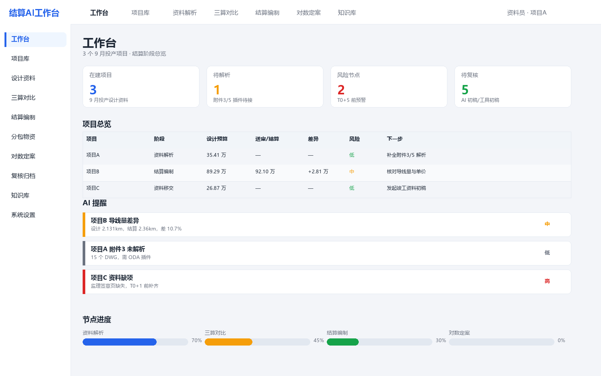
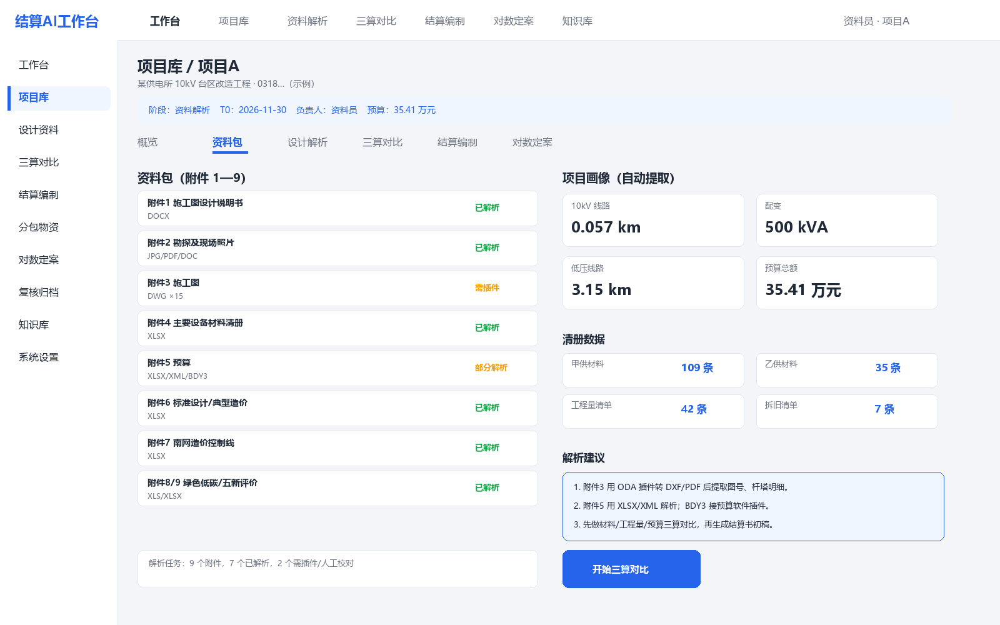
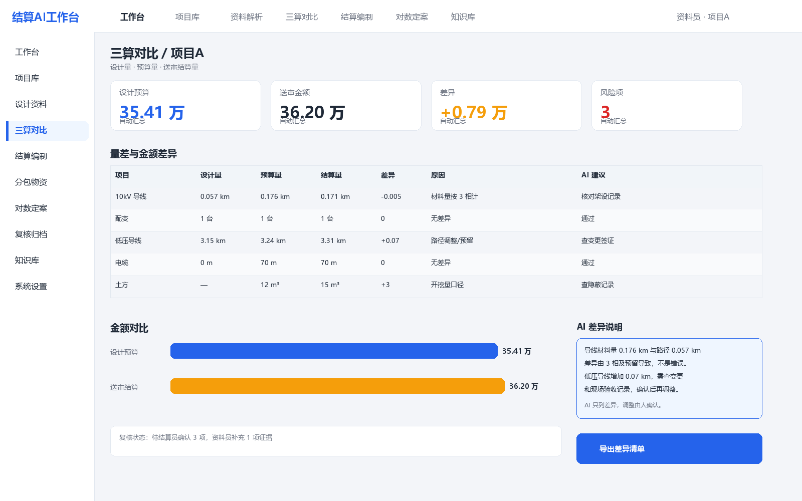
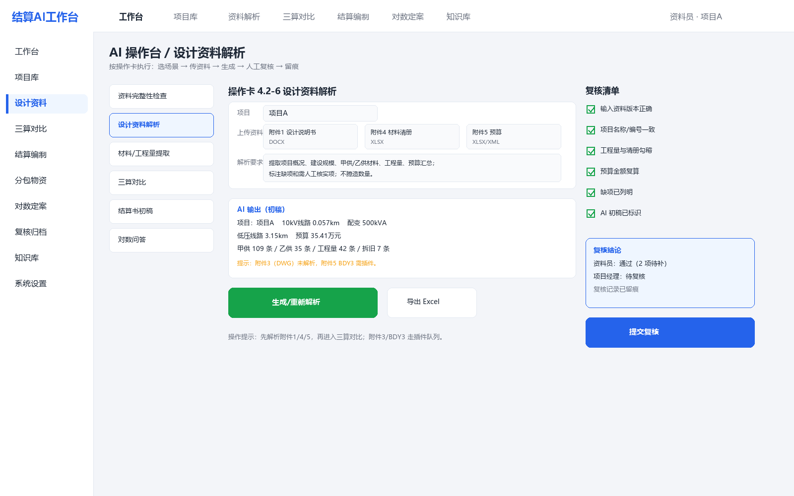

# 配网结算AI工作台建设方案（一期）

（配电网工程）

**编制单位：** 工程部、市场部（结算组）

**版本：** V1.0

**日期：** 2026年11月

**配套文件：** 《结算工作专项方案（V2.1）》《结算工作AI应用方案与操作指引（V3.0）》

## 一、建设背景与目标

### （一）建设背景

9月投产的3个配网项目已完成设计资料收集，资料包包括施工图设计说明书、勘探及现场照片、施工图、主要设备材料清册、预算、标准设计和典型造价应用、南网造价控制线、绿色低碳评价和“五新”应用评价等。资料格式覆盖DOCX、XLSX、XLS、PDF、XML、DWG、BDY3、ZIP和JPG/PNG，共127个文件、271.6MB。

这些资料目前分散在文件夹里，业务人员要打开多个文件才能拼出项目概况、材料量、工程量和预算；结算时还要把设计、预算、现场验收、结算书四套数据手工比对。AI应用指引里的操作卡已经写明“怎么做”，但缺少一个统一入口，下属使用门槛仍然较高。

公司内部已有《工程资料管理（内部使用版）》，具备资料、生成、结算等基础功能。本方案不建议另起一套系统，而是在现有工具之上增加“结算AI工作台”层，把资料解析、三算对比、AI操作卡、复核留痕集中到一个界面。

### （二）建设目标

1. 一个项目库：3个试点项目统一建档，资料包、解析结果、进度和风险一屏可见。
2. 一个解析中心：自动解析DOCX、XLSX、XLS、PDF、XML、ZIP，提取项目画像、材料清册、工程量、预算汇总；DWG、BDY3以插件方式逐步接入。
3. 一个三算对比：设计量、预算量、结算量同表比对，AI标记差异并起草说明。
4. 一个AI操作台：把《结算工作AI应用方案与操作指引（V3.0）》的操作卡搬进平台，按角色和节点推送任务。
5. 一套复核留痕：AI初稿、人工修改、复核签字、版本和日志可追溯。

### （三）建设原则

1. 不重复造系统：优先扩展内部《工程资料管理》，平台只做解析、对比、AI和复核层。
2. 先解析后AI：先把资料变成结构化数据，再让AI做比对、起草和问答，避免“无依据生成”。
3. 人机协同：AI出初稿，业务人员复核签认；AI不签章、不定案、不对外承诺。
4. 数据不出域：项目资料、合同、结算金额只在公司内网或专有云处理。
5. 先试点后推广：3个项目试点，跑通后再复制到其他项目。

## 二、资料基础与解析结论

### （一）资料盘点

3个项目共127个文件、271.6MB。按格式统计如下：

| 格式 | 文件数 | 容量 | 主要用途 | 解析方式 |
| --- | --- | --- | --- | --- |
| PNG | 4 | 126.5MB | 施工图截图、现场图 | 视觉/OCR，二期 |
| JPG | 43 | 58.1MB | 现场勘察照片 | 视觉/OCR，二期 |
| DWG | 15 | 39.9MB | 施工图 | ODA插件，二期 |
| BDY3 | 3 | 21.8MB | 预算原生文件 | 预算软件插件，二期 |
| XLSX | 20 | 15.7MB | 材料清册、预算、评价表 | 内置，一期 |
| XML | 25 | 5.4MB | 预算导出表 | 内置，一期 |
| DOCX | 3 | 1.5MB | 施工图设计说明书 | 内置，一期 |
| ZIP | 3 | 0.6MB | 预算XML打包 | 内置，一期 |
| XLS | 4 | 0.3MB | 绿色低碳等评价表 | 内置，一期 |
| PDF | 1 | 0.2MB | 钻探报告附图 | 内置/OCR，一期 |
| DOC | 1 | 0.2MB | 钻探报告正文 | 转换/OCR，二期 |
| DB | 3 | 0.2MB | 预算辅助数据 | 随预算软件，二期 |

说明：文件名、项目名称、供电所和村镇信息不在本方案中列出，避免内部资料外泄；完整清单保留在项目资料目录和内部报告中。

### （二）已解析内容

1. **附件1施工图设计说明书（DOCX）**：提取项目名称、编码、建设单位、建设性质、建设规模、新建和拆除范围、主要设备选型、地形地质、交叉跨越、机械化施工、安全风险等。设计说明书正文约226至260段，含20个左右的表格。
2. **附件4主要设备材料清册（XLSX）**：含封面、甲供材料、乙供材料、工程量清单、拆旧设备材料清单等6个工作表；单个项目甲供材料81至109条、乙供材料27至37条、工程量清单35至42条、拆旧清单0至10条。
3. **附件5预算（XLSX/XML）**：XLSX含封面、编制说明、施工图预算费用明细表、总算表、安装工程汇总、单位工程表、拆除工程、其他费用、勘察费、建设场地征用等20多个工作表；XML含总算表、分部分项工程量表、甲供/乙供汇总、经济指标表等，可替代或补充BDY3。
4. **附件2勘探及现场照片**：中压线路T接点、新建台架位置、线行通道、低压台区站址、沿墙/沿杆导线等照片，按勘察对象分目录存放。
5. **附件3施工图（DWG）**：10kV部分、0.4kV部分、通用图、附图等；DWG为二进制格式，需要ODA File Converter等插件转DXF/PDF后才能提取图号、图框和杆塔明细。
6. **附件6至9**：标准设计和典型造价应用统计、南网造价控制线、绿色低碳电网建设等级评价、“五新”应用评价，均为XLSX/XLS，可解析。

### （三）项目画像（匿名示例）

| 字段 | 项目A | 项目B | 项目C |
| --- | --- | --- | --- |
| 项目类型 | 台区改造 | 业扩配套 | 业扩配套 |
| 10kV线路 | 0.057km | 2.131km | 0.077km |
| 配变 | 500kVA | 200kVA | 500kVA |
| 低压线路 | 3.15km | 3.108km | 0.060km |
| 拆除内容 | 低压导线2.5km、水泥杆3根 | 无 | 无 |
| 预算总额 | 35.41万元 | 89.29万元 | 26.87万元 |
| 设备购置费 | 11.15万元 | 7.72万元 | 11.38万元 |
| 安装工程费 | 19.74万元 | 69.36万元 | 12.39万元 |
| 其他费用 | 4.27万元 | 12.21万元 | 3.09万元 |
| 甲供/乙供 | 109/35条 | 109/37条 | 81/27条 |
| 工程量清单 | 42条 | 41条 | 35条 |

### （四）解析结论

1. 设计资料包的结构稳定，附件1、附件4、附件5是项目画像、材料量、工程量和预算的主要来源，一期可完全解析。
2. 材料清册和预算的数量口径不完全一致，例如10kV导线材料量按三相计，约为路径长的3倍；平台必须内置“相数、预留、损耗、拆旧与新建分开”等规则，不能把正常差异判为错误。
3. DWG和BDY3是插件缺口，但不影响一期三算对比：预算可用XLSX/XML，施工图可先用PDF/截图或人工挂接；二期再接ODA和预算软件插件。
4. 3个项目的资料量适中，适合作为一期试点；平台应支持批量导入、解析状态和人工校对。

## 三、用户与角色

| 角色 | 主要任务 | 平台权限 |
| --- | --- | --- |
| 资料员、验收小组 | 上传资料、解析校对、资料完整性检查、竣工资料初稿、签证跟踪 | 项目资料编辑、解析、AI操作、提交复核 |
| 结算员 | 三算对比、结算书初稿、分包结算、业主送审、对数问答 | 结算数据编辑、AI操作、提交复核、导出 |
| 物资员 | 物资对账、拆旧退库、调拨单据核对 | 物资数据编辑、对账、提交复核 |
| 项目经理 | 现场验收、工程量确认、资料复核 | 项目只读、复核、审批 |
| 市场部负责人 | 结算书审定、对外口径、对数决策 | 部门项目只读、审定、导出 |
| 信息管理员 | 账号、权限、解析插件、模型、日志 | 系统管理、插件配置、审计 |
| 公司领导 | 看进度、风险、金额 | 只读看板 |

## 四、平台功能架构

| 模块 | 主要功能 | 主要用户 | 对应操作卡 |
| --- | --- | --- | --- |
| 工作台 | 项目总览、节点进度、风险提醒、待复核 | 全部 | 4.5-2 |
| 项目库 | 项目建档、阶段、负责人、项目画像 | 资料员、项目经理 | 4.2-6 |
| 资料包 | 附件1至9上传、解析状态、缺项检查、版本 | 资料员 | 4.2-1、4.2-6 |
| 设计解析 | 项目概况、建设规模、材料清册、工程量、预算 | 资料员、结算员 | 4.2-6、4.2-7 |
| 三算对比 | 设计量、预算量、结算量比对、差异说明 | 结算员 | 4.3-5 |
| 结算编制 | 结算书初稿、分包结算、甲供材扣回 | 结算员 | 4.3-1、4.3-2 |
| 分包物资 | 分包比对、物资对账、拆旧退库、调拨 | 结算员、物资员 | 4.3-2、4.4-1 |
| 对数定案 | 问题清单、依据检索、回复初稿、争议销项 | 结算员 | 4.3-4、4.3-6 |
| 复核归档 | 复核清单、签字、版本、归档、审计日志 | 复核员、负责人 | 4.5-1 |
| AI操作台 | 操作卡、提示词、上传、AI输出、留痕 | 全部 | 第四章 |
| 知识库 | 合同、定额、模板、历史案例、问答 | 全部 | 场景7 |
| 系统管理 | 用户、角色、插件、模型、日志 | 信息管理员 | 六（五） |

### （一）与现有系统的关系

建议把平台做成内部《工程资料管理》的扩展模块，而不是另建一套：

1. 资料上传、生成、存储继续用现有工具，平台通过接口或共享目录读取。
2. 平台新增“解析结果、项目画像、三算对比、AI操作台、复核留痕”五类数据。
3. 现有工具的“结算”模块继续做计价，平台负责前置的资料解析和差异说明。
4. 飞书作为消息和审批入口，平台通过飞书机器人推送日报、预警和待复核。

如果现有工具无法扩展，再考虑独立部署；一期不建议重建资料管理功能。

## 五、核心业务流程

1. **建项目**：资料员在项目库建项目，填项目编码、名称、阶段、负责人，上传附件1至9。
2. **解析**：平台自动解析DOCX、XLSX、XLS、PDF、XML、ZIP，生成项目画像、材料清册、工程量、预算汇总；DWG/BDY3进入插件队列。
3. **校对**：资料员按操作卡4.2-6、4.2-7逐项核对，确认后锁定“设计/预算”基准。
4. **三算对比**：结算员按操作卡4.3-5生成差异表，AI起草差异说明，人工确认。
5. **编制与复核**：按操作卡4.3-1至4.3-4编制结算书、分包结算、送审资料包；复核员按4.5-1签字。
6. **对数与归档**：按操作卡4.3-4、4.3-6准备对数问答，定案后归档，AI使用记录留存。

## 六、数据架构与解析插件

### （一）核心数据实体

| 实体 | 关键字段 | 说明 |
| --- | --- | --- |
| Project | 项目编码、名称、类型、阶段、负责人、T0 | 项目主数据 |
| Document | 文件名、格式、版本、大小、解析状态、哈希 | 资料包文件 |
| ParseJob | 任务类型、插件、开始/结束、结果、错误 | 解析任务 |
| ProjectProfile | 规模、配变、线路、拆除、预算、参建单位 | 项目画像 |
| MaterialItem | 物资编码、名称、规格、单位、数量、甲供/乙供 | 材料清册 |
| BOQItem | 清单编码、名称、单位、数量、部位 | 工程量清单 |
| BudgetItem | 费用编码、名称、单位、数量、单价、合价 | 预算 |
| SettlementItem | 结算项目、工程量、单价、金额、依据 | 结算书 |
| CompareResult | 设计量、预算量、结算量、差异、原因、依据 | 三算对比 |
| Task | 节点、责任人、期限、状态 | 进度任务 |
| AIOutput | 场景、输入、提示词、模型版本、输出、复核人 | AI留痕 |
| Review | 复核项、结论、签字、时间 | 复核记录 |
| User | 姓名、角色、项目权限 | 用户与权限 |

### （二）解析插件矩阵

| 格式 | 解析方式 | 输出 | 插件或工具 | 优先级 |
| --- | --- | --- | --- | --- |
| DOCX | python-docx或文档解析 | 项目概况、规模、表格 | 内置 | 一期 |
| XLSX/XLS | openpyxl、xlrd | 甲供、乙供、工程量、预算 | 内置 | 一期 |
| PDF | PyMuPDF、pdfplumber、OCR | 文本、表格、图号 | 内置加OCR | 一期 |
| XML | lxml | 总算表、分部分项、甲供/乙供 | 内置 | 一期 |
| ZIP | zipfile | 预算XML、PDF、Excel | 内置 | 一期 |
| DWG | ODA File Converter转DXF/PDF | 图号、图框、杆塔明细 | ODA插件 | 二期 |
| BDY3 | 预算软件插件或导出 | 预算明细、清单 | 厂商插件 | 二期 |
| DOC | 格式转换或OCR | 报告正文 | 转换插件 | 二期 |
| JPG/PNG | 视觉模型、OCR | 照片分类、水印、缺拍 | 视觉/OCR | 二期 |

### （三）数据标准

1. 项目编码统一采用投资计划/合同编码；项目名称统一采用设计说明书封面名称。
2. 材料编码优先采用甲供材料清单的物资编码；无编码的乙供材料用“名称+规格+单位”生成临时主键。
3. 单位统一为千米、米、吨、千克、台、套、块、根；解析时保留原单位和换算值。
4. 版本号写入文件名和数据库；解析结果带来源文件、页码/工作表、行号，便于回溯。
5. 金额保留两位小数；数量按原表精度，换算后标注。

## 七、界面原型

### （一）工作台

*图1 工作台：项目总览、待办、风险提醒和节点进度*

工作台是下属每天打开的第一个页面：看到自己负责的项目、当前阶段、待解析、待复核、风险节点和AI提醒。点击项目进入详情；点击提醒进入对应操作卡。

### （二）项目详情与资料包

*图2 项目详情：附件1至9的解析状态、项目画像和清册数据*

左侧是资料包清单，右侧是自动提取的项目画像和清册数据。解析状态分“已解析、部分解析、需插件、缺失”；点击任一项可查看来源文件、页码/工作表和人工校对结果。

### （三）三算对比

*图3 三算对比：设计量、预算量、结算量差异和AI说明*

三算对比是结算员的核心页面：上方是预算、送审、差异和风险；中间是量差与金额差异表；右侧是AI差异说明；下方是复核状态和导出按钮。AI只列差异，调整由人确认。

### （四）AI操作台

*图4 AI操作台：选场景、传资料、生成、人工复核、留痕*

AI操作台把操作卡变成可点击的流程：左侧选场景（资料检查、设计解析、材料/工程量提取、三算对比、结算书初稿、对数问答），中间上传资料并生成，右侧按复核清单逐项打勾。生成结果标注“AI初稿”，复核后进入正式流程。

## 八、技术架构与部署

### （一）总体架构

1. **前端**：Web端响应式页面，兼容飞书H5；后期可加飞书小程序。
2. **后端**：Python FastAPI或Node服务，提供项目、文档、解析、对比、复核、AI接口。
3. **数据库**：PostgreSQL存项目、文档、解析结果、对比、任务、复核；对象存储放原始文件和解析产物。
4. **解析队列**：Celery/RQ异步任务，按格式调用插件；失败重试和状态回写。
5. **AI层**：公司私有化大模型或专有云；RAG知识库；OCR；视觉模型；提示词模板和审计日志。
6. **集成**：飞书SSO、飞书机器人、内部《工程资料管理》、预算软件、供电局系统（按授权）。

### （二）部署方式

1. 部署在公司内网服务器或专有云，项目资料不出内网。
2. 与内部《工程资料管理》同域或通过内网API对接，避免重复上传。
3. 文件存储使用公司对象存储或加密磁盘；数据库每日备份。
4. 飞书作为移动入口，推送日报、预警、待复核和审批。

### （三）安全设计

1. 项目级权限：用户只能看自己参与的项目；部门负责人看本部门；公司领导看汇总。
2. 数据分级：公开、内部、敏感；敏感资料只在私有化环境处理。
3. 日志审计：登录、查看、下载、解析、AI调用、复核、导出全程留痕。
4. 数据脱敏：人员姓名、电话、身份证号、银行账号不进入AI提示词。
5. 禁止公网：不使用公网免费AI工具处理项目资料；供应商签署保密协议。

## 九、实施计划与MVP

### （一）MVP范围

一期只做“能跑通3个项目”的最小闭环：

1. 项目库、资料包上传、解析状态。
2. DOCX、XLSX、XLS、PDF、XML、ZIP解析；项目画像、材料清册、工程量、预算汇总。
3. 三算对比表、差异说明、导出Excel。
4. AI操作台：资料完整性检查、设计资料解析、材料/工程量提取、三算对比4张卡。
5. 复核清单、AI使用台账、项目权限、审计日志。
6. 飞书机器人推送日报和待复核。

DWG、BDY3、照片视觉、结算书自动生成、供电局系统对接放二期。

### （二）分期计划

| 阶段 | 时间 | 工作内容 | 交付物 | 责任 |
| --- | --- | --- | --- | --- |
| 一期 | 4周 | 项目库、资料包、DOCX/XLSX/PDF/XML解析、项目画像、三算对比、AI操作台、复核留痕 | 可试用MVP、3个项目数据 | 产品、后端、前端、解析、AI |
| 二期 | 4周 | DWG/BDY3插件、照片视觉、结算书初稿、分包/物资、飞书审批 | 二期版本、插件说明 | 开发、信息管理员、业务 |
| 三期 | 按需 | 供电局系统/财务/物资系统对接、移动端、数据分析 | 集成版本、运行报告 | 信息、业务、供应商 |

### （三）试点安排

1. 试点项目：9月投产的3个项目，项目A/B/C。
2. 试点用户：资料员、结算员、物资员、项目经理、市场部负责人各1至2人。
3. 试点周期：一期上线后连续运行2周，记录使用率、解析准确率、节省工时和问题。
4. 试点结束：形成评估报告，决定是否推广到其他项目。

### （四）团队与资源

1. 业务负责人：工程部、市场部各1人，负责需求、数据和验收。
2. 产品/项目负责人：1人，负责范围、计划、协调。
3. 开发：后端1至2人、前端1人、解析/数据1人、AI1人、测试1人。
4. 信息管理员：账号、权限、部署、插件、安全。
5. 外部资源：DWG/BDY3插件供应商、私有化模型供应商按需。

## 十、验收指标与效益

| 指标 | 目标 | 数据来源 |
| --- | --- | --- |
| 资料解析覆盖率 | 可解析格式不低于95% | 解析任务记录 |
| 项目画像字段准确率 | 人工校对后不低于95% | 抽查记录 |
| 材料/工程量提取准确率 | 不低于95% | 与原件比对 |
| 三算差异清单覆盖率 | 100% | 对比表 |
| 结算书初稿时间 | 缩短30%以上 | 工时记录 |
| 日报/预警及时率 | 100% | 飞书推送记录 |
| 用户使用率 | 试点用户不低于80% | 登录/操作日志 |
| 数据安全事件 | 0 | 审计日志 |

## 十一、风险与应对

| 序号 | 风险 | 影响 | 应对 |
| --- | --- | --- | --- |
| 1 | 资料格式不统一 | 解析失败或字段缺失 | 建模板和校验规则；失败转人工；插件补齐 |
| 2 | DWG/BDY3插件缺失 | 图纸/预算不能自动解析 | 一期用PDF/XLSX/XML替代；二期接ODA/预算软件 |
| 3 | 数据口径错误 | 三算对比误判 | 内置相数、预留、损耗、拆旧规则；人工复核 |
| 4 | 敏感数据外泄 | 合规风险 | 私有化部署、项目权限、脱敏、日志 |
| 5 | 业务人员不用 | 平台空转 | 操作卡嵌入流程；培训；试点示范；减负不减责 |
| 6 | 与现有系统重复 | 重复录入、抵触 | 优先扩展内部工具；接口/共享目录；不重复建资料库 |
| 7 | 解析准确率不达标 | 返工 | 先人工校对后锁定；错误台账；模板迭代 |
| 8 | 需求扩大 | 工期失控 | 一期锁定MVP；其他需求进二期清单 |

## 十二、结论与待确认事项

### （一）结论

1. 3个9月投产项目的设计资料结构稳定，一期解析DOCX、XLSX、XLS、PDF、XML、ZIP即可支撑项目画像、材料/工程量提取和三算对比。
2. 建议在内部《工程资料管理》基础上扩展“结算AI工作台”，不另建一套资料管理系统。
3. 一期按“项目库+资料包解析+三算对比+AI操作台+复核留痕”做MVP，3个项目试点，4周可上线试用。
4. DWG、BDY3、照片视觉、结算书自动生成、系统对接放二期，避免一期范围过大。

### （二）待确认事项

1. 平台一期是否按本方案MVP范围开发。
2. 是否同意在现有《工程资料管理》上扩展，而不是新建独立系统。
3. 一期试点是否使用这3个项目，试点用户和业务负责人是否确定。
4. 部署位置、账号体系、飞书集成和预算软件插件由哪个部门牵头。
