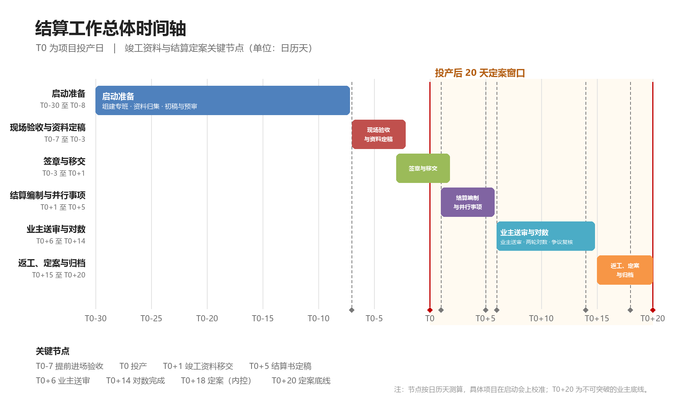

# 结算工作专项方案

（配电网工程）

**编制单位：** 工程部、市场部（结算组）

**版本：** V2.1

**日期：** 2026年11月

**配套文件：** 《结算工作AI应用方案与操作指引》

## 一、总则

### （一）编制目的

为落实业主关于“项目投产之日起20天内完成结算定案”的要求，解决竣工资料编制慢、签章流转时间长、结算编制与送审对数衔接不紧等问题，明确工程部、市场部（结算组）、物资组的职责边界、交接标准和节点时限，实现竣工资料一次成型、结算书一次送审、对数一次到位，特制定本方案。

### （二）适用范围

本方案适用于公司承接的10kV及以下配电网工程，包括10kV线路、低压线路、电力电缆、配变及配套设备、土建配套等。其他类型工程可参照执行。

### （三）编制依据

1. 工程施工合同、招标文件、投标文件及补充协议；
2. 施工图设计文件、设计变更通知单、图纸会审纪要；
3. 现行配电网工程计价规范、预算定额、费用标准及地方有关规定；
4. 业主（供电局）关于工程竣工资料编制、移交和结算管理的有关规定；
5. 公司工程管理、结算管理、物资管理制度；
6. 业主下达的项目投产计划及节点考核要求。

### （四）工作原则

1. **资料先行、过程同步。** 过程资料随施工进度同步形成、同步审核、同步归档，不等到完工后集中补做。
2. **现场确认、一次成型。** 工程量以现场实测和影像资料为依据，验收时一次性确认，减少后续争议和返工。
3. **并行推进、节点倒排。** 以投产日T0为基准倒排节点，签证、结算、分包、物资、对数等工作最大限度并行。
4. **清单移交、责任到人。** 各环节以清单为交接依据，逐项清点、双方签字，谁移交谁负责、谁接收谁复核。
5. **限期办结、闭环销项。** 每个节点明确责任人和完成时限，问题清单逐项销项，逾期升级处理。
6. **内控提前、留有余量。** 内控目标为投产后第18天完成定案，预留2天纠偏缓冲，确保第20天底线不突破。

## 二、目标与时间基准

### （一）总体目标

1. 投产后第18天（T0+18）完成结算定案，第20天（T0+20）为业主底线；
2. 竣工资料在T0+1完成移交，一次移交合格率不低于95%，缺项按清单限期补齐；
3. 送审结算书在T0+5定稿，T0+6送业主；
4. 分包结算在T0+5前完成确认；
5. 拆旧、余料退库在T0+5前完成，供电局系统物资调拨在T0+6前完成；
6. 与第三方审核中介对数在T0+14前完成，资料返工在T0+16前闭环。

### （二）时间基准

1. **T0：** 项目投产日，以业主或调度正式下达的投产日期为准。
2. **T-n / T+n：** 投产前第n天、投产后第n天，均按日历天计算，含周末和法定节假日。
3. 涉及供电所、监理、设计、业主签章及第三方中介对数的环节，如遇节假日，应提前预约、线上办理或安排专人值班，确保节点不突破。
4. 投产日期调整的，以业主正式通知为准，本方案节点整体平移，“投产至定案不超过20天”的总要求不变。
5. 本方案所称“T0+n前”，均指不晚于T0+n当日完成。

### （三）编制说明

本方案节点天数按常规配电网项目的实际工作量测算，作为项目启动时的基准计划。具体项目在启动会上根据项目规模、现场条件、业主流程和中介要求校准，但T0+20定案底线不变。若投产计划下达较晚、准备期不足30天，至少保证T0-7进场验收、T0-3资料定稿、T0+1资料移交三个底线节点，并在启动会上据此重排准备阶段工作。

本方案为V2.1版。V2.0在V1.0基础上作了以下优化：一是增加AI辅助应用，把资料预审、结算书初稿、对数检索、日报预警等重复性工作交给AI处理，人工负责判断和签认；二是签证组织改为“集中会签+分头跟签”，有条件时组织四家单位集中会签；三是增加资料“一次告知、一次补正”、分包与业主结算同源、物资数据联动、对数分组并行等措施；四是明确优化释放的时间优先用于复核和缓冲，不改变T0+18内控、T0+20底线的对外承诺。AI应用的具体操作见配套的《结算工作AI应用方案与操作指引》。V2.1在V2.0基础上增加了工程资料管理（内部使用版）辅助编制竣工资料初稿的操作要求（详见第六章第八节），并明确了AI应用的主责与配合（详见第十二章第三节）。

### （四）优化措施

| 序号 | 优化措施 | 原做法 | 优化后做法 | 预期效果 | 落实节点 |
| --- | --- | --- | --- | --- | --- |
| 1 | AI辅助资料预审 | 人工逐项翻资料、到移交时才发现缺项 | OCR识别、结构化台账、AI对照清单预检，人工复核确认 | 资料检查由1至2天压缩到0.5天，缺项提前到T0-15发现 | P5、M1 |
| 2 | 签证集中会签 | 验收小组分头跑四家单位，来回等签 | T0-3组织供电所、监理、设计、业主集中会签；不具备条件的，集中会签与分头跟签并行 | 签章周期由5天压缩到3至4天 | S1至S4 |
| 3 | 资料一次告知 | 资料被退回后反复补正 | 市场部预审一次性出具补正清单，工程部一次补齐；补正清单模板化 | 减少来回退件2至3次 | P5、P6、M1 |
| 4 | 分包与业主结算同源 | 分包结算与业主结算各算一套量 | 分包与业主结算统一以《现场验收工程量确认表》为工程量基准，同步编制、交叉核对 | 减少重复核对和超结漏结 | M2、M3 |
| 5 | 物资数据联动 | 材料清册、领退料、拆旧、调拨各自为战 | 材料实用量清册与领退料、拆旧、退库、调拨同表核对，物资组T0+2前提供数据 | 物资差异提前暴露，支撑结算书编制 | M4、M5 |
| 6 | 对数分组并行 | 全部问题集中对数，容易排队 | 分工程量组、计价组、资料组同时对数；争议清单T0+8前预判 | 两轮对数压缩到7天内完成 | A3、A4 |
| 7 | 返工不过夜 | 资料问题积累到后期集中处理 | 一般问题24小时、复杂问题48小时闭环；T0+15至T0+16集中返工窗口 | 返工不挤占对数时间 | F1 |
| 8 | AI辅助日报预警 | 人工汇总进度，信息滞后 | 任务台账自动生成日报初稿，逾期节点自动标红，人工确认后报送 | 日报由30分钟压缩到5分钟，预警更及时 | 全过程 |

## 三、组织架构与职责分工

### （一）结算工作领导小组

组长由公司分管经营（或生产）领导担任，副组长由工程部负责人、市场部负责人担任，成员包括物资组负责人、财务负责人、项目经理和结算组组长。

主要职责：审定结算工作计划；协调跨部门资源和外部关系；决策重大争议和赶工措施；考核节点完成情况；对影响定案的重大问题向业主沟通汇报。

### （二）工程部验收小组

工程部牵头成立验收小组，组长由工程部负责人担任，副组长由项目经理担任，成员包括技术员、资料员、测量员（不少于2人）、无人机飞手（或影像员）、签证专员和物资员。市场部结算组派员参加。

主要职责：工程过程资料编制收集；组织现场验收和工程量确认；修改竣工图纸、编制材料实用量清册；完成供电所、监理、设计、业主签章；按清单向市场部移交竣工资料；限期完成资料返工。

### （三）市场部结算组

组长由市场部负责人担任，副组长由结算组组长担任。设项目主结算员1人、复核员1人、分包结算员1人、送审对数员1人。

主要职责：提前介入资料预审和计价交底；对照移交资料编制送审结算书；组织分包结算并限期确认；向物资组移交拆旧、余料资料；向业主送审；牵头与第三方审核中介对数；完成定案和归档。

### （四）物资组

组长由物资组负责人担任，成员包括材料员、仓储员和系统操作员。

主要职责：接收拆旧、余料及领退料资料；组织拆旧物资回收、分类和余料退库；完成供电局系统物资调拨及账务处理；向市场部结算组反馈物资结算数据。

### （五）外部协同

供电所配合现场验收、工程量确认和签章；监理审核竣工资料、确认工程量并签章；设计确认竣工图与设计变更一致性并签章；业主下达投产计划、组织送审、签收资料、组织定案；第三方审核中介受理送审、开展审核、参加对数、出具审核意见。

### （六）职责分工表

| 序号 | 工作事项 | 工程部 | 市场部结算组 | 物资组 | 领导小组 |
| --- | --- | --- | --- | --- | --- |
| 1 | 验收小组成立与启动会 | 主责 | 配合 | 配合 | 督办 |
| 2 | 过程资料编制收集 | 主责 | 提出要求 | — | 督办 |
| 3 | 现场验收与工程量确认 | 主责 | 参加 | — | — |
| 4 | 竣工图与材料实用量清册 | 主责 | 复核 | 提供领退料数据 | — |
| 5 | 资料签证 | 主责 | 配合 | — | 协调 |
| 6 | 竣工资料移交 | 主责 | 接收 | — | 监督 |
| 7 | 送审结算书编制 | 配合 | 主责 | — | 审定 |
| 8 | 分包结算 | 配合 | 主责 | — | 审定 |
| 9 | 拆旧、余料退库及系统调拨 | 配合 | 资料移交 | 主责 | 协调 |
| 10 | 业主送审与对数 | 配合 | 主责 | 配合 | 协调 |
| 11 | 资料返工 | 主责 | 提出 | — | 督办 |
| 12 | 定案与归档 | 配合 | 主责 | 配合 | 决策 |

## 四、工作流程

### （一）流程总览

本方案将结算工作划分为六个阶段：

1. **启动准备阶段（T0-30至T0-8）：** 组建专班、过程资料归集、竣工图和清册初稿、资料预审；
2. **现场验收与资料定稿阶段（T0-7至T0-3）：** 提前7天进场，无人机、测距仪、滚轮测距仪实测，工程量现场签认，竣工图和清册定稿；
3. **签章与移交阶段（T0-3至T0+1）：** 完成供电所、监理、设计、业主签章，按清单移交市场部结算组；
4. **结算编制与并行事项阶段（T0+1至T0+5）：** 送审结算书编制、分包结算确认、拆旧退库和系统调拨；
5. **业主送审与对数阶段（T0+6至T0+14）：** 移交业主送审，与第三方审核中介开展两轮对数；
6. **返工、定案与归档阶段（T0+15至T0+20）：** 资料返工闭环、定案签章、归档和复盘。

### （二）启动准备阶段（T0-30至T0-8）

项目基本完工、投产计划明确后，工程部在T0-30前成立验收小组，市场部结算组、物资组同步指定接口人，召开结算启动会，宣贯20天定案要求和本方案节点。

过程资料从开工起即按《竣工资料移交清单》目录归集，重点包括施工记录、隐蔽工程验收记录及影像、材料设备合格证和试验报告、设计变更、工程签证、停电和跨越手续等。T0-20锁定投产计划，向业主、监理报送验收计划，完成无人机空域报备和测量仪器检定校准。

T0-15完成竣工图、材料实用量清册和工程量计算书初稿，市场部结算组同步预审资料完整性并交底计价口径、甲供材扣回口径。T0-11至T0-9完成资料补正，形成拆旧、余料清单初稿。T0-8完成内部预验收，确认现场条件、测量路线和影像计划。

### （三）现场验收与资料定稿阶段（T0-7至T0-3）

T0-7验收小组进场，召开现场验收交底会，邀请供电所、监理、设计、业主代表参加，确认验收范围、计量口径和签认方式。

10kV线路采用无人机航拍，全线正射影像，重点拍摄杆塔、导线、开关、配变、交叉跨越和跨越架；低压线路采用测距仪逐档测量；电力电缆采用滚轮测距仪沿敷设路径实测；重点设备、跨越架和隐蔽工程逐处拍照，影像带时间、地点和桩号水印。T0-5形成《现场验收工程量确认表》，请供电所、监理、业主现场代表签认。

T0-5至T0-3，工程部根据实测结果修改竣工图、修订材料实用量清册、定稿工程量计算书，市场部结算组同步复核。T0-3完成资料装订和《竣工资料移交清单》填写，按签章单位分册。

### （四）签章与移交阶段（T0-3至T0+1）

验收小组安排签证专员按供电所、监理、设计、业主的顺序跑签。T0-3具备条件的，组织四家单位集中会签；不具备条件的，集中会签与分头跟签并行。签章资料按单位分册、目录清晰，签章问题当日记录、次日跟办；如业主有既定流转顺序，按业主规定执行。

T0+1，工程部按《竣工资料移交清单》向市场部结算组正式移交，逐项清点、双方签字，纸质和电子版同步移交。签章未全部闭环的，先移交已签部分并附未签清单，T0+3前补齐；未签清单作为移交清单附件，由签证专员跟踪销项。

### （五）结算编制与并行事项阶段（T0+1至T0+5）

市场部结算组T0+1完成资料复核，问题清单当日反馈工程部，工程部T0+2前补齐。结算组对照移交资料编制送审结算书，覆盖工程量、计价、取费、甲供材扣回、设计变更和现场签证，实行编制、复核、部门负责人三级审核，T0+4完成初稿，T0+5定稿。

T0+2，市场部向分包商发出分包结算书，限期T0+5前书面确认；同步向物资组移交拆旧、余料和领退料资料。物资组T0+5前完成拆旧回收、分类和余料退库，T0+6前完成供电局系统物资调拨及账务处理。

### （六）业主送审与对数阶段（T0+6至T0+14）

T0+6，市场部将送审结算书和竣工资料一并移交业主送审，同步报监理；需在业主或供电局系统上报的，当日完成。T0+6至T0+7配合业主和中介预审，资料补正由工程部T0+7前完成。

T0+8至T0+11开展第一轮对数，按工程量、单价、取费、变更签证分项核对；T0+12至T0+13开展第二轮对数，争议项逐条复核，需现场复核或补充资料的，工程部T0+13前完成。T0+14对数完成，三方确认结算金额，出具对数纪要。

### （七）返工、定案与归档阶段（T0+15至T0+20）

对数期间发现的资料问题，市场部随时开具《资料返工通知单》，工程部一般问题24小时内、复杂问题48小时内闭环。T0+15至T0+16为集中返工窗口，市场部同步调整结算书。

T0+17完成结算书终稿和业主、中介复核；T0+18完成定案表签章，实现内控目标；T0+19至T0+20完成定案资料归档、分发，衔接发票和收款，开展复盘总结。T0+20为业主底线，不得突破。

## 五、时间节点管控

### （一）总体时间安排

| 阶段 | 时间 | 工期 | 主要工作 | 关门节点 |
| --- | --- | --- | --- | --- |
| 启动准备 | T0-30至T0-8 | 23天 | 组建专班、资料归集、初稿编制、资料预审 | T0-8内部预验收 |
| 现场验收与资料定稿 | T0-7至T0-3 | 5天 | 现场实测、工程量签认、竣工图和清册定稿 | T0-3资料定稿 |
| 签章与移交 | T0-3至T0+1 | 5天 | 供电所、监理、设计、业主签章，资料移交 | T0+1资料移交 |
| 结算编制与并行事项 | T0+1至T0+5 | 5天 | 送审结算书、分包结算、拆旧退库、系统调拨 | T0+5结算书定稿 |
| 业主送审与对数 | T0+6至T0+14 | 9天 | 业主送审、两轮对数、争议复核 | T0+14对数完成 |
| 返工、定案与归档 | T0+15至T0+20 | 6天 | 资料返工、定案签章、归档复盘 | T0+18定案，T0+20底线 |

*图1 结算工作总体时间轴（T0为投产日）*

### （二）详细节点计划

| 节点 | 时间 | 工期 | 工作内容与交付物 | 责任 | 紧前 |
| --- | --- | --- | --- | --- | --- |
| P1 | T0-30 | 1天 | 成立验收小组和结算专班，明确责任人和接口人，召开启动会；交付：小组名单、联络单、会议纪要 | 工程部（市场部、物资组参加） | — |
| P2 | T0-30至T0-8 | 随施工 | 过程资料同步收集，按移交清单目录归集，隐蔽工程覆盖前完成影像和验收记录；交付：资料台账、影像库 | 工程部 | 施工进度 |
| P3 | T0-20 | 1天 | 锁定投产计划，向业主、监理报送验收计划，无人机空域报备，仪器检定校准，确认停电和跨越安排；交付：投产计划确认单、验收计划、校准记录 | 工程部 | P1 |
| P4 | T0-15 | 1天 | 完成竣工图初稿、材料实用量清册初稿、工程量计算书初稿；交付：三份初稿 | 工程部 | P2 |
| P5 | T0-15 | 1天 | 市场部预审资料完整性（AI预检+人工复核），出具补正清单，交底计价口径和甲供材扣回口径；交付：预审意见、交底记录 | 市场部 | P4 |
| P6 | T0-11至T0-9 | 3天 | 完成资料补正，核对分包结算基础数据，形成拆旧、余料清单初稿；交付：补正闭环表、清单初稿 | 工程部、市场部、物资组 | P5 |
| P7 | T0-8 | 1天 | 验收小组内部预验收，确认现场条件、测量路线和影像计划，形成验收工作方案；交付：验收工作方案 | 工程部 | P6 |
| V1 | T0-7 | 1天 | 进场召开现场验收交底会，供电所、监理、设计、业主代表参加，确认验收范围、计量口径和签认方式；交付：交底会签到表、范围确认单 | 验收小组 | P7 |
| V2 | T0-7至T0-6 | 2天 | 10kV线路无人机航拍，全线正射影像，重点拍摄杆塔、导线、开关、配变、交叉跨越和跨越架；交付：航拍成果、影像目录 | 测量员、影像员 | V1 |
| V3 | T0-6至T0-5 | 2天 | 低压线路测距仪逐档测量，电力电缆滚轮测距仪沿路径实测，重点设备、跨越架和隐蔽工程拍照；交付：测量记录、照片 | 测量员 | V1 |
| V4 | T0-5 | 1天 | 汇总实测数据，形成《现场验收工程量确认表》，请供电所、监理、业主现场代表签认；交付：签认表 | 验收小组 | V2、V3 |
| V5 | T0-5至T0-3 | 3天 | 修改竣工图，修订材料实用量清册，定稿工程量计算书（AI/规则核对三量差异），市场部同步复核；交付：竣工图、清册、计算书 | 工程部（市场部复核） | V4 |
| V6 | T0-3 | 1天 | 竣工资料装订成册（正本、副本），按签章单位分册，填写《竣工资料移交清单》；交付：成册资料、移交清单 | 工程部 | V5 |
| S1 | T0-3 | 1天 | 供电所签章；交付：签章页 | 签证专员 | V6 |
| S2 | T0-2 | 1天 | 监理签章；交付：签章页 | 签证专员 | S1 |
| S3 | T0-1 | 1天 | 设计签章，确认竣工图与设计变更一致；交付：签章页 | 签证专员 | S2 |
| S4 | T0-1至T0 | 2天 | 业主签章，完成工程、物资、财务等会签，未闭环问题列清单跟踪；交付：签章页、问题清单 | 签证专员、市场部 | S3 |
| S5 | T0+1 | 1天 | 按《竣工资料移交清单》向市场部结算组正式移交，逐项清点、双方签字，电子版同步；交付：移交清单（双方签字） | 工程部、市场部 | S4 |
| M1 | T0+1 | 1天 | 结算组复核移交资料，问题清单当日反馈，工程部T0+2前补齐；交付：复核记录、问题清单 | 市场部、工程部 | S5 |
| M2 | T0+1至T0+4 | 4天 | 编制送审结算书（AI初稿+规则校验），覆盖工程量、计价、取费、甲供材扣回、变更签证，完成三级复核；交付：结算书初稿 | 市场部 | S5（提前介入） |
| M3 | T0+2至T0+5 | 4天 | 分包结算书发分包商，限期T0+5前书面确认，同步核对工程量（AI比对各分包工程量）；交付：送达记录、确认单 | 市场部 | M1 |
| M4 | T0+2至T0+5 | 4天 | 市场部向物资组移交拆旧、余料、领退料资料，物资组完成拆旧回收、分类和余料退库（AI/规则对账）；交付：拆旧单、退库单 | 市场部、物资组 | M1 |
| M5 | T0+3至T0+6 | 4天 | 完成供电局系统物资调拨、审批跟踪和账务处理；交付：调拨单、系统记录 | 物资组 | M4 |
| M6 | T0+5 | 1天 | 送审结算书内部审核、定稿，分包结算确认闭环；交付：结算书定稿、审核记录 | 市场部 | M2、M3 |
| A1 | T0+6 | 1天 | 结算书和竣工资料移交业主送审，同步报监理，需系统上报的当日完成；交付：业主签收单 | 市场部 | M6、M5 |
| A2 | T0+6至T0+7 | 2天 | 配合业主、中介预审，完成资料补正；交付：补正记录 | 工程部、市场部 | A1 |
| A3 | T0+8至T0+11 | 4天 | 第一轮对数，工程量、单价、取费、变更签证逐项核对（AI检索证据、生成问答初稿）；交付：第一轮对数记录 | 市场部（工程部参加） | A2 |
| A4 | T0+12至T0+13 | 2天 | 第二轮对数，争议项复核（AI汇总争议、跟踪销项），需现场复核或补充资料的T0+13前完成；交付：复核记录、补充资料 | 市场部、工程部 | A3 |
| A5 | T0+14 | 1天 | 对数完成，三方确认结算金额，出具对数纪要；交付：对数纪要 | 市场部 | A4 |
| F1 | T0+15至T0+16 | 2天 | 资料问题集中返工，按返工通知单限期闭环，市场部同步调整结算书；交付：返工闭环记录 | 工程部、市场部 | A5 |
| F2 | T0+17 | 1天 | 结算书终稿，业主、中介复核；交付：结算书终稿 | 市场部 | F1 |
| F3 | T0+18 | 1天 | 定案表签章，业主、监理、中介、施工方确认，内控目标完成；交付：定案表 | 市场部 | F2 |
| F4 | T0+19至T0+20 | 2天 | 定案资料归档、分发，衔接发票和收款，开展复盘；交付：归档清单、复盘报告 | 市场部、工程部、财务 | F3 |

### （三）关键线路与并行控制线

**关键线路：** V1现场验收交底→V2、V3实测→V4工程量签认→V5资料定稿→V6资料成册→S1至S4签章→S5资料移交→M2结算书编制→M6结算书定稿→A1业主送审→A3、A4两轮对数→F1资料返工→F2结算书终稿→F3定案。

**并行控制线：**

1. 分包结算线：M3分包结算书发出（T0+2）→分包商确认（T0+5）→M6闭环；
2. 物资退库线：M4拆旧回收和余料退库（T0+2至T0+5）→M5供电局系统调拨（T0+3至T0+6）；
3. 影像资料线：V2、V3影像采集→V5归档→A4现场复核调用；
4. 资料补正线：P5预审→P6补正→M1复核→A2补正→F1返工。

并行控制线不得影响关键线路；任一并行线预计晚于关门节点1天，即按预警机制升级。

### （四）节点管控机制

1. **每日站班会。** T0-7至T0+20，每日8:30召开10分钟站班会，明确当日任务、责任人和完成标准。
2. **每日日报。** T0-7起每日17:00前，各节点责任人向专班报送当日完成情况、次日计划和需协调事项；日报初稿由任务台账自动生成，人工确认后报送，专班汇总后报领导小组。
3. **每周调度会。** 准备阶段每周一召开调度会，检查资料归集、初稿编制和外部协调进展。
4. **签证跟踪。** 签证专员每日更新《资料签证流转跟踪表》，签章未按计划签回的，次日由部门负责人上门跟签。
5. **问题清单。** 所有问题统一编号，明确责任人、限期和销项标准；一般问题24小时内闭环，复杂问题48小时内闭环。
6. **预警升级。** 节点延误1天为黄色预警，责任部门负责人当日说明并24小时内追平；延误2天为橙色预警，领导小组副组长协调资源；延误3天及以上或威胁T0+20为红色预警，领导小组组长牵头，必要时向业主报告并启动赶工。

### （五）节点调整规则

1. 投产日期调整的，以业主正式通知为准，节点整体平移，T0+20底线不变。
2. 关键线路延误时，按以下顺序压缩：市场部提前介入预编→签章集中会签、上门跟签→对数分专业并行→返工不过夜→增加人员、延长工作时间。
3. 非关键线路让路关键线路；并行控制线延误不得挤占现场验收、资料定稿、业主送审和对数时间。
4. 因业主、中介、天气、空域等外部原因造成延误的，责任部门当日书面报告并留存证据，由领导小组与业主协调，但不免除内部追赶责任。

## 六、工程部工作要求

### （一）过程资料编制与收集

1. 过程资料实行“三同步”：与施工进度同步、与隐蔽工程覆盖同步、与设计变更同步。
2. 资料员按《竣工资料移交清单》建立资料台账，每周核对一次，缺项列明责任人和补交时限。
3. 隐蔽工程、关键工序必须在覆盖前完成影像拍摄和验收记录，后补资料须说明原因并经项目经理签认。
4. 材料、设备合格证和试验报告随进场随收集，甲供物资领用单、退料单与物资组同步核对。

### （二）现场验收组织

1. 验收小组提前7天进场，即T0-7到达现场；进场前完成人员、仪器、车辆、资料表格和影像设备准备。
2. 现场验收交底会邀请供电所、监理、设计、业主代表参加，明确验收范围、计量口径、签认方式和争议处理方式。
3. 验收路线按“先10kV线路、再低压线路、后电缆和重点设备”的顺序安排，测量、影像、记录同步进行。
4. 每日验收结束前完成当日记录整理和影像备份，避免集中补记。

### （三）验收方法与影像要求

1. **10kV线路：** 采用无人机航拍，全线正射影像，杆塔、导线、开关、配变、交叉跨越、跨越架逐处拍摄；影像编号与线路名称、杆号、桩号对应。
2. **低压线路：** 采用测距仪逐档测量档距、线路长度和下户线长度，记录杆号、转角、拉线和交叉情况。
3. **电力电缆：** 采用滚轮测距仪沿敷设路径实测，记录起点、终点、井位、预留长度和盘长，与电缆敷设记录核对。
4. **重点设备：** 配变、开关柜、环网柜、箱变等拍摄全景、铭牌和安装位置照片，铭牌信息清晰可读。
5. **跨越架：** 搭设前、搭设后、验收挂牌和拆除前分别拍摄，反映跨越对象、搭设尺寸和防护措施。
6. **隐蔽工程：** 基础、接地、电缆沟、保护管、回填等覆盖前拍摄，每处不少于3张，包含全景、细部和带尺度参照的细部照片，并附隐蔽验收记录。
7. **影像要求：** 照片带时间、地点水印，重要影像标注桩号或杆号；原始影像不得裁剪、修改；每日备份至移动硬盘和云盘各一份。
8. **无人机管理：** 飞手具备相应资质，无人机完成实名登记，飞行前完成空域报备，遵守现场安全和禁飞规定。

### （四）竣工图纸与材料实用量清册

1. 竣工图必须反映现场实际，设计变更、现场签证逐项标注，加盖竣工图章，提供CAD和PDF电子版。
2. 竣工图修改完成后，由项目经理、技术负责人复核，市场部结算组对照现场验收记录复核工程量口径。
3. 材料实用量清册按“设计量、领用量、实用量、退库量、损耗量”分列，甲供、乙供分开，数据与领退料记录一致。
4. 清册与竣工图、工程量计算书、现场验收记录相互勾稽，出现差异的逐项说明原因。

### （五）资料签证

1. 验收小组指定专人负责签章，按供电所、监理、设计、业主顺序办理；T0-3具备条件的组织集中会签；业主有既定顺序的，按业主规定执行。
2. 签章资料按单位分册，附目录和签章页，资料不齐的不得送签。
3. 签章过程每日跟踪，签章问题当日记录、次日跟办；超过计划1天未签回的，报部门负责人协调。
4. 签章完成后核对签章单位、签章位置、日期和骑缝章，发现遗漏当日补办。

### （六）资料移交

1. T0+1按《竣工资料移交清单》向市场部结算组移交，双方逐项清点、签字确认，纸质和电子版同步。
2. 移交清单注明份数、形式和缺项补交时限；缺项未补齐的，由签证专员跟踪至闭环。
3. 移交后工程部保留一份完整副本，以备对数、返工和审计调用。

### （七）资料返工

1. 收到《资料返工通知单》后，一般问题24小时内完成，复杂问题48小时内完成。
2. 返工涉及现场复核的，工程部安排人员配合，不得以人员不在场为由拖延。
3. 返工完成后书面回复市场部结算组，附整改说明和补充资料，由结算组复查销项。

### （八）工程资料管理工具应用

1. 验收小组在现场验收和资料编制阶段，使用公司内部《工程资料管理（内部使用版）》辅助生成竣工资料初稿。系统入口由信息管理员在项目结算群发布，账号按项目分配，仅限本人使用。
2. T0-7至T0-5收集预算、材料清册、图纸、工程量签证表、竣工报告等电子文件，按“项目简称-文件名称-版本-日期”命名。
3. 登录系统进入“生成”页，填写工程名称、工程编号（可留空自动抽取），上传预算、材料清册、图纸，生成竣工资料初稿；在“资料”页查看、检索和下载生成结果。
4. 初稿下载后，由资料员对照《竣工资料移交清单》逐项核对，补充现场验收记录、影像资料和签章页；工程量、材料量、参建单位、日期等信息逐项核实。
5. 系统“结算”模块可在具备工程量签证表和竣工报告时试点定额匹配计价，生成计价初稿；金额、单价、取费仍按本方案要求用规则复算，不得直接采用。
6. 工具只生成初稿，不替代现场验收、工程量确认、签章和定案；初稿标注“工具初稿”，保留生成记录和复核记录。
7. 数据安全：只在公司内部网络和授权账号使用，不上传与项目无关的资料，不将账号、系统地址和项目资料转发到外网或公开文档；导出文件按项目归档。

## 七、市场部结算组工作要求

### （一）提前介入与资料复核

1. T0-15起介入资料预审，提出补正清单和计价口径，避免资料移交后集中返工。
2. T0-7起接收工程部电子资料，同步开展工程量复核和计价准备。
3. T0+1收到正式移交资料后当日完成复核，问题清单当日反馈，工程部T0+2前补齐。

### （二）送审结算书编制

1. 结算书覆盖工程量、综合单价、取费、甲供材扣回、设计变更、现场签证和合同约定费用。
2. 工程量以现场验收确认表和竣工图为准，计价依据以合同和现行计价规范为准，甲供材按领退料记录和物资调拨单核对。
3. 实行编制、复核、部门负责人三级审核，T0+4完成初稿，T0+5定稿。
4. 结算书与竣工资料、清册、计算书数据一致，差异逐项说明。

### （三）分包结算

1. T0+2向分包商发出分包结算书，明确确认期限为T0+5前，送达方式留存记录。
2. 分包结算工程量与业主结算工程量勾稽，避免超结、漏结。
3. 分包商逾期未确认的，按合同约定处理，书面催告并留存证据；影响定案的，报领导小组协调。

### （四）业主送审

1. T0+6将送审结算书和竣工资料一并移交业主，同步报监理，办理签收手续。
2. 需在业主或供电局系统上报的，当日完成录入和提交，留存系统截图。
3. 建立送审台账，记录送审时间、接收人、预审意见和补正情况。

### （五）与第三方审核中介对数

1. 对数前完成资料自检和争议预判，形成对数提纲。
2. 对数按工程量、单价、取费、变更签证分组进行，市场部主谈，工程部负责现场和工程量解释。
3. 每轮对数形成书面记录，双方签字；争议项列清单，明确依据、金额和解决时限。
4. T0+14完成对数，三方确认结算金额，出具对数纪要。

### （六）定案与归档

1. T0+18完成定案表签章，取得业主、监理、中介和施工方确认。
2. 定案资料按项目归档，包括结算书、对数纪要、定案表、竣工资料移交清单和影像资料目录。
3. T0+20前完成归档和分发，衔接发票开具和收款，形成复盘报告。

## 八、物资组工作要求

### （一）拆旧与余料退库

1. T0+2接收市场部移交的拆旧、余料和领退料资料，核对清单与现场实物，并与材料实用量清册、领退料记录同表核对。
2. T0+5前完成拆旧物资回收、分类、称重和入库，完成余料退库和账务处理。
3. 拆旧物资按可利用、报废分类登记，残值按公司规定处理，相关单据移交市场部结算组。

### （二）供电局系统物资调拨

1. T0+3启动供电局系统物资调拨，T0+6前完成调拨单录入、审批跟踪和账务处理。
2. 调拨数据与领退料记录、材料实用量清册核对一致，差异逐项说明。
3. 系统审批受阻的，当日报告领导小组协调，必要时安排专人驻点办理。

### （三）账务与资料闭环

1. 建立物资台账，记录领用、退库、拆旧、调拨全过程，做到账、卡、物一致。
2. 向市场部结算组提供物资结算数据、调拨单和退库单，作为结算书编制依据。
3. 配合业主审计和第三方审核，提供物资相关凭证和说明。

## 九、协同衔接机制

### （一）交接界面与时限

| 序号 | 交接事项 | 移交方 | 接收方 | 时限 | 交接凭证 |
| --- | --- | --- | --- | --- | --- |
| 1 | 竣工资料 | 工程部 | 市场部结算组 | T0+1 | 竣工资料移交清单（附件1） |
| 2 | 拆旧、余料、领退料资料 | 市场部结算组 | 物资组 | T0+2 | 拆旧余料清单、资料移交单 |
| 3 | 分包结算书 | 市场部结算组 | 分包商 | T0+2 | 送达记录、分包结算确认单（附件5） |
| 4 | 送审结算书和竣工资料 | 市场部结算组 | 业主 | T0+6 | 业主签收单 |
| 5 | 资料返工通知 | 市场部结算组 | 工程部 | 随时 | 资料返工通知单（附件4） |
| 6 | 物资调拨、退库凭证 | 物资组 | 市场部结算组 | T0+6 | 调拨单、退库单 |
| 7 | 结算日报和预警 | 各责任部门 | 领导小组 | 每日17:00 | 日报、预警单 |

### （二）问题清单与销项

1. 各环节发现问题统一登记，编号规则为“项目简称-环节-序号”。
2. 问题清单明确问题描述、依据、责任人、限期和销项标准，每日更新。
3. 到期未销项的，自动升级预警；连续两次逾期的，由领导小组约谈责任部门负责人。

### （三）外部单位协同

1. 启动会后建立与供电所、监理、设计、业主和第三方中介的联络清单，明确联系人和联系方式。
2. 签章、送审、对数提前预约，必要时邀请外部单位现场办公。
3. 外部单位提出的补正要求，一次性告知、一次性补正，避免反复退件。
4. 与业主建立周沟通机制，重大节点提前报告，争取业主支持。

## 十、进度预警与考核

### （一）预警分级

| 预警级别 | 触发条件 | 响应措施 | 响应人 |
| --- | --- | --- | --- |
| 黄色 | 节点延误1天或预计延误1天 | 责任部门负责人当日说明，24小时内追平 | 部门负责人 |
| 橙色 | 节点延误2天或影响后续关键节点 | 领导小组副组长协调资源，启动赶工 | 领导小组副组长 |
| 红色 | 延误3天及以上或威胁T0+20 | 领导小组组长牵头，向业主报告，启动应急预案 | 领导小组组长 |

### （二）考核指标

| 序号 | 考核指标 | 目标值 | 考核对象 | 数据来源 |
| --- | --- | --- | --- | --- |
| 1 | 竣工资料移交及时率 | 100%（T0+1） | 工程部 | 移交清单 |
| 2 | 资料一次移交合格率 | 不低于95% | 工程部 | 市场部复核记录 |
| 3 | 签章完成率 | 100%（T0+1） | 工程部 | 签章页 |
| 4 | 送审结算书定稿 | T0+5 | 市场部结算组 | 结算书 |
| 5 | 分包结算确认率 | 100%（T0+5） | 市场部结算组 | 确认单 |
| 6 | 拆旧、余料退库 | T0+5 | 物资组 | 退库单 |
| 7 | 供电局系统物资调拨 | T0+6 | 物资组 | 调拨单 |
| 8 | 对数完成 | T0+14 | 市场部结算组 | 对数纪要 |
| 9 | 资料返工闭环 | T0+16 | 工程部 | 返工通知单 |
| 10 | 结算定案 | T0+18（内控）、T0+20（底线） | 领导小组 | 定案表 |

### （三）考核与奖惩

1. 节点完成情况纳入部门月度绩效考核，由领导小组按月通报。
2. 因资料编制、签章、返工等原因造成定案延误的，按公司现行制度考核责任部门和责任人。
3. 提前完成定案、资料零返工、结算审减率控制良好的，给予通报表扬和专项奖励。
4. 因外部原因造成延误的，责任部门及时报告并留存证据，经领导小组确认后免于内部考核。

## 十一、风险与保障

### （一）风险识别与应对

| 序号 | 风险 | 影响 | 预防措施 | 应急措施 | 责任人 |
| --- | --- | --- | --- | --- | --- |
| 1 | 投产日期提前或推迟 | 节点整体打乱 | 提前锁定投产计划，准备阶段留有余量 | 节点整体平移，优先保障T0+20 | 工程部 |
| 2 | 签章流转滞后 | 资料移交和结算顺延 | 现场签认、集中会签、提前预约、专人跟签 | 上门跟签、领导协调、先电子后纸质 | 工程部 |
| 3 | 隐蔽工程影像缺失 | 工程量无法确认、返工 | 覆盖前拍摄、每日备份、台账检查 | 开挖抽验、旁证补强、责任追溯 | 工程部 |
| 4 | 设计变更未闭环 | 竣工图和结算争议 | 变更随施工审批，T0-9前清理 | 变更单列、设计确认、不影响主体送审 | 工程部、设计 |
| 5 | 工程量争议 | 对数反复、定案延期 | 现场实测、影像支撑、双方签认 | 第三方复测、合同计价规则裁决 | 市场部、工程部 |
| 6 | 物资调拨或退库滞后 | 结算数据不完整 | T0+2移交资料，专人跟踪系统审批 | 驻点办理、财务联动、领导小组协调 | 物资组 |
| 7 | 分包商不确认 | 分包结算无法闭环 | 限期确认、书面送达、合同约定 | 书面催告、按合同处理、法务介入 | 市场部 |
| 8 | 中介对数争议大 | 定案延期 | 提前沟通口径、准备依据、分组对数 | 争议清单、业主裁决、补充证据 | 市场部 |
| 9 | 资料返工超期 | 影响对数或定案 | 一次告知、限期整改、专人督办 | 集中办公、增加人手、考核问责 | 工程部 |
| 10 | 天气、空域、停电影响 | 现场验收延期 | 提前报备、准备备用测量手段 | 调整飞行窗口、人工丈量补充 | 工程部 |
| 11 | AI输出错误或数据泄露 | 结算偏差、合规风险 | 数据分级、私有化部署、关键数字规则复算、人工签认 | 停用相关工具、回溯日志、纠正重做 | 市场部、信息管理员 |

### （二）保障措施

1. **组织保障。** 领导小组统筹，专班推进，节点责任到人；每日站班会、日报和周调度会形成闭环。
2. **人员保障。** 工程部配备专职资料员和测量员，市场部配备主结算员和复核员，关键岗位设AB角，避免人员请假影响节点。
3. **技术保障。** 无人机、测距仪、滚轮测距仪使用前检定校准；影像资料统一水印和命名；测量数据双人复核。
4. **资料保障。** 统一模板、统一目录、统一命名规则；纸质和电子双套保存，每日备份，防止资料丢失。
5. **制度保障。** 执行首问负责、限时办结、移交签认、考核问责等制度；节点计划作为部门月度工作考核依据。
6. **数字保障。** AI工具按《结算工作AI应用方案与操作指引》使用，敏感资料不出内网；关键数字用规则复算，AI输出必须人工确认；保留人工备份流程，工具故障时不影响节点。

## 十二、AI辅助应用

### （一）定位与原则

AI在结算工作中承担“查、算、写、找、盯”五类重复性工作，不承担签认、决策和对外承诺。使用中坚持四条原则：一是人机协同，AI出初稿、人做判断；二是数据不出域，业主、审计、合同等敏感资料只在公司批准的环境处理；三是结果可追溯，保留输入、提示词、输出和复核记录；四是数字必复核，工程量、单价、金额必须用规则和表格复算，不直接采用AI计算结果。

### （二）重点应用场景

| 环节 | AI辅助内容 | 人工负责 | 预期效果 |
| --- | --- | --- | --- |
| 资料收集与预审 | OCR识别、按移交清单建立台账、缺项和签章缺失检查、补正清单初稿 | 确认真实性、签章、份数 | 检查时间减半，缺项提前发现 |
| 竣工资料初稿 | 用内部《工程资料管理（内部使用版）》上传预算、材料清册、图纸，生成初稿 | 逐项核对、补录、签章 | 初稿编制时间缩短 |
| 竣工图、清册、工程量核对 | 提取图纸和表格数据，比对设计量、领用量、实用量、结算量，标记差异 | 逐项确认差异、现场复核 | 减少漏项和量差 |
| 现场影像整理 | 照片按线路、杆号、工序自动归类，检查缺拍、模糊、重复 | 确认关键点位和隐蔽工程真实性 | 找照片时间大幅缩短 |
| 送审结算书编制 | 按模板生成初稿、差异说明、缺项清单；规则引擎复算金额 | 复核计价依据、合同条款、金额 | 初稿时间缩短1至1.5天 |
| 分包结算与物资对账 | 分包与业主工程量比对、领退料与清册比对、差异表初稿 | 合同判断、争议处理、确认 | 对账时间减半 |
| 业主送审与对数 | 资料包自检、问题预判、合同和定额检索、回复初稿、争议汇总 | 主谈、判断、对外答复 | 对数准备时间减半 |
| 进度管控 | 日报周报初稿、逾期节点标红、风险提示 | 确认数据、协调决策 | 日报5分钟完成 |
| 知识库 | 制度、合同、定额、历史案例问答 | 判断适用性 | 新员工上手更快 |

### （三）权责分工

AI应用实行“谁的业务谁主责、谁提供数据谁配合、谁复核谁签字”。主责部门对AI输出的业务结论和流转结果负责，配合部门对提供数据的及时性、完整性负责；编制人与复核人原则上分离；AI不承担权责，使用AI不改变原业务主责。跨部门事项由领导小组协调。

| 责任部门 | AI应用主责事项 | 配合事项 |
| --- | --- | --- |
| 工程部 | 资料收集与完整性检查、竣工图与材料清册核对、现场影像整理、签证跟踪、竣工资料初稿 | 向市场部提供工程量、变更、验收资料；配合对数 |
| 市场部结算组 | 送审结算书编制、分包结算、业主送审与对数、定案归档、知识库业务内容 | 提出资料清单和计价口径；配合资料预审和移交 |
| 物资组 | 物资对账、拆旧退库、供电局系统调拨 | 提供领退料、拆旧、退库、调拨数据 |
| 信息管理员 | AI工具、账号、权限、数据安全、知识库系统 | 配合试点、培训和故障处理 |
| 结算专班、领导小组 | 日报预警、跨部门协调、考核 | 各节点责任部门配合 |

### （四）使用要求

1. 首批在资料预审、结算书初稿、对数准备三个场景试点，跑通后再推广；试点项目由领导小组确定。
2. 敏感资料不上传公网AI工具；使用公司私有化或专有云环境，人员信息脱敏。
3. AI输出一律标注“AI初稿”，经责任人复核后才能进入正式流程；不得直接发给业主、中介、分包商。
4. 关键数字使用Excel、计价软件或规则脚本复算，AI只负责提取、比对和文字起草。
5. 保留AI使用记录，包括输入、提示词、模型版本、输出和复核人，随项目资料归档。
6. 工具故障时立即切换人工流程，不得因AI停用影响节点。

### （五）配套指引

AI应用的适用性评估、场景操作步骤、业务人员操作卡、设计资料解析与三算对比操作卡、完整示例、提示词模板、数据安全要求、试点计划和验收指标，详见《结算工作AI应用方案与操作指引（V3.0）》。本方案只明确“哪些节点用、谁复核、什么时候用”，具体“怎么用”按配套指引执行。

## 十三、附则

1. 本方案由工程部、市场部负责解释。
2. 本方案自发布之日起执行；与公司现行制度不一致的，按公司制度执行。
3. 附件与正文具有同等效力；项目实施中可根据业主要求和现场情况调整节点，但须经领导小组批准，并报业主备案。

## 附件1 竣工资料移交清单

| 序号 | 资料类别 | 资料名称 | 份数 | 形式 | 提供部门 | 备注 |
| --- | --- | --- | --- | --- | --- | --- |
| 1 | 前期资料 | 施工合同、中标通知书 | 1 | 原件或复印件 | 市场部 |  |
| 2 | 前期资料 | 开工报告 | 2 | 原件 | 工程部 |  |
| 3 | 前期资料 | 施工组织设计（方案）及审批 | 1 | 原件 | 工程部 |  |
| 4 | 前期资料 | 图纸会审纪要、技术交底 | 1 | 原件 | 工程部 |  |
| 5 | 前期资料 | 设计变更通知单、工程联系单 | 按实际 | 原件 | 工程部 |  |
| 6 | 过程资料 | 施工日志 | 1 | 原件 | 工程部 |  |
| 7 | 过程资料 | 隐蔽工程验收记录（基础、接地、电缆沟、保护管等） | 按实际 | 原件 | 工程部 | 附影像 |
| 8 | 过程资料 | 杆塔、拉线、导线、设备安装记录 | 按实际 | 原件 | 工程部 |  |
| 9 | 过程资料 | 试验报告（变压器、开关、避雷器、电缆、接地、绝缘、耐压等） | 按实际 | 原件 | 工程部 |  |
| 10 | 过程资料 | 材料、设备合格证及进场验收记录 | 按实际 | 原件或复印件 | 工程部、物资组 |  |
| 11 | 过程资料 | 甲供物资领用单、退料单 | 按实际 | 原件 | 物资组 |  |
| 12 | 过程资料 | 停电计划、跨越手续、青赔等资料 | 按实际 | 原件 | 工程部 | 如有 |
| 13 | 竣工资料 | 竣工图（含CAD、PDF电子版） | 2套 | 原件加电子版 | 工程部 | 加盖竣工图章 |
| 14 | 竣工资料 | 竣工报告、验收记录 | 2套 | 原件 | 工程部 |  |
| 15 | 竣工资料 | 工程量计算书 | 2套 | 原件 | 工程部 |  |
| 16 | 竣工资料 | 材料实用量清册 | 2套 | 原件 | 工程部 |  |
| 17 | 竣工资料 | 现场验收工程量确认表 | 2套 | 原件 | 工程部 |  |
| 18 | 竣工资料 | 影像资料（无人机航拍、测量记录、重点设备、跨越架、隐蔽工程照片） | 1套 | 电子版 | 工程部 | 附目录 |
| 19 | 签章资料 | 供电所签章页 | 2套 | 原件 | 工程部 |  |
| 20 | 签章资料 | 监理签章页 | 2套 | 原件 | 工程部 |  |
| 21 | 签章资料 | 设计签章页 | 2套 | 原件 | 工程部 |  |
| 22 | 签章资料 | 业主签章页 | 2套 | 原件 | 工程部 |  |
| 23 | 结算资料 | 分包合同、分包结算确认单 | 按实际 | 原件 | 市场部 |  |
| 24 | 结算资料 | 拆旧清单、余料清单、退库单 | 按实际 | 原件 | 物资组 |  |
| 25 | 结算资料 | 供电局系统物资调拨单 | 按实际 | 原件或电子版 | 物资组 |  |
| 26 | 移交手续 | 竣工资料移交清单（双方签字） | 2份 | 原件 | 工程部、市场部 |  |
| 27 | 移交手续 | 电子文件目录及存储介质 | 1套 | 电子版 | 工程部 |  |

说明：具体份数按业主和公司档案要求调整；移交时逐项清点，缺项列明补交时限，双方签字确认。

## 附件2 现场验收工程量确认表

| 序号 | 项目名称 | 桩号或位置 | 单位 | 设计量 | 实测量 | 确认量 | 测量方法 | 影像编号 | 备注 |
| --- | --- | --- | --- | --- | --- | --- | --- | --- | --- |
| 1 |  |  |  |  |  |  |  |  |  |
| 2 |  |  |  |  |  |  |  |  |  |
| 3 |  |  |  |  |  |  |  |  |  |
| 4 |  |  |  |  |  |  |  |  |  |
| 5 |  |  |  |  |  |  |  |  |  |

验收小组：　　　　　供电所：　　　　　监理：　　　　　业主：　　　　　日期：

## 附件3 资料签证流转跟踪表

| 序号 | 资料名称 | 送签单位 | 送签日期 | 签回日期 | 签章人 | 存在问题 | 催办记录 |
| --- | --- | --- | --- | --- | --- | --- | --- |
| 1 |  |  |  |  |  |  |  |
| 2 |  |  |  |  |  |  |  |
| 3 |  |  |  |  |  |  |  |
| 4 |  |  |  |  |  |  |  |
| 5 |  |  |  |  |  |  |  |

## 附件4 资料返工通知单

| 项目 | 内容 |
| --- | --- |
| 项目名称 |  |
| 资料名称 |  |
| 问题描述 |  |
| 整改要求及依据 |  |
| 限期完成时间 |  |
| 责任部门及责任人 |  |
| 复查结果 |  |
| 签发人及日期 |  |

## 附件5 分包结算确认单

| 项目 | 内容 |
| --- | --- |
| 分包合同名称及编号 |  |
| 分包单位 |  |
| 送审金额 |  |
| 审定金额 |  |
| 确认意见 |  |
| 分包单位盖章 |  |
| 确认日期 |  |

## 附件6 结算定案节点考核表

| 序号 | 节点 | 计划完成 | 实际完成 | 偏差（天） | 原因 | 考核意见 |
| --- | --- | --- | --- | --- | --- | --- |
| 1 | 竣工资料移交 | T0+1 |  |  |  |  |
| 2 | 送审结算书定稿 | T0+5 |  |  |  |  |
| 3 | 分包结算确认 | T0+5 |  |  |  |  |
| 4 | 物资退库及调拨 | T0+6 |  |  |  |  |
| 5 | 业主送审 | T0+6 |  |  |  |  |
| 6 | 对数完成 | T0+14 |  |  |  |  |
| 7 | 资料返工闭环 | T0+16 |  |  |  |  |
| 8 | 结算定案 | T0+18 |  |  |  |  |
